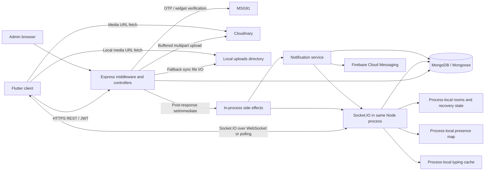

# Architecture and conventions

[README](README.md) · [Original master report](ORIGINAL-MASTER-REPORT.md)

**Planning baseline:** `4c01dc24247aa95a73e286a2b42c7f2f81257c7a`. Verified facts below are preserved from the original report; additional interface contracts are explicitly proposed implementation details. No strategy redesign, test execution or performance baseline has occurred.

## Shared implementation contracts (proposed; no code created)

These interfaces make the original strategy implementable across independent sessions; they are elaborations, not additional test cases. Keep schemaVersion=1 initially and require reviewed migration for breaking changes.

### Repository and branch contract

Only `https://github.com/mathiharan29/medcollab-beta`; base `master`; proposed feature branch `testing/vocle-performance-scale`. Record source SHA separately from harness SHA. Revalidate affected source when HEAD differs from the investigation; never replace the approved contract silently with new behavior. Do not run heavy tests in Codex Cloud. Development and runtime approvals are independent.

### Proposed directory structure

```text
tests/performance/
  package.json, package-lock.json
  catalog.json
  schemas/
  config/
  lib/
  data/
  providers/
  scenarios/
  workloads/
  oracles/
  telemetry/
  db/
  faults/
  supervisor/
  analysis/
  reporting/
  baseline-manifests/
  distributed/
  infra-manifests/
  ci/
  device/
docs/performance/
medcollab-app/integration_test/performance/  # separate future device work
```

All are proposed future paths. Current deliverable is only this Markdown/documentation package plus machine-readable plan metadata. Existing backend/client paths in the source inventory are implementation evidence, not permission to change application behavior.

### Run configuration schema

Required fields:

| Field | Type/validation | Meaning |
|---|---|---|
| schemaVersion | integer, initially 1 | Contract version |
| runId, authorizationRef | nonempty strings | Unique run and explicit execution authorization record |
| repository | exact upstream name | Reject other repositories |
| sourceSha, harnessSha | full immutable commit SHAs | Distinct tested application and test code |
| caseIds, variants | catalog IDs and known variants | No unknown or silently missing cases |
| environment | E1–E5, isolated environment ID, topology hash | E0 static validation has no target |
| target | allowlisted service identity, approved URL and address set | Reject arbitrary URLs, redirects and DNS drift |
| workload | profile B/C/L/T/P/Z/G/F; seed; distributions | Original hypotheses retained |
| data | dataset version, manifest hash, seed, index manifest | Reproducibility |
| providers | double/networked-simulator/sandbox and per-provider budget | Egress closed by default |
| budgets | finite maxima below | Missing values block execution |
| deadlines | setup, operation, observation, drain, cleanup, total | Explicit integer milliseconds; no indefinite waits |
| instrumentation | external/diagnostic-preload/application/device; version | Record measurement perturbation |
| baseline | optional immutable artifact ID | Absent means no baseline comparison |
| thresholds | approved policy ID or null | Null maps to BASELINE_REQUIRED/PRODUCT_DECISION_REQUIRED |

Budgets must specify maximum persistent connections, new connections/s, HTTP starts/s, message starts/s, application event starts/s, expected outbound deliveries, concurrent uploads, bytes transferred, total requests/messages/events, database growth, provider calls, elapsed time and resource/cost ceilings. Zero provider calls is valid for blocked providers; omitted provider limits are not unrestricted. E1 must honor original B and media caps. Rate-limiter settings and NODE_ENV are provenance fields, not silent overrides.

### Scenario interface

Phase 01 owns:

```text
defineScenario({
  id, variant, operationIds, sourceRefs, requiredCapabilities,
  async prepare(ctx) -> PreparedState,
  async run(ctx, prepared) -> void,
  async observe(ctx, prepared) -> void,
  async reconcile(ctx, prepared) -> OracleResult,
  async cleanup(ctx, prepared) -> CleanupResult
}) -> Scenario
```

Importing/exporting a scenario does not execute hooks, start a service or contact a target. `ctx` supplies immutable config, cancellation signal, clock, actors, journal, adapters, metrics and ledger. Run and observe may operate concurrently only under supervisor control. All hooks have deadlines. Reconcile follows a bounded drain, captures ambiguous work and does not erase primary evidence.

### Exact shared utility ownership

| Owner | Proposed interface | Required contract |
|---|---|---|
| Phase 01 | `validateRunConfig(raw) -> ValidatedConfig` | Schema and finite-bound checks; pure, no target contact |
| Phase 01 | `assertIsolatedTarget(config, identityEvidence) -> TargetAuthorization` | Fail closed on host/address/identity mismatch; no guessed production exclusion |
| Phase 01 | `captureProvenance(inputs) -> Provenance` | Source/harness/lock/runtime/OS/topology/data/index/provider/timezone hashes |
| Phase 01 | `allocateActors(seed, profile, workerPartition) -> ActorManifest` | Deterministic disjoint ownership; devices distinct from users |
| Phase 01 | `registerOwnedResource(journal, resource) -> ResourceRef` | Durable intent before create; state updates after acknowledgement |
| Phase 01 | `recordStage(actionId, stage, monotonicTime, context)` | Scheduled/start/response/persist/event/provider/render stages, explicit clock domain |
| Phase 01 | `recordOutcome(actionId, outcome)` | Success/failure/ambiguous/censored/unfinished; never infer absent write from failed response |
| Phase 01 | `finalizeRun(run, oracleResults, cleanup) -> RunResult` | Required IDs and terminal outcomes accounted; missing evidence cannot pass |
| Phase 01 | `cleanupOwnedResources(journal, authorization) -> CleanupResult` | Independent ownership validation and bounded retry; no broad fallback delete |
| Phase 02 | `http.request(actor, operationId, payload, ctx) -> HttpObservation` | Known route template, auth, redirect guard, status/body/bytes/timing; retries explicit |
| Phase 03 | `openCohort(actorManifest, config, ledger) -> Cohort` | Register listeners before connection; capped persistent sessions |
| Phase 03 | `awaitApplicationReady(socket, deadline)` | Wait authenticated separately from transport connect |
| Phase 03 | `joinChannelAndWait(socket, channelId, deadline)` | Wait matching join_channel event, not nonexistent callback ack |
| Phase 03 | `recordDelivery(messageId, actorDeviceId, time, eventCopy)` | Retain transport duplicates; count unique logical deliveries |
| Phase 03 | `closeCohort(cohort, deadline) -> CleanupResult` | Bound closure; track remaining sockets/listeners |
| Phase 07A | `runBarrierRound(actors, operations, deadline) -> RoundResult` | Ready barrier, coordinated release, per-operation outcome, no silent retries |
| Phase 10 | `buildDatasetManifest(seed, dimensions) -> DatasetManifest` | Pure forecast/generation plan; real seeding is separately authorized |
| Phase 10 | `verifyIndexes(db, expected) -> IndexEvidence` | Actual runtime index evidence; never build on shared DB |
| Phase 10 | `sampleExplain(querySpec, db) -> ExplainEvidence` | Authorized diagnostic outside timed window; query/result semantics preserved |
| Phase 14 | `applyOwnedFault(faultSpec, lease, journal) -> FaultHandle` | Only owned target; finite scope/duration and restoration metadata |
| Phase 14 | `restoreOwnedFault(handle, deadline) -> RestoreResult` | Idempotent bounded restoration, independent watchdog fallback |

Implement only the interfaces owned by the assigned phase. Later interfaces may be declared as explicit capability requirements; dependent subvariants stay unexecuted until available. Do not create parallel competing HTTP, cleanup, clock or identity libraries.

### Result and status schema

Keep four independent fields:

- implementation: NOT_IMPLEMENTED / PARTIAL / IMPLEMENTED
- review: NOT_REVIEWED / CHANGES_REQUESTED / REVIEWED
- execution: NOT_EXECUTED or a terminal run status
- threshold: BASELINE_REQUIRED / PRODUCT_DECISION_REQUIRED / NOT_EVALUATED / EVALUATED

Terminal run statuses remain the original PASSED, FAILED_FUNCTIONAL, FAILED_PERFORMANCE, INVALID_GENERATOR, FAILED_INFRASTRUCTURE, ABORTED_LIMIT, BLOCKED_PREREQUISITE, NOT_EXECUTED and INCONCLUSIVE. Implemented does not mean PASSED. Unknown threshold can coexist with recorded functional observations, but cannot produce a performance pass. Do not add a success marker for incomplete coverage.

Every result records run/case/variant, source/harness, environment, seed/data/index hashes, start/end, workload budget and achieved starts, observations, oracle result, error classes, censor counts, required/unavailable metrics, cleanup state and artifact references. Preserve setup failure and unexecuted dependent IDs in reports.

### Metrics and correlation contract

Units: durations in milliseconds, bytes in bytes, rates per second, counts as integers. Internal clocks are monotonic plus explicit clock-domain ID; wall-clock timestamps are for provenance/timeline. Allowed low-cardinality labels include case/variant, method/route template, event, stage, status class and worker. User/message IDs belong only in bounded ledgers.

Required stage series: HTTP scheduled-to-terminal and started-to-terminal; connection transport/app-ready/channel-ready; send accepted/persisted; recipient first/each/last delivery; inbox persistence; provider attempt/completion; reconciliation; recovery. Separate fault-induced outcomes from normal error rates without hiding them. Resource series include generator CPU/RSS/event-loop/NIC/scheduling delay; SUT CPU/RSS/heap/external/GC/event loop; DB pool/operations/cache/I/O/storage; device frames/native/Dart memory when applicable.

A message ledger holds logical action, attempts, persisted IDs, expected eligible actor-devices, received copies, notification outcomes and rendered state if observed. Events may arrive before HTTP response. Intentional identical-content actions must not be collapsed. No server idempotency field is assumed. Merge histogram buckets/counts, never percentile values.

### Synthetic resource contract

DatasetManifest owns synthetic accounts, relationships, spaces, channels, message/thread/quote graph, handoffs, inbox records, media and expected audience. Use original S/M/L dimensions but forecast bytes before real setup. Setup, index build and cleanup stay outside timed samples. Preserve timestamp/default/model-hook behavior for bulk fixtures; verify memberPairKey and ObjectId references. No production-derived data.

Resource journal entries carry runId, resource type, exact ID/path/namespace, owner identity, create intent/outcome, cleanup state and retry count. Cross-check deletion against journal and environment lease. Restore faults before cleanup. Abort on ownership ambiguity.

### Provider and fault boundaries

Provider doubles replace only MSG91/FCM/Cloudinary boundaries. Keep real middleware, bcrypt, Mongoose and business flows. A zero-latency SDK fake does not represent a provider network. Record double overhead and synchronous logging/buffering effects. Sandbox calls require independent approval and never become bulk traffic.

Diagnostic preloads and application instrumentation are distinct run modes. Do not use a patched business path to claim unchanged application capacity. Internal side-effect debt, driver pool and render-stage claims require appropriate observability; missing instrumentation is a visible limitation.

### Development versus execution DAG

Phase-file order is an implementation handoff order. Case dependencies in TEST-CASE-MATRIX are execution prerequisites, often available later (e.g. inbox query-growth evidence or media cleanup). Writing a scenario does not require a prior performance run. It does require the shared interface contract. Early consumers can declare deferred capabilities; never replace real measurements with fakes that change what is being measured.

Before execution, compute the selected cases' prerequisite closure, require the relevant environment/evidence and explicitly authorize the run. Some system cases compose earlier scenarios; they do not own duplicate implementations. REG-SYS-001 additionally needs valid promoted baseline artifacts and statistical policy, not merely code dependencies.


## B. Verified architecture and dependency map

### B1. Evidence conventions

- **Verified:** directly visible in the pinned upstream implementation.
- **Risk:** an engineering inference from that implementation, requiring execution to establish severity.
- **Hypothesis:** proposed workload or experiment parameter.
- **Unknown:** deployment, usage, or runtime evidence unavailable in this investigation.

Unless stated otherwise, backend paths below are relative to `medcollab-backend/src/`. All source links are pinned to the inspected commit.

### B2. Components and runtime

| Component | Verified implementation | Performance implications |
|---|---|---|
| Backend | Express **5.2.1**, Mongoose **9.7.0**, Socket.IO **4.8.3** in the inspected lockfile; CommonJS Node application | Event-loop scheduling, JSON serialization, middleware, and asynchronous I/O need independent measurement |
| Runtime declaration | `package.json` declares Node `>=18`; existing workflows select Node 22; runtime lock specifies 22.20.0 | Record actual runtime for every run; do not equate declared minimum with deployed version |
| HTTP server | `server.js:startServer` connects DB, configures providers, creates HTTP server, attaches Socket.IO, then listens | Cold-start time includes DB connection; HTTP and realtime share a process |
| Mobile | Flutter/Dart; locked `socket_io_client` 3.1.6; Dio HTTP client | Node protocol clients cannot establish Flutter rendering, memory, or lifecycle performance |
| Database | MongoDB via Mongoose; one configured pool with `maxPoolSize:10`, selection timeout 10 seconds, socket timeout 45 seconds | Auth, business queries, notifications, and background writes compete for the pool |
| Media | Multer memory storage; Cloudinary upload stream or synchronous local-file fallback | Concurrent upload buffers and downstream stalls can grow RSS/external memory |
| Push | Firebase Admin, one `messaging.send` per token | Provider latency and token multiplicity amplify in-flight work |
| Authentication | JWT access/refresh tokens; server OTP and MSG91 widget verification paths | Distinct CPU, provider, DB, and limiter costs |
| Administrative UI | Static admin assets served by the backend; protected admin API | Analytics requests contend with user traffic |
| Deployment declarations | Railway/Nixpacks; `/health`; restart-on-failure, maximum three retries | These are repository settings, not evidence of current deployed resources |

Sources: [backend package][package], [server][server], [database configuration][db], [Railway configuration][railway], [mobile socket client][client-socket], [runtime lock][runtime].

### B3. Dependency map



There is **no verified durable queue between persistence and side effects**. The diagram’s “in-process side effects” box is scheduled application work, not a worker service.

### B4. Critical flows

| Flow | Actual sequence and synchronization | Amplification/shared state | Failure and measurement requirements |
|---|---|---|---|
| Server OTP login | Request → limiter/validation → invalidate prior OTPs → bcrypt hash → OTP insert → MSG91; verification → bcrypt compare → atomic OTP claim/delete → find/create user → JWTs | Phone-local contention; bcrypt CPU; provider request; user uniqueness | Measure request and verification separately; concurrent first login; provider timeout; OTP consumed but subsequent user operation failing |
| Widget login | Validate input → MSG91 form request; second JSON-form request after a non-success response → identity resolution → user find/create → JWTs | Up to two provider calls on response failure; transport exception does not necessarily take the fallback path | Count provider attempts and distinguish timeout, provider rejection, account creation, and successful token issuance |
| Protected API | JWT verify → user read → active check → unawaited `lastSeenAt` update → route handler | “Read-only” API traffic still produces writes; hot users generate hot user documents | Measure auth overhead, DB operations/request, pending background writes, and errors after response |
| Socket connection | JWT/user validation → active-space lookup → join space rooms → register handlers/presence → user room → `authenticated` | Presence broadcast and user availability query; membership-dependent work | Measure transport connect and application-ready latency separately |
| Message send | Access resolution → optional thread/quote lookup → message insert/populate → channel preview update → HTTP 201 → scheduled room/user emits → optional thread update → notifications | Hot channel preview; hot thread root; duplicate room paths; recipient-dependent notifications | Record accepted, persisted, emitted, received, reconciled, and notification-complete stages independently |
| Notification | Notification insert → user-room event → recipient preferences/token read → per-token FCM calls | Parallel recipient promises and per-token promises; no durable retry queue | FCM acceptance is not device receipt; swallowed failures require explicit accounting |
| Space join/approval | Read space → array membership/pending mutation → save → fetch channels → enumerate local sockets → update rooms → member event | Hot embedded arrays; socket scan proportional to local connections | Race same/different members, approval/removal, and room convergence |
| Request acceptance | Read request → save accepted state → keyed channel upsert → populate → synchronous notification → response | Multi-document partial completion; repeated acceptance side effects | Verify retry recovers missing DM; count channels, state transitions, and notifications |
| Conversation expansion | Validate targets → find/create destination → read complete selected source history → allocate ID map and copies → ordered insert → update preview | Memory and write work proportional to history; no transactional copy | Check partial copies, concurrent expansion, references, and mixed-traffic impact |
| Handoff submit/ack | Conditional state update; user lookups; room event; response; deferred notification | Hot handoff and notification paths | Submit/ack use conditional updates, but edit/reassign use read-modify-save; test their interactions |
| Search | Resolve accessible spaces/channels → sequential category queries → regex filtering/population | `$in` cardinality, regex scans, nested handoff arrays, broad known-user scan | Measure per-search-type and no-result queries, not only aggregate search latency |
| Media upload/delete | Auth → limiter → complete memory buffer → provider upload or sync disk write → storage counter; delete may try three resource types and scan handoff attachments | Buffer memory, external latency, synchronous disk I/O, attachment scan | Separate transfer, provider, persistence, deletion, and subsequent fetch results |
| Mobile recovery | Resume/connect callbacks → room synchronization; network errors schedule recovery; token refresh may replace socket; chat HTTP reload/reconciliation | Multiple readiness callbacks can trigger synchronization; retries add traffic | Test actual Flutter behavior separately from protocol-level recovery |

Detailed sources: [auth][auth], [OTP model][otp-model], [OTP service][otp-service], [MSG91 service][msg91], [auth middleware][auth-middleware], [messages][messages], [requests][requests], [channels][channels], [handoffs][handoffs], [search][search], [media][media], [client socket][client-socket].

### B5. State, caching, jobs, and recovery

**Verified state and caching**

- `onlineUsers: Map<userId, Set<socketId>>` tracks devices in one Node process.
- `typingMembers` caches channel members for 60 seconds. Entries are refreshed on access; no eviction sweep was found.
- Socket.IO recovery is configured for two minutes with `skipMiddlewares:true`.
- `spaceRooms` iterates the process’s sockets for membership changes.
- Flutter `ChatTranscriptCache` holds transcript lists in static maps without a visible size bound in that class.
- No general backend query cache or Redis cache was found.

**Background work**

- Message/handoff side effects use `setImmediate`.
- Auth activity, media storage counters, stale FCM token removal, and final-device disconnect activity updates include unawaited database operations.
- MongoDB TTL indexes expire OTPs and notifications; notification default expiry is 30 days.
- No application cron scheduler, worker pool, job queue, or replayable outbox was found.

**Recovery limits**

- `/health` returns HTTP 200 even when its database field reports disconnected.
- Shutdown closes the HTTP server and subsequently MongoDB, with a 30-second forced-exit timeout. Explicit Socket.IO closure and explicit draining of deferred side effects are not present in the inspected shutdown function.
- Local media is explicitly described by startup warnings as ephemeral on Railway redeploy.
- JWT expiry is checked during ordinary socket authentication; no per-event JWT expiry validation was found.
- Recovery bypasses authentication middleware when recovery succeeds.

Sources: [presence][presence], [typing][typing], [socket][socket], [rooms][rooms], [mobile cache][client-cache], [server][server], [application health route][app].

### B6. Database schema and index review

These are **schema declarations**, not proof that a deployed database has built the indexes.

| Model | Important structure/indexes | Queries to investigate |
|---|---|---|
| User | Unique phone; sparse unique username; institution; role/speciality; verified/createdAt; lastSeenAt; isActive; embedded FCM tokens capped at five by model method | Auth reads/activity writes; colleague discovery; admin sorting/cohorts; concurrent token/preference updates |
| OTP | Phone; TTL `expiresAt`; `{phone,isUsed,expiresAt}` | Latest eligible OTP sorted by createdAt; concurrent issuance/claim; TTL interference |
| Space | Unique inviteCode; member-user multikey; createdBy; embedded members/pendingRequests | Membership lookup plus `isActive`; large document load; concurrent array changes |
| Channel | spaceId; `{spaceId,type}`; `{spaceId,isArchived,position}`; `{type,members}`; partial unique `{type,memberPairKey}` for direct channels | Unpaginated DM list sorted by lastMessage/updatedAt; keyed DM upsert; channel-name existence check |
| Message | channelId; threadId; `{channelId,createdAt:-1}`; `{threadId,createdAt:1}`; `{spaceId,createdAt:-1}`; mentions | Feed sorts by `_id`, not createdAt; thread feed also sorts `_id`; regex search; quote cleanup; sender aggregates; hot reactions/readBy |
| MessageRequest | Individual sender/recipient/status indexes; `{fromUserId,toUserId}`; `{toUserId,status}` | Bidirectional pending lookups; no declared unique pending-pair constraint; sorted request lists |
| Handoff | spaceId; `{spaceId,shiftDate:-1}`; `{toUserId,status}`; `{fromUserId,shiftDate:-1}`; `{spaceId,shiftDate,shiftType}` | Composite shiftDate/`_id` cursor; assignment-history filters; unpaginated personal lists; attachment regex |
| Notification | userId; read; TTL expiresAt; `{userId,read,createdAt:-1}` | Feed sorts `_id`; channel mark-read also filters metadata.channelId; count after listing |
| SupportTicket | Embedded schema in support controller; type/userId/status indexes | Admin newest-100 sort, open count; insertion/logging |

Model references: [User][user-model], [OTP][otp-model], [Space][space-model], [Channel][channel-model], [Message][message-model], [MessageRequest][request-model], [Handoff][handoff-model], [Notification][notification-model], [SupportTicket][support].

**Candidate experiments, not immediate index prescriptions**

Evaluate existing plans first, then compare isolated database variants for:

- Message feed: equality filters for channel/thread/deletion followed by `_id`.
- Thread feed: channel/thread/deletion plus `_id`, accounting for the implemented `$or`.
- Notification feed: user/read/type variants plus `_id`.
- Notification channel clearing: user/read/metadata.channelId.
- Handoff history: space/shiftDate/`_id`, with representative visibility filters.
- DM listing: type/members/archive plus sort fields, subject to multikey constraints.
- Message sender aggregation used by admin and Needl-related reads.
- Request direction/status/createdAt.
- Admin createdAt ordering/cohorts and support createdAt ordering.

A normal B-tree index should not be assumed to solve unanchored, case-insensitive regex search. The institution index also does not eliminate the current application-side normalization scan in `resolveKnownUserIds`.

No explicit application transactions, transaction sessions, read concern, or write concern settings were found. Runtime MongoDB defaults/topology therefore remain required evidence.

---

## C. Endpoint, event, and background-operation inventory

### C1. Inventory contract

The route scan found **87 feature-router method/path registrations**, including two aliases for group-DM creation.

For every operation below:

- Its stable operation ID is the listed identifier prefixed with `OP-`.
- HTTP metrics are method/route-template p50/p95/p99, attempted/started/completed rate, status/error class, response bytes, and server/DB resource cost.
- All protected routes inherit the user read and activity write in `protect`.
- `A` means authenticated active user; `O` adds completed onboarding; `PA` adds platform-admin allowlist.
- Handler references point to the feature controller unless stated otherwise.
- Inputs include path identifiers in addition to the explicitly listed body/query fields.
- Case references in `F supply workload, concurrency, failure indicators, and required environment.

### C2. Authentication and users

| ID | Method/path | Handler and source line | Auth/input → behavior | Sensitivity, risk, cases |
|---|---|---|---|---|
| AUTH-01 | POST `/api/auth/request-otp` | `requestOtp`:53 | Public; phone → OTP delivery attempt | bcrypt/provider/phone races; high; AUTH-001, RES-002 |
| AUTH-02 | POST `/api/auth/verify-otp` | `verifyOtp`:74 | Public; phone/otp → account/session | OTP claim, user create race; high; AUTH-001 |
| AUTH-03 | POST `/api/auth/verify-msg91-token` | `verifyMsg91Token`:99 | Public; phone/accessToken → verified session | provider latency/fallback; high; AUTH-001 |
| AUTH-04 | POST `/api/auth/refresh` | `refreshToken`:141 | Refresh JWT → new access token | IP limiter, synchronized expiry; high; AUTH-002/003 |
| AUTH-05 | POST `/api/auth/logout` | `logout`:173 | A; optional fcmToken → token removal | device cleanup; medium; AUTH-002 |
| USER-01 | GET `/api/users/me` | `getMe`:51 | A → profile | additional user read; medium; API-001 |
| USER-02 | PUT `/api/users/me` | `updateMe`:62 | A; profile/preferences/avatar → updated profile | preference lost updates; avatar deletion wait; medium/high; API-001, MED-002 |
| USER-03 | PUT `/api/users/me/availability` | `updateAvailability`:124 | A; status/until/note → DB update and presence | spaces-per-user amplification; high; RT-003 |
| USER-04 | PUT `/api/users/me/fcm-token` | `registerFcmToken`:174 | A; token → deduped/capped list | same-user concurrent saves; medium; AUTH-002 |
| USER-05 | GET `/api/users/search` | `searchUsers`:196 | A+O; q/spaceId → up to 20 users | known-user scan/regex; high; SEARCH-001 |
| USER-06 | GET `/api/users/lookup` | `lookupByPhone`:256 | A+O; phone → relationship/capabilities | repeated relationship queries; medium/high; SEARCH-001 |
| USER-07 | GET `/api/users/:id` | `getUserById`:185 | A → public profile | lookup/activity-write overhead; medium; API-001 |
| USER-08 | GET `/api/users/me/needl` | `getNeedl`:347 | A+O → up to 40 roots, reply-root probe capped 80 | sequential channel access; high; SEARCH-002 |

Sources: [auth routes][auth-routes], [auth controller][auth], [user routes][user-routes], [user controller][users].

### C3. Spaces and invitations

All are A+O; controller checks membership/admin/owner as applicable.

| ID | Method/path | Handler:line | Inputs/behavior | Sensitivity, risk, cases |
|---|---|---|---|---|
| SPC-01 | POST `/api/spaces` | `createSpace`:52 | name/type/description → space and default channels | multi-write setup, code uniqueness; medium; SOC-004 |
| SPC-02 | GET `/api/spaces` | `getMySpaces`:82 | → memberships with channel data | spaces/channels per user; high; SEARCH-002 |
| SPC-03 | POST `/api/spaces/join` | `joinSpace`:149 | inviteCode → member or pending request | hot arrays, socket scan; high; SOC-004, RT-006 |
| SPC-04 | GET `/api/spaces/invite/:code` | `previewInvite`:269 | code → preview | invite lookup; low; API-001 |
| SPC-05 | GET `/api/spaces/:id` | `getSpaceById`:120 | → space/channels | embedded members and channels; medium; SEARCH-002 |
| SPC-06 | PUT `/api/spaces/:id` | `updateSpace`:317 | settings/details → save | same-space concurrent edits; medium; SOC-004 |
| SPC-07 | POST `/api/spaces/:id/invite` | `regenerateInviteCode`:299 | → replacement code | join/regeneration race; medium; SOC-004 |
| SPC-08 | GET `/api/spaces/:id/members` | `getMembers`:335 | → user details sorted in application | membership cardinality; high; SEARCH-002 |
| SPC-09 | GET `/api/spaces/:id/pending` | `getPendingJoins`:447 | → pending users | pending-list size; medium; SOC-004 |
| SPC-10 | POST `/api/spaces/:id/pending/:userId/approve` | `approveJoinRequest`:218 | → member transition/rooms | approval race; high; SOC-004, RT-006 |
| SPC-11 | DELETE `/api/spaces/:id/members/:userId` | `removeMember`:374 | → removal/room eviction | socket count and concurrent sends; high; RT-006 |
| SPC-12 | POST `/api/spaces/:id/leave` | `leaveSpace`:400 | → leave/room eviction | same shared state; high; RT-006 |

Sources: [space routes][space-routes], [space controller][spaces].

### C4. Channels, direct conversations, and expansion

All are A+O with channel/space authorization in handlers.

| ID | Method/path | Handler:line | Inputs/behavior | Sensitivity, risk, cases |
|---|---|---|---|---|
| CH-01 | POST `/api/spaces/:spaceId/channels` | `createChannel`:15 | name/type/privacy → channel | check-then-create name race; medium; SOC-004 |
| CH-02 | GET `/api/spaces/:spaceId/channels` | `getSpaceChannels`:44 | → accessible channels | unpaginated list; medium; SEARCH-002 |
| CH-03 | GET `/api/channels/dm` | `getMyDMs`:219 | → enriched conversations | unpaginated/populated/sorted; high; SEARCH-002 |
| CH-04 | POST `/api/channels/dm` | `createOrGetDM`:241 | userId → keyed DM or self notes | unique index/upsert/self-notes race; high; SOC-002 |
| CH-05 | POST `/api/channels/dm/group` | `createGroupDM`:325 | userIds → group DM | sequential permission checks; high; SOC-002 |
| CH-06 | POST `/api/channels/group-dm` | same handler | alias of CH-05 | same risk; same case, alias coverage only |
| CH-07 | POST `/api/channels/:id/expand` | `expandDM`:423 | userIds/history/todayStart/timezoneOffsetMinutes → destination/copies | history-sized memory/write amplification; critical; SOC-003 |
| CH-08 | GET `/api/channels/:id` | `getChannelById`:67 | → populated members/pins | members/pins population; medium; API-001 |
| CH-09 | PUT `/api/channels/:id` | `updateChannel`:98 | name/details/posting policy → save | concurrent rename/policy; medium; SOC-004 |
| CH-10 | DELETE `/api/channels/:id` | `archiveChannel`:146 | → archive | send/archive race; high; RT-006 |
| CH-11 | GET `/api/channels/:id/members` | `getChannelMembers`:629 | → member profiles | membership size; medium; SEARCH-002 |
| CH-12 | POST `/api/channels/:id/pin/:messageId` | `pinMessage`:661 | → pins; maximum five checked in handler | concurrent cap/duplicate race; high; SOC-005 |
| CH-13 | DELETE same pin path | `unpinMessage`:695 | → pins | concurrent array replacement; medium; SOC-005 |

Group DMs allow **up to nine total members**, not arbitrarily large broadcasts. Large fan-out experiments belong primarily to space channels.

Sources: [channel routes][channel-routes], [channel controller][channels], [channel model][channel-model].

### C5. Messaging and threads

Prefix: `/api/channels/:channelId/messages`. All are A+O with access resolution.

| ID | Method/suffix | Handler:line | Inputs/behavior | Sensitivity, risk, cases |
|---|---|---|---|---|
| MSG-01 | GET `/` | `getMessages`:49 | before/limit → root page, default 30, max 100 | history/index/population; high; API-001, DATA-001 |
| MSG-02 | POST `/` | `sendMessage`:92 | type/content/priority/mentions/threadId/replyToId → persisted message, later side effects | hot preview/fan-out; critical; MSG-001, RT-002, NOT-001 |
| MSG-03 | GET `/:id/thread` | `getThread`:295 | before/limit → root/reply page | thread size/index; high; MSG-002 |
| MSG-04 | POST `/:id/reply` | `replyToThread`:336 | message body → send with threadId | hot root aggregate; high; MSG-002 |
| MSG-05 | PUT `/:id` | `editMessage`:345 | content.text → save/event | same-message edits; high; MSG-004 |
| MSG-06 | DELETE `/:id` | `deleteMessage`:377 | → soft delete, quote updates, preview repair/event | references and concurrent sends; high; MSG-004 |
| MSG-07 | POST `/:id/react` | `toggleReaction`:440 | emoji → updated reaction array/event | read-modify-save contention; high; MSG-004 |
| MSG-08 | POST `/read` | `markAsRead`:463 | messageIds → direct-channel readBy updates | batch size/hot documents; high; MSG-004 |

There is no observed client delivery-ack endpoint. `/read` records a user read action and returns HTTP success; it does not implement a general transport acknowledgement protocol.

Sources: [message routes][message-routes], [message controller][messages], [message model][message-model].

### C6. Requests, handoffs, notifications, search, and media

| ID | Method/path | Handler:line | Auth/input → behavior | Risk and cases |
|---|---|---|---|---|
| REQ-01 | GET `/api/message-requests/pending-count` | `pendingCount`:185 | A+O → count | count growth; SOC-001 |
| REQ-02 | GET `/api/message-requests` | `listRequests`:145 | A+O; direction/status → newest 50 | sorted query/population; SOC-001 |
| REQ-03 | POST `/api/message-requests` | `createRequest`:52 | A+O; toUserId/introMessage → request and awaited notification | duplicate pending race/provider coupling; high; SOC-001 |
| REQ-04 | POST `/api/message-requests/:id/accept` | `acceptRequest`:197 | recipient → accepted request and DM | partial commit/retry; high; SOC-001 |
| REQ-05 | POST `/api/message-requests/:id/decline` | `declineRequest`:299 | recipient → declined | accept/decline race; high; SOC-001 |
| HND-01 | POST `/api/handoffs` | `createHandoff`:56 | A+O; space/channel/recipient/shift/patients → draft | document size; HAND-001 |
| HND-02 | GET `/api/handoffs` | `getMyHandoffs`:94 | A+O; type/status/space/date → unpaginated list | high; SEARCH-002 |
| HND-03 | GET `/api/handoffs/:id` | `getHandoffById`:149 | authorized participant/admin → populated detail | nested notes/patients; HAND-001 |
| HND-04 | PUT `/api/handoffs/:id` | `updateHandoff`:192 | sender draft update | edit/submit race; high; HAND-002 |
| HND-05 | POST `/api/handoffs/:id/submit` | `submitHandoff`:215 | sender → conditional submitted transition | high; HAND-001/002 |
| HND-06 | POST `/api/handoffs/:id/acknowledge` | `acknowledgeHandoff`:277 | recipient/note → conditional acknowledgement | high; HAND-002 |
| HND-07 | POST `/api/handoffs/:id/notes` | `addHandoffNote`:329 | participant/text/kind → appended note/event | hot array; HAND-002 |
| HND-08 | POST `/api/handoffs/:id/reassign` | `reassignHandoff`:382 | participant/toUserId/note → reassignment/history/event | competing assignments; high; HAND-002 |
| HND-09 | DELETE `/api/handoffs/:id` | `deleteHandoff`:469 | sender draft → deletion | delete/submit race; HAND-002 |
| HND-10 | GET `/api/spaces/:spaceId/handoffs` | `getSpaceHandoffs`:487 | member; filters/before/limit → page, cap 50 | compound cursor/growth; DATA-001 |
| NOT-01 | GET `/api/notifications` | `getNotifications`:14 | A+O; before/limit/type/unreadOnly → page plus unread count | high; NOT-002 |
| NOT-02 | GET `/api/notifications/unread-count` | `getUnreadCount`:46 | A+O → count | write/read competition; NOT-002 |
| NOT-03 | PUT `/api/notifications/read-all` | `markAllAsRead`:71 | A+O → bulk update | inbox size; NOT-002 |
| NOT-04 | PUT `/api/notifications/read-by-channel/:channelId` | `markReadByChannel`:100 | A+O → bulk update/count | metadata filter; NOT-002 |
| NOT-05 | PUT `/api/notifications/:id/read` | `markAsRead`:55 | owner → read | concurrent state toggles; NOT-002 |
| NOT-06 | PUT `/api/notifications/:id/unread` | `markAsUnread`:82 | owner → unread | same; NOT-002 |
| NOT-07 | DELETE `/api/notifications/:id` | `deleteNotification`:142 | owner → delete | concurrent delivery/read; NOT-002 |
| SRC-01 | GET `/api/search` | `globalSearch`:46 | A+O; q/type/limit → category results | regex/cardinality; high; SEARCH-001 |
| MED-01 | POST `/api/media/upload` | `uploadFile`:34 | A+O; multipart file/context → media metadata | 50 MiB buffer/provider/disk; critical; MED-001 |
| MED-02 | DELETE `/api/media/:publicId` | `deleteFile`:238 | A+O + ownership → media deletion/attachment clearing | provider retries and regex scan; high; MED-002 |

Sources: [request routes][request-routes], [requests][requests], [handoff routes][handoff-routes], [handoffs][handoffs], [notification routes][notification-routes], [notification controller][notifications], [search][search], [media routes][media-routes], [media controller][media].

### C7. Administrative, support, developer, and platform paths

| IDs | Paths and handlers | Auth/behavior | Risk and coverage |
|---|---|---|---|
| ADM-01–08 | GET `/api/admin/me`→`getAdminMe`:306; `/overview`→`getOverview`:34; `/users`→`listUsers`:112; `/growth`→`getGrowth`:320; `/retention`→`getRetention`:362; `/infrastructure`→`getInfrastructure`:421; `/support`→`listSupportTickets`:518; `/users/:id`→`getUser`:206 | A+PA; users page/limit/q/status filters; growth days | Counts/aggregations, deep skip, three cohort materializations; high for mixed workload; OPS-001 |
| ADM-09–10 | PUT `/api/admin/users/:id/verify`→`setDoctorVerification`:255; `/users/:id/deactivate`→`setUserActive`:281 | A+PA; verified/active | State change while connected; OPS-001, AUTH-002, RT-005 |
| SUP-01–03 | POST `/api/support/bug`→`createBug`:45; `/feature`→`createFeature`:67; `/feedback`→`createFeedback`:89 | A; title/description and optional steps/context → ticket | Insert/logging; low individually; OPS-001 |
| DEV-01–03 | POST `/api/dev/seed-notifications`, `/seed-conversation`, `/seed-handoff`; inline handlers at 47, 105, 156 | A; enabled outside production or with explicit flag | Fixture utilities; exclude from representative business load |
| SYS-01–03 | GET `/`, `/health`, `/api`; `app.js`:128,142,273 | Public metadata/health | Low-cost controls; health is not DB readiness; API-001, RES-001 |
| SYS-04 | GET `/join/:code`; `app.js`:164 | Public deep-link HTML | Static response; low priority; API-001 |
| SYS-05 | `/uploads/*`; `app.js`:208 | Static local media | Disk/network load; MED-002 |
| SYS-06 | `/admin`, `/admin/`, `/admin/*`; `app.js`:227–235 | Static admin assets | Low priority asset delivery; OPS-001 |

The “infrastructure” admin response contains estimated usage and hard-coded pricing/headroom hints. **It must not be used as resource telemetry or current provider pricing evidence.** [Admin controller, lines 421–510][admin]

Sources: [admin routes][admin-routes], [admin controller][admin], [support routes][support-routes], [support controller][support], [developer routes][dev-routes], [app][app].

### C8. Realtime inventory

| ID | Direction/event | Source and behavior | Scaling/correctness dimension | Cases |
|---|---|---|---|---|
| RT-01 | Connect/auth handshake | `socket/index.js`:93–167; JWT/user/spaces then `authenticated` | connection arrival rate; memberships/user; DB pool | RT-001 |
| RT-02 | C→S `join_channel` | message handler:62; access query then same-name success event | joins/sec, access cost, setup races | RT-001/006 |
| RT-03 | C→S `leave_channel` | message handler:92; leave room, no explicit success response | churn; room cleanup | RT-003/006 |
| RT-04 | C→S `sync_space_rooms` | space handler:15; DB sync, full presence snapshot, broadcast, success event | roughly per-space queries plus per-member events | RT-003, SPIKE-001 |
| RT-05–06 | C→S `typing_start`, `typing_stop` | message handler:111/135 | cached membership query, channel/user-room fan-out | RT-004 |
| RT-07–08 | S→C `user_typing`, `user_stopped_typing` | same handlers | duplicate transport delivery, stale cache, slow consumers | RT-004/007 |
| RT-09 | C→S `update_availability` | presence handler:78 | user update and per-space broadcast | RT-003 |
| RT-10 | S→C `presence_update` | presence handler:150/191; user controller:124 | devices/user, spaces/user, snapshot population | RT-003 |
| RT-11 | S→C `new_message` | socket index:198 | channel emit plus separate user emits | RT-002, MSG-003 |
| RT-12–13 | S→C `message_updated`, `message_deleted` | socket index:238/247 | channel-room recipients; reload convergence | MSG-004 |
| RT-14 | S→C `new_notification` | socket index:257 | per-user/device fan-out | NOT-001/002 |
| RT-15–18 | S→C `handoff_submitted`, `handoff_acknowledged`, `handoff_note_added`, `handoff_reassigned` | handoff controller:244/304/369/444 | space fan-out and state reconciliation | HAND-001/002 |
| RT-19–20 | S→C `space_member_joined`, `space_member_left` | space controller:201/249/424 | membership changes and eviction timing | RT-006 |
| RT-21 | Disconnect | presence handler:120 | final-device offline; activity write | RT-003, SOAK-001 |
| RT-22 | Recovery | socket index:83–86,116–153 | replay window, restored identity/rooms, skipped auth | RT-005 |
| RT-23 | S→C `error` | setup and handlers | failure correlation; not an application receipt | all realtime cases |

**Do not generate `send_message` traffic:** the constant exists, but no corresponding server listener was found. Similarly, constants alone do not establish an executable event contract.

### C9. Background-operation inventory

| ID | Operation | Concurrency/data sensitivity | Metrics/cases |
|---|---|---|---|
| BG-01 | Per-authenticated-request `lastSeenAt` write | API rate and repeated same-user traffic | writes/request, lag/errors; DATA-002 |
| BG-02 | Post-send emit/thread/notification chain | accepted message rate × audience | scheduled/completed/failed/lost work; MSG-001, RES-001 |
| BG-03 | Post-handoff notification | transitions × recipient devices | completion lag; HAND-001, RES-001 |
| BG-04 | FCM invalid-token cleanup | stale tokens and concurrent registrations | eventual token state; NOT-001, AUTH-002 |
| BG-05 | Upload storage counter increment | parallel uploads per user | counter reconciliation; MED-001 |
| BG-06 | OTP and notification TTL | expired document population | TTL deletes/sec, foreground latency; DATA-003 |
| BG-07 | Recovery packet/session retention | event rate × disconnections/window | retained memory, replay coverage; RT-005, SOAK-001 |
| BG-08 | Mobile retry/rejoin/sync/read-clear actions | reconnects and received messages | extra HTTP/events per logical action; NET-001, MOBILE-001 |

---

## D. Bottleneck and scalability risk register

All entries below are **source-derived risks**, not measured defects unless described as an explicit implementation fact.

| Risk | Priority | Evidence and mechanism | Required investigation |
|---|---|---|---|
| R01: acknowledged message without completed delivery side effects | P0 | HTTP response precedes `setImmediate`; no durable outbox | Kill/fail after acceptance; reconcile DB, recipients, thread counters, notifications |
| R02: fan-out overwhelms pool/event loop | P0 | Parallel notification promises; per-recipient reads/inserts; per-token sends | Audience/viewer/token sweeps with pending-work accounting |
| R03: misleading horizontal scaling | P0 | Local presence/cache/socket enumeration; no adapter | Cross-instance sender/receiver and membership tests before throughput comparisons |
| R04: duplicates after response loss | P0 | No server message idempotency key observed; client reconciliation dedupes IDs/content locally | Lost-response and manual retry, including legitimate identical messages |
| R05: hot channel/thread documents | P0 | Every send updates channel preview; thread replies update same root | Hot-room versus distributed-room throughput and final preview/counter correctness |
| R06: pool saturation hidden behind successful responses | P0 | Pool cap ten; unawaited auth/media/token writes | Checkout waiting, background lag, failure attribution |
| R07: full-history expansion memory/partial-copy risk | P0 | Complete read, in-memory copies, ordered insert; no transaction | History-volume sweep and failpoint between copy stages |
| R08: stale room access/recovery | P0 | Recovery skips middleware; removal helpers synchronize space rooms, not visibly all channel rooms | Revocation while connected/disconnected; check subsequent payloads |
| R09: read-modify-save races | P0 | Membership, requests, reactions, pins, preferences, reassignments | Barrier-controlled competing operations and DB state oracles |
| R10: upload memory/event-loop pressure | P0 | 50 MiB Multer buffer; synchronous local file writes | Parallel transfers, slow provider, mixed message latency |
| R11: unbounded/list-sized reads | P1 | DM/personal handoff lists, members, admin cohorts | Data-growth curves, response bytes, heap/GC |
| R12: query/index mismatch | P1 | Feed `_id` sorts versus declared createdAt compounds | Explain plans, scanned/returned ratio, alternative-index experiments |
| R13: discovery/Needl query amplification | P1 | Broad institution scan; sequential access checks | Users/channels per account independently varied |
| R14: reconnect synchronization amplification | P1 | Connect and authenticated callbacks invoke readiness; sync includes per-space/member work | Actual events/connect and requests/resume |
| R15: typing cache/memory and stale membership | P1 | Timestamped map without observed eviction; fallback user emits | Distinct-channel churn, TTL boundary, removed member |
| R16: shutdown fails to drain realtime/deferred work | P0 | HTTP close callback plus forced exit; no explicit side-effect drain | Graceful versus abrupt termination |
| R17: health masking outage | P1 | `/health` remains 200 with DB disconnected | Dependency-aware readiness and recovery measurement |
| R18: provider failures appear successful upstream | P1 | Notification errors caught/returned as null; FCM errors caught | Independent provider/notification ledgers |
| R19: rate limiting distorts results | P0 for validity | Global bypass in test mode; auth 20/15m by IP; upload 30/h/user | Separate deployment-policy and isolated-ceiling experiments |
| R20: client memory/reconciliation degradation | P1 | Cached transcript lists, seen-message set, repeated list copying/sorting | Device soak, many chats, duplicate payloads, account switch |

### Existing product decisions must remain part of the oracle

The upstream [product decision ledger][decisions] establishes, among other things:

- No 500-message cap for expansion of all history.
- Phone-local midnight for expansion “today.”
- Copied thread/quote remapping; destination preview may retain source message ID.
- One group DM per membership.
- Lost-send reconciliation/deduplication expectation.
- Author-only draft handoffs.
- Immediate presence eviction after leave/removal.
- Quiet hours use server timezone.

There are potential mismatches requiring characterization:

- `getHandoffById` explicitly permits an admin to view drafts, while the ledger says author-only.
- Message creation exposes no server idempotency field.
- Space eviction does not visibly guarantee eviction from previously joined channel rooms.
- Expansion’s source-ID preview is an explicit product decision, so it must **not** be incorrectly reported as a broken-reference defect.
- Client media constants use 25 MiB while backend enforcement uses 50 MiB.

Do not weaken existing assertions to make performance runs pass.

---

## E. Workload personas and traffic models

### E1. Units

Use independent controls:

- **Virtual user:** one simulated actor with state.
- **Active user:** actor currently performing business actions.
- **Persistent connection:** one transport connection; a user can have several.
- **HTTP RPS:** attempted and completed HTTP requests per second.
- **Messages/s:** logical message-send operations and persisted messages separately.
- **Events/s:** emitted or received events; include duplicates.
- **Connections/s:** new connection attempts and application-ready connections separately.

For planning:

\[
C \approx U_{\text{connected}} \times D_{\text{devices}}
\]

\[
\lambda_{\text{messages}}
= \sum_p U_p a_p r_p
\]

Here \(a_p\) is the active fraction and \(r_p\) is messages per active second for persona \(p\).

Notification work depends on audience, active viewing, message priority, preferences, and tokens. It cannot be derived from message rate alone.

### E2. Persona hypotheses

These are **starting hypotheses**, not production usage estimates.

| Persona | Proposed share | Actions and think time | Session/connection | Required data and key metrics |
|---|---:|---|---|---|
| Mostly idle | 45% | Infrequent dashboard/profile/notification reads, 2–5 minutes apart | 30–120 minutes, connected | Multiple spaces; bytes/connection, idle memory, heartbeat failures |
| Direct-message user | 20% | Bursts of 2–5 messages; 10–40 seconds between active sends; read/history actions | 15–45 minutes | Consented pairs; delivery latency, receipts, retry correctness |
| Group participant | 12% | View, scroll, reply, occasional reaction; 20–90 seconds | 20–60 minutes | Space channels and threads; fan-out, hot-root writes |
| Heavy broadcaster | 2% | Short bursts followed by long idle periods; emergency variant separate | 10–30 minutes | Larger space audience; all-recipient tail latency and amplification |
| Search-heavy | 5% | Search/category switching every 5–20 seconds during activity | 5–20 minutes | Common/rare/miss queries, many accessible channels |
| Media-heavy | 4% | Upload then message, 1–5 minutes between transfers | 10–30 minutes | Images/PDF/video; upload memory and later fetch latency |
| Reconnecting mobile | 5% | Resume, refresh, sync, reload, then short activity | 20–60 minutes with outages | Recoverable and expired recovery windows |
| Notification-heavy | 3% | Inbox reads, channel clearing, preference changes | 15–45 minutes | Large unread history, muted/quiet-hour branches |
| Multi-device | 2% | Two or three devices sharing one identity; independent viewing | 30–90 minutes | Token/register/logout races; presence correctness |
| Shift/handoff user | 2% | Draft, edit, submit, acknowledge, note, reassign | 15–40 minutes clustered by shift | Synthetic patients/attachments; transition consistency |

Treat admin traffic as a separate overlay, initially 0–2 simultaneous operators, rather than diluting the clinical-user distribution.

### E3. Experimental mixes

Use four distinct mixes:

1. **Representative hypothesis mix:** table above.
2. **Read-heavy:** increase history, search, lists, and inbox activity; retain auth activity writes.
3. **Write/fan-out-heavy:** increase messages, threads, notifications, and hot-room concentration.
4. **Mobile shift-change:** synchronized reconnect, dashboard, handoff, and notification access.

Within each mix:

- Use skewed channel popularity, including a deliberately hot channel.
- Vary spaces/user and devices/user independently.
- Separate viewing recipients from connected non-viewers and offline recipients.
- Maintain multiple accounts; one token shared by all VUs is an invalid default.
- Use distributions for think time and payload size.
- Preserve legitimate repeated identical message content in correctness experiments.
- Model typed bursts with stop events and abandonment, not one typing event per message.

### E4. Open and closed models

- **Open arrivals:** capacity, message throughput, connection storms, provider backlog.
- **Closed users:** human journeys and UI/device behavior.
- **Barrier concurrency:** competing writes and transition races.
- **Fixed connections plus independent arrivals:** realtime capacity and mixed workloads.

A closed-loop test can reduce offered load as the server slows. Always report that reduction rather than interpreting it as stable throughput.

---

### F1. Case specification and inherited fields

The catalog is normalized to avoid repeating the same safety and measurement text dozens of times. **Each case inherits all fields below; its entry supplies the operation-specific fields.** The implementation should materialize these into full machine-readable case records.

Every case has:

- **Status:** `PLANNED / NOT IMPLEMENTED / NOT EXECUTED`.
- **Common preconditions:** pinned upstream source and harness SHA; validated isolated target; seeded owned database; confirmed required indexes; provider mode recorded; generator calibrated; instrumentation operational.
- **Baseline acceptance:** `BASELINE_REQUIRED`.
- **Product latency/throughput/recovery objectives:** `PRODUCT_DECISION_REQUIRED`.
- **Functional acceptance:** the stated case invariants, checked independently of HTTP status.
- **Common failure indicators:** unexpected response/event errors, lost accepted work, incorrect state, growing unfinished work, generator inability to sustain arrivals, or a safety-limit breach.
- **Common metrics:** HTTP/event stage latency histograms, offered/completed rates, errors, correctness counts, generator telemetry, SUT CPU/RSS/heap/external memory/event-loop delay, DB utilization and query/pool metrics.
- **Common cleanup:** stop arrivals; bounded drain; capture terminal ledger; disconnect clients; remove only run-owned data/files/provider objects; verify cleanup. Fault tests restore connectivity/processes before cleanup.
- **Automation:** fully automatable except real-device/provider observations noted below.
- **Source references:** operation inventory entries plus the function references named in each case.
- **Dependencies:** `PERF-API-001` and validated foundation unless the case explicitly names others.
- **Limits:** the selected profile’s resource/traffic cap plus any tighter case-specific limit.

A timeout, unexecuted case, inconclusive measurement, or missing oracle must never become a pass.

### F2. Execution environments

| Code | Environment/infrastructure | Standard GitHub-hosted runner? | Dedicated infrastructure? |
|---|---|---|---|
| E0 | Static validation, no SUT/network load | Yes | No |
| E1 | Small isolated Node/Mongo/provider-double environment; bounded local generator | Yes, for characterization only | No |
| E2 | Separate fixed-resource generator, backend, MongoDB, provider-double host/network; OS/DB telemetry | Hosted runner may orchestrate, not supply defensible sustained capacity by assumption | Yes |
| E3 | E2 plus disposable multi-instance backend/load balancer and optional Mongo replica set | No as the measurement platform | Yes |
| E4 | E2 plus controlled network impairment and physical Android devices | Hosted runner only orchestrates/reporting | Yes |
| E5 | Explicitly approved provider sandbox and registered synthetic devices | A tiny integration check may be orchestrated there | Provider sandbox; dedicated generator for any sustained experiment |

### F3. Workload profiles and limits

Numbers below are **initial experiment bounds**, not promised capacity or acceptable production performance.

| Profile | Arrival/concurrency/ramp/duration | Limits |
|---|---|---|
| B: baseline | One actor, then 5 actors; 60-second ramp; 2-minute warm-up; 5-minute sample; three independent runs | E1 cap 10 HTTP starts/s, 20 connections, 20 synthetic accounts; no provider egress |
| C: race | 2, 5, then 10 actors synchronized at a barrier; up to 20 rounds; 10-minute overall limit | Fresh owned entity per round; no uncontrolled retry loop |
| L: load | 5-minute ramp, 5-minute warm-up, 30-minute steady state, 5-minute drain | Requires signed manifest with finite request/event/connection/byte caps |
| T: staircase | Start below known sustainable rate; increase offered rate 25% per 10-minute stage; maximum six stages | E2 only; stop at saturation/safety limit; no automatic unbounded escalation |
| P: spike | 5-minute base, 30-second bounded jump, 2-minute peak, 10-minute recovery | Peak explicitly capped; initially no more than 2× established stable rate |
| Z: soak | 10-minute ramp; 2-hour first pass; separately approved 8-hour pass; 15-minute drain | Provisioned storage budget, finite session churn, abort watchdog |
| G: growth | Same low offered rate across independent S/M/L datasets; 5-minute warm-up and 10-minute sample each | One data dimension changed at a time; setup excluded from timed sample |
| F: failure | 5-minute stable load; one bounded fault; restore; up to 10-minute recovery | Initial outage 15 seconds, then separately 60 seconds; process-owned resources only |

For E2–E5, **missing numerical limits block execution**. The manifest must specify maximum connections, new connections/s, HTTP/s, messages/s, application events/s, total requests/messages, transferred bytes, duration, database growth, and provider calls.

Initial watchdog defaults may stop at 85% container memory or 20% free-disk reserve, but these are operational safeguards, **not SLOs**. Final budgets must be selected from the provisioned environment.

### F11. Category interpretation

| Category | Question and design | Instrumentation/expected observations | Limitation |
|---|---|---|---|
| Baseline | What does each operation cost at low load? | Route timings, query/write counts, bytes, CPU | Not a capacity claim |
| Load | Can the defined mix remain stable? | Offered/completed work and debt, tails/resources | “Expected load” is still a hypothesis |
| Stress | Where does stability first break? | Queue growth, saturation, failures and recovery | Fault threshold is not sustainable operating point |
| Spike | Can sudden demand be absorbed/recovered? | Burst admission, setup, recovery and fairness | Respect actual limiter policy |
| Soak | Does state/resource retention grow? | Time-series slopes and post-drain recovery | Data growth must be separated from leaks |
| Capacity | What is sustainable for a specified environment/mix? | Stable plateaus and repeated validation | No universal VU number |
| Scalability | Does additional resource produce correct useful work? | Efficiency plus cross-instance invariants | Current multi-instance correctness is unproven |
| Resilience | What survives dependency/process failure? | Commit/delivery ledgers, RTO/RPO observations | No durable side-effect replay assumed |
| Concurrency | Are successful operations mutually consistent? | Barrier races and state-machine oracle | Undefined winner semantics require decisions |
| Network | How do transport impairments affect business results? | Retry/reconnect/duplicate/catch-up metrics | Proxy loss differs from device radio behavior |
| Data growth | Which dimensions cause nonlinear cost? | Query plans, I/O, memory, bytes | Change dimensions independently |
| Media | Where do transfer/buffer/provider costs occur? | Upload/fetch phases and memory | CDN and backend are different systems |
| Regression | Is degradation reproducible and material? | Paired repeated runs and uncertainty | Shared-runner noise can invalidate conclusions |

---

## H. Framework evaluation

| Tool | HTTP and Socket.IO fit | Concurrency/persistence | Metrics/distribution/CI | Cost and recommendation |
|---|---|---|---|---|
| **Artillery** | HTTP plus documented Socket.IO engine; supports mixed HTTP actions | Good arrival-phase model; long sessions possible; custom logic required for recipient cohorts | Built-in metrics and CI/distributed execution options | Best primary scheduler given Node ecosystem; pin version and validate engine semantics |
| **Custom Node `socket.io-client`** | Exact protocol-family fit; pinned server/client 4.8.3 available upstream | Best control over receiver identity, multiple devices, recovery offsets, barriers, transport loss | Must implement bounded scheduling/accounting and mergeable reporting | Use as a small shared observer/scenario layer, not an entire new load platform |
| **k6** | Strong HTTP and WebSocket support; plain WebSocket support is not equivalent to Socket.IO | Useful open/closed executors and efficient protocol loads | Strong metrics/threshold model; CI and distributed options | Defer as secondary HTTP tool unless generator evidence justifies it; avoid hand-written Socket.IO protocol |
| **Locust** | Strong HTTP; current API documentation includes `SocketIOUser` | Flexible Python actor model and workers; validate recovery/client compatibility | Distributed execution and customizable metrics | Viable alternative, but adds a second implementation language and protocol-library behavior |
| **Flutter device harness** | Actual application behavior | Real lifecycle/UI, few devices rather than bulk VUs | Device/frame/memory profiling; separate orchestration | Required secondary validation for MOBILE-SYS-001 |
| **Network proxy/OS impairment tools** | Operate below protocol | Useful for delays/disconnections/bandwidth | Need privileged dedicated network environment | Supporting infrastructure, not another workload framework |

Artillery documents its Socket.IO engine, event responses/acknowledgements, and mixing HTTP actions. These features fit Vocle’s HTTP-send/realtime-receive architecture, but application correlation still needs custom code. [Artillery Socket.IO documentation](https://www.artillery.io/docs/reference/engines/socketio)

k6 documents HTTP/WebSocket/gRPC support; its WebSocket API does not itself implement Vocle’s Socket.IO event/session protocol. [k6 protocol documentation](https://grafana.com/docs/k6/latest/using-k6/protocols/)

Locust’s current API lists a Socket.IO user abstraction; it should not be dismissed using older claims that it supports only HTTP. Its protocol wrapper and recovery semantics would still need a compatibility experiment. [Locust API](https://docs.locust.io/en/stable/api.html)

### Recommended minimum toolset

1. Artillery, version locked, for HTTP/open-arrival scheduling.
2. Shared Node Socket.IO cohort/observer library, pinned to 4.8.3 initially.
3. MongoDB explain/telemetry tools and host/container telemetry.
4. Existing Flutter integration infrastructure extended with **new performance-specific instrumentation**, without changing regression assertions.
5. One network impairment mechanism selected for the dedicated environment.

Before adopting Artillery’s Socket.IO engine for every case, prove:

- `handshake.auth.token` is passed correctly.
- Listeners exist before traffic starts.
- Application `authenticated` and `join_channel` events are distinguished from callback acknowledgements.
- Persistent receivers survive scenario scheduling as intended.
- HTTP sender and recipient cohort can correlate the same message.
- Recovery state is preserved when the experiment intends recovery.

Socket.IO explicitly notes that recovery is not guaranteed, requires an initialized offset, and depends on adapter support. A future Redis adapter choice must therefore account for recovery compatibility; the ordinary Redis Pub/Sub adapter is not equivalent to the Redis Streams adapter here. [Socket.IO recovery documentation](https://socket.io/docs/v4/connection-state-recovery/)

---

## I. Metrics, observability, and thresholds

### I1. Required metric stages

| Metric | Definition |
|---|---|
| HTTP scheduled latency | Scheduled arrival → terminal response/failure; captures generator delay |
| HTTP service-observed latency | Actual request start → response completion |
| Server processing | Server request entry → response finish; excludes client network |
| Application-ready connection | Connection attempt → `authenticated` |
| Channel-ready latency | `join_channel` emission → matching success event |
| Message acceptance | HTTP send start → successful response |
| Delivery latency | Send start → first receipt of message ID at a designated recipient |
| Fan-out tail | Send start → last expected eligible recipient receipt |
| Notification completion | Trigger → notification persistence/provider attempt completion, separately |
| Reconciliation latency | Reconnect/resume → client state agrees with authoritative history |
| Recovery time | Fault restoration → predefined stable useful service window |
| Correctness | Lost/duplicate persisted messages, missing deliveries, unauthorized deliveries, invalid state transitions |
| Backlog/debt | Accepted logical work minus completed corresponding stages |
| Generator health | CPU, memory, event-loop delay, socket count, NIC, arrival scheduling delay, dropped starts |

Do not average p95/p99 values across workers. Merge compatible histograms or raw bounded samples with sample counts.

### I2. Correlation and clock design

For each logical message maintain:

- Run ID and logical action ID.
- Sender/user/device/channel identity.
- Scheduled/start/response timestamps.
- Persisted message ID once known.
- Expected recipient/device set and eligibility snapshot.
- Received message IDs and timestamps.
- Notification/provider evidence.
- Terminal status: completed, failed, ambiguous, censored, or unfinished.

The application has no observed idempotency/correlation field suitable for silently adding arbitrary protocol semantics. Initially:

- Place a synthetic marker in test text where appropriate.
- Map HTTP response ID to previously received events; events can arrive before the response.
- Keep intentional identical-text cases separate from marker-based cases.
- Use the same generator process/monotonic clock for baseline sender/receiver latency.
- For distributed workers, measure clock synchronization uncertainty or use a coordinator/round-trip design. Do not present unsynchronized one-way timings as precise.

### I3. Current observability gaps

The backend currently provides console logging, Morgan request logging, health metadata, and selected error logs. No application metrics endpoint, distributed traces, side-effect queue metrics, or delivery acknowledgement ledger was found.

Also:

- Production Morgan uses combined format; it should not be assumed to expose detailed server processing timings.
- Socket debug logs are suppressed in production mode.
- Notification failures can be caught without failing the originating HTTP operation.
- Administrative “infrastructure” estimates are not actual resource measurements.

### I4. Instrumentation levels

| Level | Changes required | What it establishes |
|---|---|---|
| External only | No application source changes; generator, reverse proxy, container/host and Mongo telemetry | HTTP/client latency, received events, DB state, resource trends |
| Diagnostic preload | New test-owned module loaded in an explicitly marked diagnostic run | Pool/driver events and bounded hooks, subject to measured overhead |
| Application instrumentation | Separate approved application change | Reliable server-stage timing, pending side effects, outcome counters, emit timing, trace correlation |
| Device instrumentation | New performance-specific Flutter instrumentation | Rendering/jank, parsing, cache/reconciliation, lifecycle |

Do not monkey-patch business handlers or replace MongoDB operations in a run advertised as application capacity. Provider doubles should replace only provider boundaries.

Application instrumentation is required for defensible internal queueing and stage-attribution claims. External-only tests can show symptoms but not always locate the responsible internal stage.

### I5. Baseline and regression methodology

1. Pin source, harness, dependencies, OS/image, Node/DB versions, hardware limits, topology, dataset, seed, indexes, timezone, provider mode, and workload.
2. Record startup/index-build completion separately from warm-up.
3. Establish stable warm-up using resource/latency trends.
4. Run at least three initial independent repetitions; increase repetitions when variance prevents a conclusion.
5. Pair baseline/candidate experiments; randomize or alternate order.
6. Compare equal **offered** load and achieved load. Flag generator saturation.
7. Preserve timeouts/errors in accounting. Do not calculate “fast p99” from successful requests only while ignoring failures.
8. Use run-level or block-bootstrap confidence intervals, avoiding an assumption that every request is independent.
9. Define meaningful regression deltas only after noise characterization and product priorities.
10. Require both statistical evidence and practical significance.
11. Treat correctness failure as failure regardless of latency improvement.
12. Record inconclusive results explicitly.

Until approved:

- Latency thresholds: `BASELINE_REQUIRED`.
- Production SLOs: `PRODUCT_DECISION_REQUIRED`.
- Recovery objectives/RPO: `PRODUCT_DECISION_REQUIRED`.
- Capacity claim: permitted only for the specific measured workload/environment and validated stable duration.

---

## J. Synthetic data and isolation

### J1. Dataset profiles

Illustrative initial profiles:

| Profile | Accounts | Spaces | Channels/conversations | Messages | Handoffs | Notifications |
|---|---:|---:|---:|---:|---:|---:|
| S | 20 | 4 | 20 | 2,000 | 40 | 2,000 |
| M | 1,000 | 100 | 2,000 | 200,000 | 5,000 | 200,000 |
| L | 10,000 | 1,000 | 20,000 | 2,000,000 | 50,000 | 2,000,000 |

These are hypotheses for experiments, **not target production scale**. Measure document and index bytes before approving M/L creation.

Separate dimensions include:

- Messages per hot channel.
- Threads/replies per root.
- Conversations per account.
- Spaces per account and members per space.
- Pending requests per account.
- Patients, attachments, notes, and reassignment history per handoff.
- Read/unread/deleted ratios.
- Popular versus rare searchable terms.
- Provider tokens per user.
- Distinct typed-in channels for cache churn.

### J2. Deterministic generation

- Seeded PRNG and versioned dataset manifest.
- Deterministic identity allocation per worker/shard.
- Synthetic reserved identifiers used only inside blocked-egress environments.
- No real phone numbers, credentials, tokens, names, messages, or patient information.
- Synthetic patient aliases such as `SYNTHETIC-PATIENT-000123`.
- Generated media with no metadata from real files.
- Preserve valid model constraints and permission relationships.
- Use API-driven setup for a small representative sample.
- Bulk data setup may use direct DB writes **outside the measured interval**, with explicit handling of defaults, timestamps, memberPairKey, and middleware-dependent fields.
- Record all inserted IDs and ownership independently; do not rely on adding unknown fields that Mongoose might strip.

### J3. Isolation controls

Future execution must:

1. Require an explicit allowlisted isolated target.
2. Refuse production hosts and known deployment domains.
3. Resolve and validate all addresses, redirects, and websocket targets.
4. Verify run-specific environment identity through the orchestrator.
5. Use unique owned database names, volumes, upload roots, and networks.
6. Block outbound access by default.
7. Mount source read-only where practical.
8. Reject inherited `.env` credentials.
9. Separate dependency download/setup from network-restricted execution.
10. Require a provider-call budget before any real sandbox run.

The existing regression provider preload is useful design evidence, but its synchronous capture writes, buffer concatenation, fake clock, and module interception should not be copied blindly into high-load tests. [Existing provider preload][provider-preload]

### J4. Cleanup

- Maintain a resource journal before issuing mutations.
- Stop arrivals before cleanup.
- Capture ambiguous/unfinished operations before deleting evidence.
- Remove only IDs, directories, containers, and provider objects recorded as owned by the run.
- Verify ownership again in independent cleanup.
- Keep a cleanup-complete/cleanup-failed artifact.
- Quarantine failed cleanup for explicit follow-up.
- Never clean by broad production-style prefix alone.
- Do not use media storage counters as authoritative cleanup proof: upload increments exist, while the inspected delete path does not symmetrically decrement them.

### J5. Provider modes

| Mode | Purpose | Permitted claim |
|---|---|---|
| Deterministic boundary double | Backend capacity and failure controls | Application behavior under specified provider latency/error distribution |
| Networked local provider simulator | Connection pools/timeouts/network overhead | Backend interaction with simulated network dependency |
| Real provider sandbox | Small compatibility/delivery validation | Observed integration behavior within approved limits |
| Real synthetic device observer | FCM-to-device and UI measurement | Device-specific end-to-end delivery |

No bulk performance run needs real SMS or real FCM delivery.

---

## K. GitHub Actions architecture

### K1. Existing infrastructure

Verified workflows include:

- Secret scanning.
- API/realtime security.
- MongoDB data security.
- Media security.
- Manually dispatched real Cloudinary security.
- Developer QA integration.
- Functional regression.
- Reusable sanity/environment/reporting workflows.

The functional regression workflow separates detection/execution/Flutter/reporting, captures source/harness provenance, uses isolated provider execution, and preserves diagnostic artifacts. Existing report retention varies by workflow, including 7, 14, 30, and 90 days. [Functional workflow][ci-functional]; [security workflow][ci-security]; [Cloudinary workflow][ci-cloudinary]; [reporting workflow][ci-reporting]

### K2. Proposed new workflows

**`vocle-performance-validate.yml`**

- Trigger: relevant PRs in upstream repository.
- No application startup or load.
- Validate catalog schema, route references, configuration bounds, lockfiles, report schema, workflow guards, and changed-file policy.
- No provider secrets.
- Checks limited to the new performance system.
- Preserve existing regression/security assertions.

**`vocle-performance-characterize.yml`**

- Manual dispatch only.
- Explicit SUT SHA, harness SHA, approved E1 profile, seed, and maximum budget.
- Small isolated baseline/contract runs.
- Results labelled hosted-runner characterization.
- No capacity certification.

**`vocle-performance-dedicated.yml`**

- Manual dispatch with protected environment approval.
- Launches or addresses pre-authorized E2/E3 infrastructure.
- The GitHub runner is an orchestrator; the generator and SUT remain separately identified.
- One active run per environment, enforced by both workflow concurrency and environment lease.
- No automatic heavy run for ordinary PRs.

**`vocle-performance-provider-sandbox.yml`**

- Separate manual approval and credentials.
- Strict call/byte/object budget.
- Provider resource journal and independent cleanup.
- Never included in broad load profiles.

These are proposed files only; none were created.

### K3. Required execution inputs

- Upstream repository fixed to `mathiharan29/medcollab-beta`.
- SUT commit SHA and harness SHA.
- Environment ID and expected topology hash.
- Case IDs and workload profile.
- Dataset version/seed.
- Provider mode.
- Connection/request/message/event/byte ceilings.
- Maximum duration and cost ceiling.
- Baseline artifact ID when comparing.
- Instrumentation mode.
- Explicit authorized-execution flag.

Do not accept an arbitrary target URL as the only target definition.

### K4. Failure propagation and artifacts

Use terminal states:

- `PASSED`
- `FAILED_FUNCTIONAL`
- `FAILED_PERFORMANCE`
- `INVALID_GENERATOR`
- `FAILED_INFRASTRUCTURE`
- `ABORTED_LIMIT`
- `BLOCKED_PREREQUISITE`
- `NOT_EXECUTED`
- `INCONCLUSIVE`

Always publish sanitized diagnostics when possible, but fail the gate when execution/cleanup/report validation fails. A report-generation success cannot override an execution failure.

Artifacts should include:

- Provenance and environment manifest.
- Expanded workload/case configuration.
- Seed/data/index manifest.
- Histograms and time series.
- Correctness ledger and censored outcomes.
- Generator/SUT/DB/provider telemetry.
- Fault timeline.
- Summary JSON, JUnit status, and offline HTML.
- Cleanup report.

Proposed retention: 30 days for detailed diagnostic data, 90 days for comparison summaries; longer retained baselines require an explicit storage policy.

### K5. Hosted-runner suitability

Appropriate:

- Static validation.
- Small protocol/measurement characterization.
- Report processing.
- Orchestration.
- Tiny isolated race experiments.

Not defensible without dedicated evidence:

- Connection capacity.
- High-throughput fan-out.
- Long soak.
- Stable p99 regression gates.
- Database storage/cache scaling.
- Multi-host load.
- Network impairment requiring privileged setup.
- Mobile device performance.

Never label a runner “supports N users” without generator calibration and a recorded workload.

---

### Source definitions

[package]: https://github.com/mathiharan29/medcollab-beta/blob/4c01dc24247aa95a73e286a2b42c7f2f81257c7a/medcollab-backend/package.json
[app]: https://github.com/mathiharan29/medcollab-beta/blob/4c01dc24247aa95a73e286a2b42c7f2f81257c7a/medcollab-backend/src/app.js
[server]: https://github.com/mathiharan29/medcollab-beta/blob/4c01dc24247aa95a73e286a2b42c7f2f81257c7a/medcollab-backend/src/server.js#L82
[db]: https://github.com/mathiharan29/medcollab-beta/blob/4c01dc24247aa95a73e286a2b42c7f2f81257c7a/medcollab-backend/src/config/database.js#L56
[railway]: https://github.com/mathiharan29/medcollab-beta/blob/4c01dc24247aa95a73e286a2b42c7f2f81257c7a/medcollab-backend/railway.json
[auth-middleware]: https://github.com/mathiharan29/medcollab-beta/blob/4c01dc24247aa95a73e286a2b42c7f2f81257c7a/medcollab-backend/src/middleware/auth.js#L37
[limits]: https://github.com/mathiharan29/medcollab-beta/blob/4c01dc24247aa95a73e286a2b42c7f2f81257c7a/medcollab-backend/src/middleware/rateLimiter.js#L60
[auth]: https://github.com/mathiharan29/medcollab-beta/blob/4c01dc24247aa95a73e286a2b42c7f2f81257c7a/medcollab-backend/src/features/auth/auth.controller.js
[auth-routes]: https://github.com/mathiharan29/medcollab-beta/blob/4c01dc24247aa95a73e286a2b42c7f2f81257c7a/medcollab-backend/src/features/auth/auth.routes.js
[otp-model]: https://github.com/mathiharan29/medcollab-beta/blob/4c01dc24247aa95a73e286a2b42c7f2f81257c7a/medcollab-backend/src/features/auth/otp.model.js#L70
[otp-service]: https://github.com/mathiharan29/medcollab-beta/blob/4c01dc24247aa95a73e286a2b42c7f2f81257c7a/medcollab-backend/src/services/otp.service.js
[msg91]: https://github.com/mathiharan29/medcollab-beta/blob/4c01dc24247aa95a73e286a2b42c7f2f81257c7a/medcollab-backend/src/services/msg91Widget.service.js#L107
[users]: https://github.com/mathiharan29/medcollab-beta/blob/4c01dc24247aa95a73e286a2b42c7f2f81257c7a/medcollab-backend/src/features/users/user.controller.js
[user-routes]: https://github.com/mathiharan29/medcollab-beta/blob/4c01dc24247aa95a73e286a2b42c7f2f81257c7a/medcollab-backend/src/features/users/user.routes.js
[user-model]: https://github.com/mathiharan29/medcollab-beta/blob/4c01dc24247aa95a73e286a2b42c7f2f81257c7a/medcollab-backend/src/features/users/user.model.js
[spaces]: https://github.com/mathiharan29/medcollab-beta/blob/4c01dc24247aa95a73e286a2b42c7f2f81257c7a/medcollab-backend/src/features/spaces/space.controller.js
[space-routes]: https://github.com/mathiharan29/medcollab-beta/blob/4c01dc24247aa95a73e286a2b42c7f2f81257c7a/medcollab-backend/src/features/spaces/space.routes.js
[space-model]: https://github.com/mathiharan29/medcollab-beta/blob/4c01dc24247aa95a73e286a2b42c7f2f81257c7a/medcollab-backend/src/features/spaces/space.model.js
[channels]: https://github.com/mathiharan29/medcollab-beta/blob/4c01dc24247aa95a73e286a2b42c7f2f81257c7a/medcollab-backend/src/features/channels/channel.controller.js
[channel-routes]: https://github.com/mathiharan29/medcollab-beta/blob/4c01dc24247aa95a73e286a2b42c7f2f81257c7a/medcollab-backend/src/features/channels/channel.routes.js
[channel-model]: https://github.com/mathiharan29/medcollab-beta/blob/4c01dc24247aa95a73e286a2b42c7f2f81257c7a/medcollab-backend/src/features/channels/channel.model.js#L150
[messages]: https://github.com/mathiharan29/medcollab-beta/blob/4c01dc24247aa95a73e286a2b42c7f2f81257c7a/medcollab-backend/src/features/messages/message.controller.js
[message-routes]: https://github.com/mathiharan29/medcollab-beta/blob/4c01dc24247aa95a73e286a2b42c7f2f81257c7a/medcollab-backend/src/features/messages/message.routes.js
[message-model]: https://github.com/mathiharan29/medcollab-beta/blob/4c01dc24247aa95a73e286a2b42c7f2f81257c7a/medcollab-backend/src/features/messages/message.model.js
[requests]: https://github.com/mathiharan29/medcollab-beta/blob/4c01dc24247aa95a73e286a2b42c7f2f81257c7a/medcollab-backend/src/features/message-requests/messageRequest.controller.js
[request-routes]: https://github.com/mathiharan29/medcollab-beta/blob/4c01dc24247aa95a73e286a2b42c7f2f81257c7a/medcollab-backend/src/features/message-requests/messageRequest.routes.js
[request-model]: https://github.com/mathiharan29/medcollab-beta/blob/4c01dc24247aa95a73e286a2b42c7f2f81257c7a/medcollab-backend/src/features/message-requests/messageRequest.model.js
[handoffs]: https://github.com/mathiharan29/medcollab-beta/blob/4c01dc24247aa95a73e286a2b42c7f2f81257c7a/medcollab-backend/src/features/handoffs/handoff.controller.js
[handoff-routes]: https://github.com/mathiharan29/medcollab-beta/blob/4c01dc24247aa95a73e286a2b42c7f2f81257c7a/medcollab-backend/src/features/handoffs/handoff.routes.js
[handoff-model]: https://github.com/mathiharan29/medcollab-beta/blob/4c01dc24247aa95a73e286a2b42c7f2f81257c7a/medcollab-backend/src/features/handoffs/handoff.model.js
[notifications]: https://github.com/mathiharan29/medcollab-beta/blob/4c01dc24247aa95a73e286a2b42c7f2f81257c7a/medcollab-backend/src/features/notifications/notification.controller.js
[notification-routes]: https://github.com/mathiharan29/medcollab-beta/blob/4c01dc24247aa95a73e286a2b42c7f2f81257c7a/medcollab-backend/src/features/notifications/notification.routes.js
[notification-model]: https://github.com/mathiharan29/medcollab-beta/blob/4c01dc24247aa95a73e286a2b42c7f2f81257c7a/medcollab-backend/src/features/notifications/notification.model.js
[notify]: https://github.com/mathiharan29/medcollab-beta/blob/4c01dc24247aa95a73e286a2b42c7f2f81257c7a/medcollab-backend/src/services/notification.service.js
[search]: https://github.com/mathiharan29/medcollab-beta/blob/4c01dc24247aa95a73e286a2b42c7f2f81257c7a/medcollab-backend/src/features/search/search.controller.js
[known]: https://github.com/mathiharan29/medcollab-beta/blob/4c01dc24247aa95a73e286a2b42c7f2f81257c7a/medcollab-backend/src/utils/knownUsers.js#L49
[media]: https://github.com/mathiharan29/medcollab-beta/blob/4c01dc24247aa95a73e286a2b42c7f2f81257c7a/medcollab-backend/src/features/media/media.controller.js
[media-routes]: https://github.com/mathiharan29/medcollab-beta/blob/4c01dc24247aa95a73e286a2b42c7f2f81257c7a/medcollab-backend/src/features/media/media.routes.js
[socket]: https://github.com/mathiharan29/medcollab-beta/blob/4c01dc24247aa95a73e286a2b42c7f2f81257c7a/medcollab-backend/src/socket/index.js
[presence]: https://github.com/mathiharan29/medcollab-beta/blob/4c01dc24247aa95a73e286a2b42c7f2f81257c7a/medcollab-backend/src/socket/handlers/presence.handler.js
[typing]: https://github.com/mathiharan29/medcollab-beta/blob/4c01dc24247aa95a73e286a2b42c7f2f81257c7a/medcollab-backend/src/socket/handlers/message.handler.js
[rooms]: https://github.com/mathiharan29/medcollab-beta/blob/4c01dc24247aa95a73e286a2b42c7f2f81257c7a/medcollab-backend/src/socket/spaceRooms.js
[admin]: https://github.com/mathiharan29/medcollab-beta/blob/4c01dc24247aa95a73e286a2b42c7f2f81257c7a/medcollab-backend/src/features/admin/admin.controller.js
[admin-routes]: https://github.com/mathiharan29/medcollab-beta/blob/4c01dc24247aa95a73e286a2b42c7f2f81257c7a/medcollab-backend/src/features/admin/admin.routes.js
[support]: https://github.com/mathiharan29/medcollab-beta/blob/4c01dc24247aa95a73e286a2b42c7f2f81257c7a/medcollab-backend/src/features/support/support.controller.js
[support-routes]: https://github.com/mathiharan29/medcollab-beta/blob/4c01dc24247aa95a73e286a2b42c7f2f81257c7a/medcollab-backend/src/features/support/support.routes.js
[dev-routes]: https://github.com/mathiharan29/medcollab-beta/blob/4c01dc24247aa95a73e286a2b42c7f2f81257c7a/medcollab-backend/src/features/dev/dev.routes.js
[client-socket]: https://github.com/mathiharan29/medcollab-beta/blob/4c01dc24247aa95a73e286a2b42c7f2f81257c7a/medcollab-app/lib/core/socket/socket_client.dart
[client-cache]: https://github.com/mathiharan29/medcollab-beta/blob/4c01dc24247aa95a73e286a2b42c7f2f81257c7a/medcollab-app/lib/core/chat/chat_transcript_cache.dart
[runtime]: https://github.com/mathiharan29/medcollab-beta/blob/4c01dc24247aa95a73e286a2b42c7f2f81257c7a/scripts/vocle-runtime-lock.json
[decisions]: https://github.com/mathiharan29/medcollab-beta/blob/4c01dc24247aa95a73e286a2b42c7f2f81257c7a/docs/PRODUCT_DECISIONS_2026-10-25.md
[provider-preload]: https://github.com/mathiharan29/medcollab-beta/blob/4c01dc24247aa95a73e286a2b42c7f2f81257c7a/tests/functional-regression/providers/preload.cjs
[ci-functional]: https://github.com/mathiharan29/medcollab-beta/blob/4c01dc24247aa95a73e286a2b42c7f2f81257c7a/.github/workflows/vocle-functional-regression.yml
[ci-security]: https://github.com/mathiharan29/medcollab-beta/blob/4c01dc24247aa95a73e286a2b42c7f2f81257c7a/.github/workflows/vocle-api-realtime-security.yml
[ci-cloudinary]: https://github.com/mathiharan29/medcollab-beta/blob/4c01dc24247aa95a73e286a2b42c7f2f81257c7a/.github/workflows/vocle-cloudinary-security.yml
[ci-reporting]: https://github.com/mathiharan29/medcollab-beta/blob/4c01dc24247aa95a73e286a2b42c7f2f81257c7a/.github/workflows/vocle-reporting.yml
