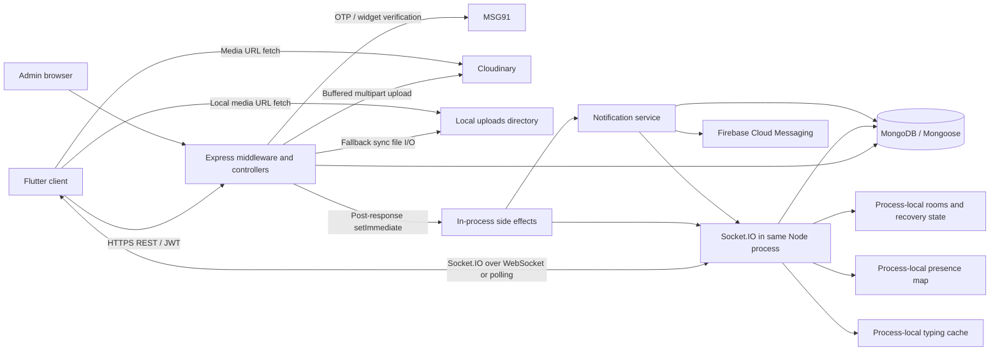

# Vocle performance and resilience testing architecture

**Investigation baseline:** upstream [`mathiharan29/medcollab-beta`](https://github.com/mathiharan29/medcollab-beta), branch `master`, commit **`4c01dc24247aa95a73e286a2b42c7f2f81257c7a`**.

The upstream SHA was checked twice during this investigation and remained unchanged. Source was retrieved from GitHub at that exact commit and inspected in memory. The earlier testing fork was **not** used as implementation evidence.

**Status: planning only.** No files were created or modified; no branches, commits, PRs, installations, application processes, tests, infrastructure, or application traffic were created. GitHub source and framework documentation were the only remote resources read.

## Master index

- [A. Executive assessment](#a-executive-assessment)
- [B. Verified architecture and dependency map](#b-verified-architecture-and-dependency-map)
- [C. Endpoint, event, and background-operation inventory](#c-endpoint-event-and-background-operation-inventory)
- [D. Bottleneck and scalability risk register](#d-bottleneck-and-scalability-risk-register)
- [E. Workload personas and traffic models](#e-workload-personas-and-traffic-models)
- [F. Proposed test-case catalog](#f-proposed-test-case-catalog)
- [G. Traceability and completeness review](#g-traceability-and-completeness-review)
- [H. Framework evaluation](#h-framework-evaluation)
- [I. Metrics, observability, and thresholds](#i-metrics-observability-and-thresholds)
- [J. Synthetic data and isolation](#j-synthetic-data-and-isolation)
- [K. GitHub Actions architecture](#k-github-actions-architecture)
- [L. Codex Cloud implementation roadmap](#l-codex-cloud-implementation-roadmap)
- [M. Open decisions](#m-open-decisions)
- [N. Missing evidence and assumptions](#n-missing-evidence-and-assumptions)
- [O. Critical design review](#o-critical-design-review)
- [P. First implementation batch](#p-first-implementation-batch)

---

## A. Executive assessment

Vocle is a Flutter client backed by a Node.js/Express application, MongoDB/Mongoose, and Socket.IO. The backend also serves an administrative portal and optional local media. MSG91, Cloudinary, and Firebase Cloud Messaging are external dependencies.

The most important performance question is **whether persisted business operations, realtime delivery, notifications, and client-visible state remain consistent as concurrency grows**. HTTP response time alone cannot answer that question.

Five implementation characteristics should shape the program:

1. **Messages are sent through HTTP, not a Socket.IO `send_message` handler.** The backend creates the message and updates the channel preview, returns HTTP success, then schedules realtime delivery, thread aggregate updates, and notifications with `setImmediate`. These side effects are neither durable nor transactional with the message write. [Message controller, `sendMessage`, lines 92–288][messages]

2. **Fan-out creates database work as well as network traffic.** A message may emit separately to its channel room and every audience member’s user room. Eligible notification recipients each trigger notification persistence and a user lookup; FCM sends are then parallelized across device tokens. A recipient in both rooms may receive duplicate transport events. [Socket emission, lines 198–232][socket]; [notification service, lines 44–211 and 282–370][notify]

3. **Horizontal realtime scaling is not implemented in the inspected source.** Presence maps, typing cache, socket enumeration, and the configured recovery mechanism are process-local. No distributed Socket.IO adapter, shared rate-limit store, durable work queue, or distributed presence service was found. Two backend instances must first pass cross-instance correctness tests before any throughput increase is described as successful scaling. [Socket setup][socket]; [presence handler][presence]; [typing handler][typing]; [space-room helpers][rooms]

4. **Several reads and mutations scale with accumulated data rather than page size.** Examples include unpaginated DM and personal handoff lists, Needl’s sequential channel-access checks, broad colleague discovery, admin retention queries, and full-history conversation expansion. [Channel controller][channels]; [user controller][users]; [known-user resolution][known]; [handoff controller][handoffs]; [admin controller][admin]

5. **Existing CI is useful infrastructure, but it is not a performance baseline.** Regression/security workflows emphasize isolation, exact source provenance, deterministic fixtures, and reports. Some use `NODE_ENV=test`, which bypasses the global API limiter. Reusing those settings without qualification would misrepresent deployed behavior. [Rate limiter, lines 60–68][limits]; [functional workflow][ci-functional]

### Recommended program

Use **Artillery for arrival scheduling and HTTP workloads**, with a small, version-pinned **Node.js Socket.IO client layer** for persistent receivers, message accounting, coordinated races, and recovery experiments.

Build the program in this order:

1. Provenance, isolation, case schema, and measurement integrity.
2. Low-load HTTP and HTTP-to-realtime delivery baselines.
3. Concurrency correctness.
4. Query/data growth and fan-out characterization.
5. Mixed load.
6. Stress, spike, soak, dependency failures, and network impairment.
7. Vertical scaling and cross-instance correctness.
8. Distributed capacity testing only after generator calibration.

**No production capacity estimate or production SLO can presently be justified.**

---

## B. Verified architecture and dependency map

### B1. Evidence conventions

- **Verified:** directly visible in the pinned upstream implementation.
- **Risk:** an engineering inference from that implementation, requiring execution to establish severity.
- **Hypothesis:** proposed workload or experiment parameter.
- **Unknown:** deployment, usage, or runtime evidence unavailable in this investigation.

Unless stated otherwise, backend paths below are relative to `medcollab-backend/src/`. All source links are pinned to the inspected commit.

### B2. Components and runtime

| Component | Verified implementation | Performance implications |
|---|---|---|
| Backend | Express **5.2.1**, Mongoose **9.7.0**, Socket.IO **4.8.3** in the inspected lockfile; CommonJS Node application | Event-loop scheduling, JSON serialization, middleware, and asynchronous I/O need independent measurement |
| Runtime declaration | `package.json` declares Node `>=18`; existing workflows select Node 22; runtime lock specifies 22.20.0 | Record actual runtime for every run; do not equate declared minimum with deployed version |
| HTTP server | `server.js:startServer` connects DB, configures providers, creates HTTP server, attaches Socket.IO, then listens | Cold-start time includes DB connection; HTTP and realtime share a process |
| Mobile | Flutter/Dart; locked `socket_io_client` 3.1.6; Dio HTTP client | Node protocol clients cannot establish Flutter rendering, memory, or lifecycle performance |
| Database | MongoDB via Mongoose; one configured pool with `maxPoolSize:10`, selection timeout 10 seconds, socket timeout 45 seconds | Auth, business queries, notifications, and background writes compete for the pool |
| Media | Multer memory storage; Cloudinary upload stream or synchronous local-file fallback | Concurrent upload buffers and downstream stalls can grow RSS/external memory |
| Push | Firebase Admin, one `messaging.send` per token | Provider latency and token multiplicity amplify in-flight work |
| Authentication | JWT access/refresh tokens; server OTP and MSG91 widget verification paths | Distinct CPU, provider, DB, and limiter costs |
| Administrative UI | Static admin assets served by the backend; protected admin API | Analytics requests contend with user traffic |
| Deployment declarations | Railway/Nixpacks; `/health`; restart-on-failure, maximum three retries | These are repository settings, not evidence of current deployed resources |

Sources: [backend package][package], [server][server], [database configuration][db], [Railway configuration][railway], [mobile socket client][client-socket], [runtime lock][runtime].

### B3. Dependency map

There is **no verified durable queue between persistence and side effects**. The diagram’s “in-process side effects” box is scheduled application work, not a worker service.

### B4. Critical flows

| Flow | Actual sequence and synchronization | Amplification/shared state | Failure and measurement requirements |
|---|---|---|---|
| Server OTP login | Request → limiter/validation → invalidate prior OTPs → bcrypt hash → OTP insert → MSG91; verification → bcrypt compare → atomic OTP claim/delete → find/create user → JWTs | Phone-local contention; bcrypt CPU; provider request; user uniqueness | Measure request and verification separately; concurrent first login; provider timeout; OTP consumed but subsequent user operation failing |
| Widget login | Validate input → MSG91 form request; second JSON-form request after a non-success response → identity resolution → user find/create → JWTs | Up to two provider calls on response failure; transport exception does not necessarily take the fallback path | Count provider attempts and distinguish timeout, provider rejection, account creation, and successful token issuance |
| Protected API | JWT verify → user read → active check → unawaited `lastSeenAt` update → route handler | “Read-only” API traffic still produces writes; hot users generate hot user documents | Measure auth overhead, DB operations/request, pending background writes, and errors after response |
| Socket connection | JWT/user validation → active-space lookup → join space rooms → register handlers/presence → user room → `authenticated` | Presence broadcast and user availability query; membership-dependent work | Measure transport connect and application-ready latency separately |
| Message send | Access resolution → optional thread/quote lookup → message insert/populate → channel preview update → HTTP 201 → scheduled room/user emits → optional thread update → notifications | Hot channel preview; hot thread root; duplicate room paths; recipient-dependent notifications | Record accepted, persisted, emitted, received, reconciled, and notification-complete stages independently |
| Notification | Notification insert → user-room event → recipient preferences/token read → per-token FCM calls | Parallel recipient promises and per-token promises; no durable retry queue | FCM acceptance is not device receipt; swallowed failures require explicit accounting |
| Space join/approval | Read space → array membership/pending mutation → save → fetch channels → enumerate local sockets → update rooms → member event | Hot embedded arrays; socket scan proportional to local connections | Race same/different members, approval/removal, and room convergence |
| Request acceptance | Read request → save accepted state → keyed channel upsert → populate → synchronous notification → response | Multi-document partial completion; repeated acceptance side effects | Verify retry recovers missing DM; count channels, state transitions, and notifications |
| Conversation expansion | Validate targets → find/create destination → read complete selected source history → allocate ID map and copies → ordered insert → update preview | Memory and write work proportional to history; no transactional copy | Check partial copies, concurrent expansion, references, and mixed-traffic impact |
| Handoff submit/ack | Conditional state update; user lookups; room event; response; deferred notification | Hot handoff and notification paths | Submit/ack use conditional updates, but edit/reassign use read-modify-save; test their interactions |
| Search | Resolve accessible spaces/channels → sequential category queries → regex filtering/population | `$in` cardinality, regex scans, nested handoff arrays, broad known-user scan | Measure per-search-type and no-result queries, not only aggregate search latency |
| Media upload/delete | Auth → limiter → complete memory buffer → provider upload or sync disk write → storage counter; delete may try three resource types and scan handoff attachments | Buffer memory, external latency, synchronous disk I/O, attachment scan | Separate transfer, provider, persistence, deletion, and subsequent fetch results |
| Mobile recovery | Resume/connect callbacks → room synchronization; network errors schedule recovery; token refresh may replace socket; chat HTTP reload/reconciliation | Multiple readiness callbacks can trigger synchronization; retries add traffic | Test actual Flutter behavior separately from protocol-level recovery |

Detailed sources: [auth][auth], [OTP model][otp-model], [OTP service][otp-service], [MSG91 service][msg91], [auth middleware][auth-middleware], [messages][messages], [requests][requests], [channels][channels], [handoffs][handoffs], [search][search], [media][media], [client socket][client-socket].

### B5. State, caching, jobs, and recovery

**Verified state and caching**

- `onlineUsers: Map<userId, Set<socketId>>` tracks devices in one Node process.
- `typingMembers` caches channel members for 60 seconds. Entries are refreshed on access; no eviction sweep was found.
- Socket.IO recovery is configured for two minutes with `skipMiddlewares:true`.
- `spaceRooms` iterates the process’s sockets for membership changes.
- Flutter `ChatTranscriptCache` holds transcript lists in static maps without a visible size bound in that class.
- No general backend query cache or Redis cache was found.

**Background work**

- Message/handoff side effects use `setImmediate`.
- Auth activity, media storage counters, stale FCM token removal, and final-device disconnect activity updates include unawaited database operations.
- MongoDB TTL indexes expire OTPs and notifications; notification default expiry is 30 days.
- No application cron scheduler, worker pool, job queue, or replayable outbox was found.

**Recovery limits**

- `/health` returns HTTP 200 even when its database field reports disconnected.
- Shutdown closes the HTTP server and subsequently MongoDB, with a 30-second forced-exit timeout. Explicit Socket.IO closure and explicit draining of deferred side effects are not present in the inspected shutdown function.
- Local media is explicitly described by startup warnings as ephemeral on Railway redeploy.
- JWT expiry is checked during ordinary socket authentication; no per-event JWT expiry validation was found.
- Recovery bypasses authentication middleware when recovery succeeds.

Sources: [presence][presence], [typing][typing], [socket][socket], [rooms][rooms], [mobile cache][client-cache], [server][server], [application health route][app].

### B6. Database schema and index review

These are **schema declarations**, not proof that a deployed database has built the indexes.

| Model | Important structure/indexes | Queries to investigate |
|---|---|---|
| User | Unique phone; sparse unique username; institution; role/speciality; verified/createdAt; lastSeenAt; isActive; embedded FCM tokens capped at five by model method | Auth reads/activity writes; colleague discovery; admin sorting/cohorts; concurrent token/preference updates |
| OTP | Phone; TTL `expiresAt`; `{phone,isUsed,expiresAt}` | Latest eligible OTP sorted by createdAt; concurrent issuance/claim; TTL interference |
| Space | Unique inviteCode; member-user multikey; createdBy; embedded members/pendingRequests | Membership lookup plus `isActive`; large document load; concurrent array changes |
| Channel | spaceId; `{spaceId,type}`; `{spaceId,isArchived,position}`; `{type,members}`; partial unique `{type,memberPairKey}` for direct channels | Unpaginated DM list sorted by lastMessage/updatedAt; keyed DM upsert; channel-name existence check |
| Message | channelId; threadId; `{channelId,createdAt:-1}`; `{threadId,createdAt:1}`; `{spaceId,createdAt:-1}`; mentions | Feed sorts by `_id`, not createdAt; thread feed also sorts `_id`; regex search; quote cleanup; sender aggregates; hot reactions/readBy |
| MessageRequest | Individual sender/recipient/status indexes; `{fromUserId,toUserId}`; `{toUserId,status}` | Bidirectional pending lookups; no declared unique pending-pair constraint; sorted request lists |
| Handoff | spaceId; `{spaceId,shiftDate:-1}`; `{toUserId,status}`; `{fromUserId,shiftDate:-1}`; `{spaceId,shiftDate,shiftType}` | Composite shiftDate/`_id` cursor; assignment-history filters; unpaginated personal lists; attachment regex |
| Notification | userId; read; TTL expiresAt; `{userId,read,createdAt:-1}` | Feed sorts `_id`; channel mark-read also filters metadata.channelId; count after listing |
| SupportTicket | Embedded schema in support controller; type/userId/status indexes | Admin newest-100 sort, open count; insertion/logging |

Model references: [User][user-model], [OTP][otp-model], [Space][space-model], [Channel][channel-model], [Message][message-model], [MessageRequest][request-model], [Handoff][handoff-model], [Notification][notification-model], [SupportTicket][support].

**Candidate experiments, not immediate index prescriptions**

Evaluate existing plans first, then compare isolated database variants for:

- Message feed: equality filters for channel/thread/deletion followed by `_id`.
- Thread feed: channel/thread/deletion plus `_id`, accounting for the implemented `$or`.
- Notification feed: user/read/type variants plus `_id`.
- Notification channel clearing: user/read/metadata.channelId.
- Handoff history: space/shiftDate/`_id`, with representative visibility filters.
- DM listing: type/members/archive plus sort fields, subject to multikey constraints.
- Message sender aggregation used by admin and Needl-related reads.
- Request direction/status/createdAt.
- Admin createdAt ordering/cohorts and support createdAt ordering.

A normal B-tree index should not be assumed to solve unanchored, case-insensitive regex search. The institution index also does not eliminate the current application-side normalization scan in `resolveKnownUserIds`.

No explicit application transactions, transaction sessions, read concern, or write concern settings were found. Runtime MongoDB defaults/topology therefore remain required evidence.

---

## C. Endpoint, event, and background-operation inventory

### C1. Inventory contract

The route scan found **87 feature-router method/path registrations**, including two aliases for group-DM creation.

For every operation below:

- Its stable operation ID is the listed identifier prefixed with `OP-`.
- HTTP metrics are method/route-template p50/p95/p99, attempted/started/completed rate, status/error class, response bytes, and server/DB resource cost.
- All protected routes inherit the user read and activity write in `protect`.
- `A` means authenticated active user; `O` adds completed onboarding; `PA` adds platform-admin allowlist.
- Handler references point to the feature controller unless stated otherwise.
- Inputs include path identifiers in addition to the explicitly listed body/query fields.
- Case references in §F supply workload, concurrency, failure indicators, and required environment.

### C2. Authentication and users

| ID | Method/path | Handler and source line | Auth/input → behavior | Sensitivity, risk, cases |
|---|---|---|---|---|
| AUTH-01 | POST `/api/auth/request-otp` | `requestOtp`:53 | Public; phone → OTP delivery attempt | bcrypt/provider/phone races; high; AUTH-001, RES-002 |
| AUTH-02 | POST `/api/auth/verify-otp` | `verifyOtp`:74 | Public; phone/otp → account/session | OTP claim, user create race; high; AUTH-001 |
| AUTH-03 | POST `/api/auth/verify-msg91-token` | `verifyMsg91Token`:99 | Public; phone/accessToken → verified session | provider latency/fallback; high; AUTH-001 |
| AUTH-04 | POST `/api/auth/refresh` | `refreshToken`:141 | Refresh JWT → new access token | IP limiter, synchronized expiry; high; AUTH-002/003 |
| AUTH-05 | POST `/api/auth/logout` | `logout`:173 | A; optional fcmToken → token removal | device cleanup; medium; AUTH-002 |
| USER-01 | GET `/api/users/me` | `getMe`:51 | A → profile | additional user read; medium; API-001 |
| USER-02 | PUT `/api/users/me` | `updateMe`:62 | A; profile/preferences/avatar → updated profile | preference lost updates; avatar deletion wait; medium/high; API-001, MED-002 |
| USER-03 | PUT `/api/users/me/availability` | `updateAvailability`:124 | A; status/until/note → DB update and presence | spaces-per-user amplification; high; RT-003 |
| USER-04 | PUT `/api/users/me/fcm-token` | `registerFcmToken`:174 | A; token → deduped/capped list | same-user concurrent saves; medium; AUTH-002 |
| USER-05 | GET `/api/users/search` | `searchUsers`:196 | A+O; q/spaceId → up to 20 users | known-user scan/regex; high; SEARCH-001 |
| USER-06 | GET `/api/users/lookup` | `lookupByPhone`:256 | A+O; phone → relationship/capabilities | repeated relationship queries; medium/high; SEARCH-001 |
| USER-07 | GET `/api/users/:id` | `getUserById`:185 | A → public profile | lookup/activity-write overhead; medium; API-001 |
| USER-08 | GET `/api/users/me/needl` | `getNeedl`:347 | A+O → up to 40 roots, reply-root probe capped 80 | sequential channel access; high; SEARCH-002 |

Sources: [auth routes][auth-routes], [auth controller][auth], [user routes][user-routes], [user controller][users].

### C3. Spaces and invitations

All are A+O; controller checks membership/admin/owner as applicable.

| ID | Method/path | Handler:line | Inputs/behavior | Sensitivity, risk, cases |
|---|---|---|---|---|
| SPC-01 | POST `/api/spaces` | `createSpace`:52 | name/type/description → space and default channels | multi-write setup, code uniqueness; medium; SOC-004 |
| SPC-02 | GET `/api/spaces` | `getMySpaces`:82 | → memberships with channel data | spaces/channels per user; high; SEARCH-002 |
| SPC-03 | POST `/api/spaces/join` | `joinSpace`:149 | inviteCode → member or pending request | hot arrays, socket scan; high; SOC-004, RT-006 |
| SPC-04 | GET `/api/spaces/invite/:code` | `previewInvite`:269 | code → preview | invite lookup; low; API-001 |
| SPC-05 | GET `/api/spaces/:id` | `getSpaceById`:120 | → space/channels | embedded members and channels; medium; SEARCH-002 |
| SPC-06 | PUT `/api/spaces/:id` | `updateSpace`:317 | settings/details → save | same-space concurrent edits; medium; SOC-004 |
| SPC-07 | POST `/api/spaces/:id/invite` | `regenerateInviteCode`:299 | → replacement code | join/regeneration race; medium; SOC-004 |
| SPC-08 | GET `/api/spaces/:id/members` | `getMembers`:335 | → user details sorted in application | membership cardinality; high; SEARCH-002 |
| SPC-09 | GET `/api/spaces/:id/pending` | `getPendingJoins`:447 | → pending users | pending-list size; medium; SOC-004 |
| SPC-10 | POST `/api/spaces/:id/pending/:userId/approve` | `approveJoinRequest`:218 | → member transition/rooms | approval race; high; SOC-004, RT-006 |
| SPC-11 | DELETE `/api/spaces/:id/members/:userId` | `removeMember`:374 | → removal/room eviction | socket count and concurrent sends; high; RT-006 |
| SPC-12 | POST `/api/spaces/:id/leave` | `leaveSpace`:400 | → leave/room eviction | same shared state; high; RT-006 |

Sources: [space routes][space-routes], [space controller][spaces].

### C4. Channels, direct conversations, and expansion

All are A+O with channel/space authorization in handlers.

| ID | Method/path | Handler:line | Inputs/behavior | Sensitivity, risk, cases |
|---|---|---|---|---|
| CH-01 | POST `/api/spaces/:spaceId/channels` | `createChannel`:15 | name/type/privacy → channel | check-then-create name race; medium; SOC-004 |
| CH-02 | GET `/api/spaces/:spaceId/channels` | `getSpaceChannels`:44 | → accessible channels | unpaginated list; medium; SEARCH-002 |
| CH-03 | GET `/api/channels/dm` | `getMyDMs`:219 | → enriched conversations | unpaginated/populated/sorted; high; SEARCH-002 |
| CH-04 | POST `/api/channels/dm` | `createOrGetDM`:241 | userId → keyed DM or self notes | unique index/upsert/self-notes race; high; SOC-002 |
| CH-05 | POST `/api/channels/dm/group` | `createGroupDM`:325 | userIds → group DM | sequential permission checks; high; SOC-002 |
| CH-06 | POST `/api/channels/group-dm` | same handler | alias of CH-05 | same risk; same case, alias coverage only |
| CH-07 | POST `/api/channels/:id/expand` | `expandDM`:423 | userIds/history/todayStart/timezoneOffsetMinutes → destination/copies | history-sized memory/write amplification; critical; SOC-003 |
| CH-08 | GET `/api/channels/:id` | `getChannelById`:67 | → populated members/pins | members/pins population; medium; API-001 |
| CH-09 | PUT `/api/channels/:id` | `updateChannel`:98 | name/details/posting policy → save | concurrent rename/policy; medium; SOC-004 |
| CH-10 | DELETE `/api/channels/:id` | `archiveChannel`:146 | → archive | send/archive race; high; RT-006 |
| CH-11 | GET `/api/channels/:id/members` | `getChannelMembers`:629 | → member profiles | membership size; medium; SEARCH-002 |
| CH-12 | POST `/api/channels/:id/pin/:messageId` | `pinMessage`:661 | → pins; maximum five checked in handler | concurrent cap/duplicate race; high; SOC-005 |
| CH-13 | DELETE same pin path | `unpinMessage`:695 | → pins | concurrent array replacement; medium; SOC-005 |

Group DMs allow **up to nine total members**, not arbitrarily large broadcasts. Large fan-out experiments belong primarily to space channels.

Sources: [channel routes][channel-routes], [channel controller][channels], [channel model][channel-model].

### C5. Messaging and threads

Prefix: `/api/channels/:channelId/messages`. All are A+O with access resolution.

| ID | Method/suffix | Handler:line | Inputs/behavior | Sensitivity, risk, cases |
|---|---|---|---|---|
| MSG-01 | GET `/` | `getMessages`:49 | before/limit → root page, default 30, max 100 | history/index/population; high; API-001, DATA-001 |
| MSG-02 | POST `/` | `sendMessage`:92 | type/content/priority/mentions/threadId/replyToId → persisted message, later side effects | hot preview/fan-out; critical; MSG-001, RT-002, NOT-001 |
| MSG-03 | GET `/:id/thread` | `getThread`:295 | before/limit → root/reply page | thread size/index; high; MSG-002 |
| MSG-04 | POST `/:id/reply` | `replyToThread`:336 | message body → send with threadId | hot root aggregate; high; MSG-002 |
| MSG-05 | PUT `/:id` | `editMessage`:345 | content.text → save/event | same-message edits; high; MSG-004 |
| MSG-06 | DELETE `/:id` | `deleteMessage`:377 | → soft delete, quote updates, preview repair/event | references and concurrent sends; high; MSG-004 |
| MSG-07 | POST `/:id/react` | `toggleReaction`:440 | emoji → updated reaction array/event | read-modify-save contention; high; MSG-004 |
| MSG-08 | POST `/read` | `markAsRead`:463 | messageIds → direct-channel readBy updates | batch size/hot documents; high; MSG-004 |

There is no observed client delivery-ack endpoint. `/read` records a user read action and returns HTTP success; it does not implement a general transport acknowledgement protocol.

Sources: [message routes][message-routes], [message controller][messages], [message model][message-model].

### C6. Requests, handoffs, notifications, search, and media

| ID | Method/path | Handler:line | Auth/input → behavior | Risk and cases |
|---|---|---|---|---|
| REQ-01 | GET `/api/message-requests/pending-count` | `pendingCount`:185 | A+O → count | count growth; SOC-001 |
| REQ-02 | GET `/api/message-requests` | `listRequests`:145 | A+O; direction/status → newest 50 | sorted query/population; SOC-001 |
| REQ-03 | POST `/api/message-requests` | `createRequest`:52 | A+O; toUserId/introMessage → request and awaited notification | duplicate pending race/provider coupling; high; SOC-001 |
| REQ-04 | POST `/api/message-requests/:id/accept` | `acceptRequest`:197 | recipient → accepted request and DM | partial commit/retry; high; SOC-001 |
| REQ-05 | POST `/api/message-requests/:id/decline` | `declineRequest`:299 | recipient → declined | accept/decline race; high; SOC-001 |
| HND-01 | POST `/api/handoffs` | `createHandoff`:56 | A+O; space/channel/recipient/shift/patients → draft | document size; HAND-001 |
| HND-02 | GET `/api/handoffs` | `getMyHandoffs`:94 | A+O; type/status/space/date → unpaginated list | high; SEARCH-002 |
| HND-03 | GET `/api/handoffs/:id` | `getHandoffById`:149 | authorized participant/admin → populated detail | nested notes/patients; HAND-001 |
| HND-04 | PUT `/api/handoffs/:id` | `updateHandoff`:192 | sender draft update | edit/submit race; high; HAND-002 |
| HND-05 | POST `/api/handoffs/:id/submit` | `submitHandoff`:215 | sender → conditional submitted transition | high; HAND-001/002 |
| HND-06 | POST `/api/handoffs/:id/acknowledge` | `acknowledgeHandoff`:277 | recipient/note → conditional acknowledgement | high; HAND-002 |
| HND-07 | POST `/api/handoffs/:id/notes` | `addHandoffNote`:329 | participant/text/kind → appended note/event | hot array; HAND-002 |
| HND-08 | POST `/api/handoffs/:id/reassign` | `reassignHandoff`:382 | participant/toUserId/note → reassignment/history/event | competing assignments; high; HAND-002 |
| HND-09 | DELETE `/api/handoffs/:id` | `deleteHandoff`:469 | sender draft → deletion | delete/submit race; HAND-002 |
| HND-10 | GET `/api/spaces/:spaceId/handoffs` | `getSpaceHandoffs`:487 | member; filters/before/limit → page, cap 50 | compound cursor/growth; DATA-001 |
| NOT-01 | GET `/api/notifications` | `getNotifications`:14 | A+O; before/limit/type/unreadOnly → page plus unread count | high; NOT-002 |
| NOT-02 | GET `/api/notifications/unread-count` | `getUnreadCount`:46 | A+O → count | write/read competition; NOT-002 |
| NOT-03 | PUT `/api/notifications/read-all` | `markAllAsRead`:71 | A+O → bulk update | inbox size; NOT-002 |
| NOT-04 | PUT `/api/notifications/read-by-channel/:channelId` | `markReadByChannel`:100 | A+O → bulk update/count | metadata filter; NOT-002 |
| NOT-05 | PUT `/api/notifications/:id/read` | `markAsRead`:55 | owner → read | concurrent state toggles; NOT-002 |
| NOT-06 | PUT `/api/notifications/:id/unread` | `markAsUnread`:82 | owner → unread | same; NOT-002 |
| NOT-07 | DELETE `/api/notifications/:id` | `deleteNotification`:142 | owner → delete | concurrent delivery/read; NOT-002 |
| SRC-01 | GET `/api/search` | `globalSearch`:46 | A+O; q/type/limit → category results | regex/cardinality; high; SEARCH-001 |
| MED-01 | POST `/api/media/upload` | `uploadFile`:34 | A+O; multipart file/context → media metadata | 50 MiB buffer/provider/disk; critical; MED-001 |
| MED-02 | DELETE `/api/media/:publicId` | `deleteFile`:238 | A+O + ownership → media deletion/attachment clearing | provider retries and regex scan; high; MED-002 |

Sources: [request routes][request-routes], [requests][requests], [handoff routes][handoff-routes], [handoffs][handoffs], [notification routes][notification-routes], [notification controller][notifications], [search][search], [media routes][media-routes], [media controller][media].

### C7. Administrative, support, developer, and platform paths

| IDs | Paths and handlers | Auth/behavior | Risk and coverage |
|---|---|---|---|
| ADM-01–08 | GET `/api/admin/me`→`getAdminMe`:306; `/overview`→`getOverview`:34; `/users`→`listUsers`:112; `/growth`→`getGrowth`:320; `/retention`→`getRetention`:362; `/infrastructure`→`getInfrastructure`:421; `/support`→`listSupportTickets`:518; `/users/:id`→`getUser`:206 | A+PA; users page/limit/q/status filters; growth days | Counts/aggregations, deep skip, three cohort materializations; high for mixed workload; OPS-001 |
| ADM-09–10 | PUT `/api/admin/users/:id/verify`→`setDoctorVerification`:255; `/users/:id/deactivate`→`setUserActive`:281 | A+PA; verified/active | State change while connected; OPS-001, AUTH-002, RT-005 |
| SUP-01–03 | POST `/api/support/bug`→`createBug`:45; `/feature`→`createFeature`:67; `/feedback`→`createFeedback`:89 | A; title/description and optional steps/context → ticket | Insert/logging; low individually; OPS-001 |
| DEV-01–03 | POST `/api/dev/seed-notifications`, `/seed-conversation`, `/seed-handoff`; inline handlers at 47, 105, 156 | A; enabled outside production or with explicit flag | Fixture utilities; exclude from representative business load |
| SYS-01–03 | GET `/`, `/health`, `/api`; `app.js`:128,142,273 | Public metadata/health | Low-cost controls; health is not DB readiness; API-001, RES-001 |
| SYS-04 | GET `/join/:code`; `app.js`:164 | Public deep-link HTML | Static response; low priority; API-001 |
| SYS-05 | `/uploads/*`; `app.js`:208 | Static local media | Disk/network load; MED-002 |
| SYS-06 | `/admin`, `/admin/`, `/admin/*`; `app.js`:227–235 | Static admin assets | Low priority asset delivery; OPS-001 |

The “infrastructure” admin response contains estimated usage and hard-coded pricing/headroom hints. **It must not be used as resource telemetry or current provider pricing evidence.** [Admin controller, lines 421–510][admin]

Sources: [admin routes][admin-routes], [admin controller][admin], [support routes][support-routes], [support controller][support], [developer routes][dev-routes], [app][app].

### C8. Realtime inventory

| ID | Direction/event | Source and behavior | Scaling/correctness dimension | Cases |
|---|---|---|---|---|
| RT-01 | Connect/auth handshake | `socket/index.js`:93–167; JWT/user/spaces then `authenticated` | connection arrival rate; memberships/user; DB pool | RT-001 |
| RT-02 | C→S `join_channel` | message handler:62; access query then same-name success event | joins/sec, access cost, setup races | RT-001/006 |
| RT-03 | C→S `leave_channel` | message handler:92; leave room, no explicit success response | churn; room cleanup | RT-003/006 |
| RT-04 | C→S `sync_space_rooms` | space handler:15; DB sync, full presence snapshot, broadcast, success event | roughly per-space queries plus per-member events | RT-003, SPIKE-001 |
| RT-05–06 | C→S `typing_start`, `typing_stop` | message handler:111/135 | cached membership query, channel/user-room fan-out | RT-004 |
| RT-07–08 | S→C `user_typing`, `user_stopped_typing` | same handlers | duplicate transport delivery, stale cache, slow consumers | RT-004/007 |
| RT-09 | C→S `update_availability` | presence handler:78 | user update and per-space broadcast | RT-003 |
| RT-10 | S→C `presence_update` | presence handler:150/191; user controller:124 | devices/user, spaces/user, snapshot population | RT-003 |
| RT-11 | S→C `new_message` | socket index:198 | channel emit plus separate user emits | RT-002, MSG-003 |
| RT-12–13 | S→C `message_updated`, `message_deleted` | socket index:238/247 | channel-room recipients; reload convergence | MSG-004 |
| RT-14 | S→C `new_notification` | socket index:257 | per-user/device fan-out | NOT-001/002 |
| RT-15–18 | S→C `handoff_submitted`, `handoff_acknowledged`, `handoff_note_added`, `handoff_reassigned` | handoff controller:244/304/369/444 | space fan-out and state reconciliation | HAND-001/002 |
| RT-19–20 | S→C `space_member_joined`, `space_member_left` | space controller:201/249/424 | membership changes and eviction timing | RT-006 |
| RT-21 | Disconnect | presence handler:120 | final-device offline; activity write | RT-003, SOAK-001 |
| RT-22 | Recovery | socket index:83–86,116–153 | replay window, restored identity/rooms, skipped auth | RT-005 |
| RT-23 | S→C `error` | setup and handlers | failure correlation; not an application receipt | all realtime cases |

**Do not generate `send_message` traffic:** the constant exists, but no corresponding server listener was found. Similarly, constants alone do not establish an executable event contract.

### C9. Background-operation inventory

| ID | Operation | Concurrency/data sensitivity | Metrics/cases |
|---|---|---|---|
| BG-01 | Per-authenticated-request `lastSeenAt` write | API rate and repeated same-user traffic | writes/request, lag/errors; DATA-002 |
| BG-02 | Post-send emit/thread/notification chain | accepted message rate × audience | scheduled/completed/failed/lost work; MSG-001, RES-001 |
| BG-03 | Post-handoff notification | transitions × recipient devices | completion lag; HAND-001, RES-001 |
| BG-04 | FCM invalid-token cleanup | stale tokens and concurrent registrations | eventual token state; NOT-001, AUTH-002 |
| BG-05 | Upload storage counter increment | parallel uploads per user | counter reconciliation; MED-001 |
| BG-06 | OTP and notification TTL | expired document population | TTL deletes/sec, foreground latency; DATA-003 |
| BG-07 | Recovery packet/session retention | event rate × disconnections/window | retained memory, replay coverage; RT-005, SOAK-001 |
| BG-08 | Mobile retry/rejoin/sync/read-clear actions | reconnects and received messages | extra HTTP/events per logical action; NET-001, MOBILE-001 |

---

## D. Bottleneck and scalability risk register

All entries below are **source-derived risks**, not measured defects unless described as an explicit implementation fact.

| Risk | Priority | Evidence and mechanism | Required investigation |
|---|---|---|---|
| R01: acknowledged message without completed delivery side effects | P0 | HTTP response precedes `setImmediate`; no durable outbox | Kill/fail after acceptance; reconcile DB, recipients, thread counters, notifications |
| R02: fan-out overwhelms pool/event loop | P0 | Parallel notification promises; per-recipient reads/inserts; per-token sends | Audience/viewer/token sweeps with pending-work accounting |
| R03: misleading horizontal scaling | P0 | Local presence/cache/socket enumeration; no adapter | Cross-instance sender/receiver and membership tests before throughput comparisons |
| R04: duplicates after response loss | P0 | No server message idempotency key observed; client reconciliation dedupes IDs/content locally | Lost-response and manual retry, including legitimate identical messages |
| R05: hot channel/thread documents | P0 | Every send updates channel preview; thread replies update same root | Hot-room versus distributed-room throughput and final preview/counter correctness |
| R06: pool saturation hidden behind successful responses | P0 | Pool cap ten; unawaited auth/media/token writes | Checkout waiting, background lag, failure attribution |
| R07: full-history expansion memory/partial-copy risk | P0 | Complete read, in-memory copies, ordered insert; no transaction | History-volume sweep and failpoint between copy stages |
| R08: stale room access/recovery | P0 | Recovery skips middleware; removal helpers synchronize space rooms, not visibly all channel rooms | Revocation while connected/disconnected; check subsequent payloads |
| R09: read-modify-save races | P0 | Membership, requests, reactions, pins, preferences, reassignments | Barrier-controlled competing operations and DB state oracles |
| R10: upload memory/event-loop pressure | P0 | 50 MiB Multer buffer; synchronous local file writes | Parallel transfers, slow provider, mixed message latency |
| R11: unbounded/list-sized reads | P1 | DM/personal handoff lists, members, admin cohorts | Data-growth curves, response bytes, heap/GC |
| R12: query/index mismatch | P1 | Feed `_id` sorts versus declared createdAt compounds | Explain plans, scanned/returned ratio, alternative-index experiments |
| R13: discovery/Needl query amplification | P1 | Broad institution scan; sequential access checks | Users/channels per account independently varied |
| R14: reconnect synchronization amplification | P1 | Connect and authenticated callbacks invoke readiness; sync includes per-space/member work | Actual events/connect and requests/resume |
| R15: typing cache/memory and stale membership | P1 | Timestamped map without observed eviction; fallback user emits | Distinct-channel churn, TTL boundary, removed member |
| R16: shutdown fails to drain realtime/deferred work | P0 | HTTP close callback plus forced exit; no explicit side-effect drain | Graceful versus abrupt termination |
| R17: health masking outage | P1 | `/health` remains 200 with DB disconnected | Dependency-aware readiness and recovery measurement |
| R18: provider failures appear successful upstream | P1 | Notification errors caught/returned as null; FCM errors caught | Independent provider/notification ledgers |
| R19: rate limiting distorts results | P0 for validity | Global bypass in test mode; auth 20/15m by IP; upload 30/h/user | Separate deployment-policy and isolated-ceiling experiments |
| R20: client memory/reconciliation degradation | P1 | Cached transcript lists, seen-message set, repeated list copying/sorting | Device soak, many chats, duplicate payloads, account switch |

### Existing product decisions must remain part of the oracle

The upstream [product decision ledger][decisions] establishes, among other things:

- No 500-message cap for expansion of all history.
- Phone-local midnight for expansion “today.”
- Copied thread/quote remapping; destination preview may retain source message ID.
- One group DM per membership.
- Lost-send reconciliation/deduplication expectation.
- Author-only draft handoffs.
- Immediate presence eviction after leave/removal.
- Quiet hours use server timezone.

There are potential mismatches requiring characterization:

- `getHandoffById` explicitly permits an admin to view drafts, while the ledger says author-only.
- Message creation exposes no server idempotency field.
- Space eviction does not visibly guarantee eviction from previously joined channel rooms.
- Expansion’s source-ID preview is an explicit product decision, so it must **not** be incorrectly reported as a broken-reference defect.
- Client media constants use 25 MiB while backend enforcement uses 50 MiB.

Do not weaken existing assertions to make performance runs pass.

---

## E. Workload personas and traffic models

### E1. Units

Use independent controls:

- **Virtual user:** one simulated actor with state.
- **Active user:** actor currently performing business actions.
- **Persistent connection:** one transport connection; a user can have several.
- **HTTP RPS:** attempted and completed HTTP requests per second.
- **Messages/s:** logical message-send operations and persisted messages separately.
- **Events/s:** emitted or received events; include duplicates.
- **Connections/s:** new connection attempts and application-ready connections separately.

For planning:

\[
C \approx U_{\text{connected}} \times D_{\text{devices}}
\]

\[
\lambda_{\text{messages}}
= \sum_p U_p a_p r_p
\]

Here \(a_p\) is the active fraction and \(r_p\) is messages per active second for persona \(p\).

Notification work depends on audience, active viewing, message priority, preferences, and tokens. It cannot be derived from message rate alone.

### E2. Persona hypotheses

These are **starting hypotheses**, not production usage estimates.

| Persona | Proposed share | Actions and think time | Session/connection | Required data and key metrics |
|---|---:|---|---|---|
| Mostly idle | 45% | Infrequent dashboard/profile/notification reads, 2–5 minutes apart | 30–120 minutes, connected | Multiple spaces; bytes/connection, idle memory, heartbeat failures |
| Direct-message user | 20% | Bursts of 2–5 messages; 10–40 seconds between active sends; read/history actions | 15–45 minutes | Consented pairs; delivery latency, receipts, retry correctness |
| Group participant | 12% | View, scroll, reply, occasional reaction; 20–90 seconds | 20–60 minutes | Space channels and threads; fan-out, hot-root writes |
| Heavy broadcaster | 2% | Short bursts followed by long idle periods; emergency variant separate | 10–30 minutes | Larger space audience; all-recipient tail latency and amplification |
| Search-heavy | 5% | Search/category switching every 5–20 seconds during activity | 5–20 minutes | Common/rare/miss queries, many accessible channels |
| Media-heavy | 4% | Upload then message, 1–5 minutes between transfers | 10–30 minutes | Images/PDF/video; upload memory and later fetch latency |
| Reconnecting mobile | 5% | Resume, refresh, sync, reload, then short activity | 20–60 minutes with outages | Recoverable and expired recovery windows |
| Notification-heavy | 3% | Inbox reads, channel clearing, preference changes | 15–45 minutes | Large unread history, muted/quiet-hour branches |
| Multi-device | 2% | Two or three devices sharing one identity; independent viewing | 30–90 minutes | Token/register/logout races; presence correctness |
| Shift/handoff user | 2% | Draft, edit, submit, acknowledge, note, reassign | 15–40 minutes clustered by shift | Synthetic patients/attachments; transition consistency |

Treat admin traffic as a separate overlay, initially 0–2 simultaneous operators, rather than diluting the clinical-user distribution.

### E3. Experimental mixes

Use four distinct mixes:

1. **Representative hypothesis mix:** table above.
2. **Read-heavy:** increase history, search, lists, and inbox activity; retain auth activity writes.
3. **Write/fan-out-heavy:** increase messages, threads, notifications, and hot-room concentration.
4. **Mobile shift-change:** synchronized reconnect, dashboard, handoff, and notification access.

Within each mix:

- Use skewed channel popularity, including a deliberately hot channel.
- Vary spaces/user and devices/user independently.
- Separate viewing recipients from connected non-viewers and offline recipients.
- Maintain multiple accounts; one token shared by all VUs is an invalid default.
- Use distributions for think time and payload size.
- Preserve legitimate repeated identical message content in correctness experiments.
- Model typed bursts with stop events and abandonment, not one typing event per message.

### E4. Open and closed models

- **Open arrivals:** capacity, message throughput, connection storms, provider backlog.
- **Closed users:** human journeys and UI/device behavior.
- **Barrier concurrency:** competing writes and transition races.
- **Fixed connections plus independent arrivals:** realtime capacity and mixed workloads.

A closed-loop test can reduce offered load as the server slows. Always report that reduction rather than interpreting it as stable throughput.

---

## F. Proposed test-case catalog

### F1. Case specification and inherited fields

The catalog is normalized to avoid repeating the same safety and measurement text dozens of times. **Each case inherits all fields below; its entry supplies the operation-specific fields.** The implementation should materialize these into full machine-readable case records.

Every case has:

- **Status:** `PLANNED / NOT IMPLEMENTED / NOT EXECUTED`.
- **Common preconditions:** pinned upstream source and harness SHA; validated isolated target; seeded owned database; confirmed required indexes; provider mode recorded; generator calibrated; instrumentation operational.
- **Baseline acceptance:** `BASELINE_REQUIRED`.
- **Product latency/throughput/recovery objectives:** `PRODUCT_DECISION_REQUIRED`.
- **Functional acceptance:** the stated case invariants, checked independently of HTTP status.
- **Common failure indicators:** unexpected response/event errors, lost accepted work, incorrect state, growing unfinished work, generator inability to sustain arrivals, or a safety-limit breach.
- **Common metrics:** HTTP/event stage latency histograms, offered/completed rates, errors, correctness counts, generator telemetry, SUT CPU/RSS/heap/external memory/event-loop delay, DB utilization and query/pool metrics.
- **Common cleanup:** stop arrivals; bounded drain; capture terminal ledger; disconnect clients; remove only run-owned data/files/provider objects; verify cleanup. Fault tests restore connectivity/processes before cleanup.
- **Automation:** fully automatable except real-device/provider observations noted below.
- **Source references:** operation inventory entries plus the function references named in each case.
- **Dependencies:** `PERF-API-001` and validated foundation unless the case explicitly names others.
- **Limits:** the selected profile’s resource/traffic cap plus any tighter case-specific limit.

A timeout, unexecuted case, inconclusive measurement, or missing oracle must never become a pass.

### F2. Execution environments

| Code | Environment/infrastructure | Standard GitHub-hosted runner? | Dedicated infrastructure? |
|---|---|---|---|
| E0 | Static validation, no SUT/network load | Yes | No |
| E1 | Small isolated Node/Mongo/provider-double environment; bounded local generator | Yes, for characterization only | No |
| E2 | Separate fixed-resource generator, backend, MongoDB, provider-double host/network; OS/DB telemetry | Hosted runner may orchestrate, not supply defensible sustained capacity by assumption | Yes |
| E3 | E2 plus disposable multi-instance backend/load balancer and optional Mongo replica set | No as the measurement platform | Yes |
| E4 | E2 plus controlled network impairment and physical Android devices | Hosted runner only orchestrates/reporting | Yes |
| E5 | Explicitly approved provider sandbox and registered synthetic devices | A tiny integration check may be orchestrated there | Provider sandbox; dedicated generator for any sustained experiment |

### F3. Workload profiles and limits

Numbers below are **initial experiment bounds**, not promised capacity or acceptable production performance.

| Profile | Arrival/concurrency/ramp/duration | Limits |
|---|---|---|
| B: baseline | One actor, then 5 actors; 60-second ramp; 2-minute warm-up; 5-minute sample; three independent runs | E1 cap 10 HTTP starts/s, 20 connections, 20 synthetic accounts; no provider egress |
| C: race | 2, 5, then 10 actors synchronized at a barrier; up to 20 rounds; 10-minute overall limit | Fresh owned entity per round; no uncontrolled retry loop |
| L: load | 5-minute ramp, 5-minute warm-up, 30-minute steady state, 5-minute drain | Requires signed manifest with finite request/event/connection/byte caps |
| T: staircase | Start below known sustainable rate; increase offered rate 25% per 10-minute stage; maximum six stages | E2 only; stop at saturation/safety limit; no automatic unbounded escalation |
| P: spike | 5-minute base, 30-second bounded jump, 2-minute peak, 10-minute recovery | Peak explicitly capped; initially no more than 2× established stable rate |
| Z: soak | 10-minute ramp; 2-hour first pass; separately approved 8-hour pass; 15-minute drain | Provisioned storage budget, finite session churn, abort watchdog |
| G: growth | Same low offered rate across independent S/M/L datasets; 5-minute warm-up and 10-minute sample each | One data dimension changed at a time; setup excluded from timed sample |
| F: failure | 5-minute stable load; one bounded fault; restore; up to 10-minute recovery | Initial outage 15 seconds, then separately 60 seconds; process-owned resources only |

For E2–E5, **missing numerical limits block execution**. The manifest must specify maximum connections, new connections/s, HTTP/s, messages/s, application events/s, total requests/messages, transferred bytes, duration, database growth, and provider calls.

Initial watchdog defaults may stop at 85% container memory or 20% free-disk reserve, but these are operational safeguards, **not SLOs**. Final budgets must be selected from the provisioned environment.

### F4. Baseline and authentication

#### PERF-API-001 — Route-family baseline

- **Category/component/priority:** baseline; HTTP/auth middleware; P0.
- **Objective/risk:** establish low-load route cost before interpreting scalability; detect read routes with hidden writes.
- **Sources:** all inventory routes; especially `protect`:37–79, message feed:49, notifications:14.
- **Data/preconditions:** S dataset; valid role-specific accounts; fresh mutation targets; no shared state between variants.
- **Workload:** B; route-specific samples for profile, spaces, channels, messages, handoffs, notifications, support/admin, and platform reads. Mutations run only against disposable entities.
- **Actions/invariants:** validate actual response envelopes and persisted state; paginate without duplicates; record expected rejects separately.
- **Metrics/acceptance:** per-operation baseline, bytes, queries/writes per request; no pooled “all APIs” latency threshold.
- **Failure indicators:** unexpected 4xx/5xx, mismatched payload/state, hidden provider call, excessive unrelated background work.
- **Limits/cleanup:** B limits; reset mutated fixtures between samples.
- **Infrastructure/environment/automation:** E1; hosted yes; dedicated no; automatic.
- **Dependencies:** foundation only.

#### PERF-AUTH-001 — Login computation and account races

- **Category/component/priority:** baseline/load/concurrency; OTP/widget login; P0.
- **Sources:** AUTH-01–03; OTP model:81–144; `issueAuthTokensForPhone`:24.
- **Data:** distinct synthetic phones plus a contested first-login identity; real OTP hashing/claim path; provider double.
- **Workload:** B and C, then L in E2. Separate server OTP, widget success, widget fallback, existing-user, and new-user variants.
- **Actions/invariants:** one user per phone; one successful claim per real OTP; correct failed-attempt behavior; provider failures issue no unintended session.
- **Metrics/acceptance:** hash/verify CPU, provider attempts, token latency, unique-index conflicts, account count. Performance `BASELINE_REQUIRED`.
- **Limits:** respect actual IP auth limiter; use controlled source addresses for scale. `OTP_BYPASS` must not substitute for OTP computation measurements.
- **Cleanup/environment:** owned users/OTPs; E1 characterization, E2 load; hosted small yes, sustained dedicated.
- **Dependencies:** API-001.

#### PERF-AUTH-002 — Session expiry and multi-device contention

- **Category/component/priority:** concurrency/recovery; refresh/logout/FCM registration; P0.
- **Sources:** AUTH-04/05, USER-04; JWT generation:123–136; mobile refresh:274–307.
- **Data:** one identity with 1/2/3 devices; tokens around expiry; more than five registration attempts.
- **Workload:** C for writes; L across token expiry; device variant in E4.
- **Actions/invariants:** compare HTTP refresh coalescing with socket recovery refreshes; logout one token; ensure other device presence remains; verify token dedupe/cap and deactivated-account handling.
- **Metrics:** refresh attempts/logical expiry, 401 recovery time, active sockets, token list consistency.
- **Acceptance:** existing token-cap and active-account contracts; socket revocation timing needs explicit product policy.
- **Limits/cleanup:** no real FCM tokens; reset expiry settings and remove fixtures.
- **Environment:** E1/E2, E4 for actual client; hosted protocol subset yes; device/durable load dedicated.
- **Dependencies:** API-001, RT-001.

#### PERF-AUTH-003 — Limiter-constrained capacity

- **Category/component/priority:** load/spike/control behavior; rate limits; P0.
- **Sources:** `rateLimiter.js`:27–105; `app.js`:99 and trust-proxy setting.
- **Data:** many users behind one IP, one user across controlled IPs, independent users.
- **Workload:** low bounded bursts spanning configured windows; separate global, OTP, auth, upload variants.
- **Actions/invariants:** distinguish expected 429s from saturation; verify recovery after window; identify shared-NAT bottleneck.
- **Metrics:** accepted/limited rates, limiter keys, latency before/after limit, application/DB work rejected requests avoid.
- **Acceptance:** configured policy behavior; business suitability `PRODUCT_DECISION_REQUIRED`.
- **Limits:** no identity spoofing to bypass policy; no uncontrolled proxy headers; real deployment-mode limiter enabled.
- **Environment:** E1/E2; hosted small yes; distributed-IP characterization dedicated.
- **Dependencies:** AUTH-001/002.

### F5. Messages, threads, and concurrent mutation

#### PERF-MSG-001 — Send throughput and hot-channel contention

- **Category/component/priority:** load/capacity/database; message send; P0.
- **Sources:** MSG-02; `sendMessage`:208–288.
- **Data:** equal message volume distributed over many channels versus one hot channel; text-size classes; connected/offline audience variants.
- **Workload:** L, then T; open message arrivals independent of receiver count.
- **Invariants:** every successful accepted send has one persisted ID; final channel preview follows the agreed ordering contract; side-effect completion accounted independently.
- **Metrics:** acceptance/persistence/delivery lag, channel write latency, notification debt, events/message.
- **Acceptance:** zero unexplained loss in fault-free runs; latency and sustainable rate `BASELINE_REQUIRED`.
- **Limits/cleanup:** finite message and fan-out budgets; drain before DB reconciliation.
- **Environment:** E2; E1 B subset hosted; capacity dedicated.
- **Dependencies:** API-001, RT-002, NOT-001.

#### PERF-MSG-002 — Hot threads and reply aggregation

- **Category/component/priority:** concurrency/load/growth; threads; P0.
- **Sources:** MSG-03/04; replyCount update:255–267; `getThread`:295.
- **Data:** many roots versus one hot root; quoted replies; long thread history.
- **Workload:** C plus L/G.
- **Invariants:** replies remain in the correct channel/thread; no repeated/missing cursor records; deferred replyCount equals relevant accepted replies after drain. Apply the product exception that deletion need not decrement count.
- **Metrics:** root update contention, counter lag, thread page latency, client count convergence.
- **Failure:** lost increments, inconsistent lastReply, reply visible but permanently absent aggregate.
- **Limits/cleanup:** bound replies/root and total fixture volume.
- **Environment:** E1 race, E2 growth/load; hosted small yes; sustained dedicated.
- **Dependencies:** MSG-001.

#### PERF-MSG-003 — Lost response, duplicate events, and retry ambiguity

- **Category/component/priority:** resilience/concurrency; message identity; P0.
- **Sources:** MSG-02; socket emission:223–231; client `_replaceLocalMessage`:527 and `_messagesMatch`:660.
- **Data:** unique markers plus intentional identical text from the same sender; one and multiple devices.
- **Workload:** C/F with controlled response suppression after server acceptance; duplicate channel/user-room events.
- **Invariants:** separate duplicate transport deliveries from duplicate database messages; legitimate identical sends must remain distinct; UI must not silently remove a legitimate send.
- **Metrics:** logical actions, HTTP attempts, persisted IDs, transport copies, rendered messages, ambiguous outcomes.
- **Acceptance:** ledger’s lost-send requirement; absence of server idempotency is recorded as a gap, never hidden by client-side dedupe.
- **Limits/cleanup:** one injected loss per controlled action initially; bounded observation before manual retry.
- **Environment:** E2 proxy; E4 client verification; dedicated required.
- **Dependencies:** MSG-001, RT-002.

#### PERF-MSG-004 — Reactions, edits, deletes, and read receipts

- **Category/component/priority:** concurrency correctness; hot messages; P0.
- **Sources:** MSG-05–08; model `toggleReaction`:260–291; deletion quote/preview repair:395–428.
- **Data:** shared message, quoted references, concurrent new sends, direct/group channels, receipt preferences.
- **Workload:** C; separate reaction races, edit/delete races, delete/latest-preview races, overlapping receipt batches.
- **Invariants:** permitted final state is consistent with successful operations; no duplicate readBy user; receipt opt-out respected; group receipt request rejected; deleted quote text follows product contract.
- **Metrics:** conflicts/lost updates, update latency, modified documents, reference-repair cost.
- **Acceptance:** explicit state-machine oracle; edit conflict ordering `PRODUCT_DECISION_REQUIRED` where undefined.
- **Limits:** bounded receipt arrays within JSON limit; fresh targets per round.
- **Environment:** E1/E2; hosted small yes.
- **Dependencies:** MSG-001/002.

### F6. Realtime capacity and lifecycle

#### SCALE-RT-001 — Connection establishment and persistent capacity

- **Category/component/priority:** baseline/capacity/spike; sockets; P0.
- **Sources:** RT-01/02; server setup:93–161.
- **Data:** varying spaces/user and 1–3 devices/user.
- **Workload:** fixed connection population with independent connection arrival rate; B then T; hold connections without business traffic first.
- **Invariants:** each connection reaches `authenticated`; channel join success is observed; count users separately from sockets.
- **Metrics:** transport setup versus app-ready latency, setup failure classes, DB queries/connect, memory/socket, heartbeat traffic.
- **Acceptance:** `BASELINE_REQUIRED`; no silent application-unready connections counted as success.
- **Limits:** connection and new-connection caps; file-descriptor/socket budgets.
- **Environment:** E2; E1 only small protocol characterization.
- **Dependencies:** AUTH-001.

#### SCALE-RT-002 — Audience fan-out and delivery accounting

- **Category/component/priority:** load/capacity; realtime messages; P0.
- **Sources:** RT-11, `resolveMessageAudienceIds`:120, `emitNewMessage`:198.
- **Data:** DM, 3/9-member direct group, public space, private channel with admins; viewers/non-viewers/multiple devices.
- **Workload:** constant message arrival while audience grows; then constant audience while arrival grows.
- **Invariants:** expected recipients receive each message ID; non-recipients do not; repeated events counted without inflating delivered logical messages.
- **Metrics:** first/p50/p95/all-recipient latency, unique delivery coverage, duplicates, bytes/message, events/message.
- **Acceptance:** fault-free coverage complete within explicit observation window; latency `BASELINE_REQUIRED`.
- **Limits:** expected deliveries and payload bytes capped before execution.
- **Environment:** E2; small E1 subset hosted.
- **Dependencies:** RT-001.

#### SCALE-RT-003 — Presence and room synchronization amplification

- **Category/component/priority:** concurrency/load; presence; P1.
- **Sources:** RT-03/04/09/10/21; presence snapshot:191; room sync:78.
- **Data:** overlapping spaces, high memberships/user, same-user devices.
- **Workload:** L with controlled resume/sync frequency; C for last-device disconnect and REST/socket availability changes.
- **Invariants:** one remaining device prevents offline state; status/note/until converge; snapshots contain permitted users; room state tracks membership.
- **Metrics:** queries/sync, events/sync, sync completion latency, duplicate snapshots, activity writes.
- **Limits:** independent sync-rate cap.
- **Environment:** E1/E2; client amplification confirmation E4.
- **Dependencies:** RT-001, AUTH-002.

#### SCALE-RT-004 — Typing cache and distinct-channel churn

- **Category/component/priority:** load/soak; typing; P1.
- **Sources:** message handler:29–40,111–150.
- **Data:** hot channel and increasing distinct channels; membership changes around 60-second cache age.
- **Workload:** bounded typing bursts under L; cache churn under Z.
- **Invariants:** typing reaches intended audience; stop/expiry removes displayed state; stale membership behavior explicitly recorded.
- **Metrics:** cache cardinality/heap, lookup misses, duplicate events, event-loop lag, typing tail latency.
- **Acceptance:** no unexplained retained-growth trend after controlled churn; exact eviction objective requires baseline/design decision.
- **Limits:** cap channel creation and typing events separately.
- **Environment:** E2; E4 for displayed expiry; dedicated for soak.
- **Dependencies:** RT-001/003.

#### SCALE-RT-005 — Recovery window, token expiry, and revocation

- **Category/component/priority:** resilience/concurrency; recovery; P0.
- **Sources:** recovery config:83–86; recovered identity:116–153; client recovery:239–327.
- **Data:** initialized event offsets; outages below/above two minutes; expiry/deactivation/membership changes during outage.
- **Workload:** F; distinguish unexpected transport loss from explicit disconnect/socket replacement.
- **Invariants:** recovered flag and actual replay agree; restored handlers work; failed recovery uses HTTP reconciliation; no stale-authority delivery accepted as correct.
- **Metrics:** recovery success, replay completeness, duplicates, reauth attempts, reconciliation latency.
- **Acceptance:** recovery policy `PRODUCT_DECISION_REQUIRED`; fault-free replay expectations tested only under eligible conditions.
- **Limits:** bounded missed-event volume; preserve outage timing evidence.
- **Environment:** E2/E4; dedicated.
- **Dependencies:** RT-002/003, AUTH-002.

#### SCALE-RT-006 — Membership and archive changes during traffic

- **Category/component/priority:** concurrency/resilience; access and rooms; P0.
- **Sources:** SPC-03/10/11/12, CH-10; `leaveUserFromSpaceRoom`:49; channel access.
- **Data:** connected user in space and channel rooms, multiple devices, pending join, archived channel.
- **Workload:** C with ongoing bounded sends; include disconnect/recover across removal.
- **Invariants:** membership DB state and room state converge; immediate presence eviction per ledger; no new unauthorized payloads; cached readable history is distinct from fresh authorized reads.
- **Metrics:** eviction latency, late events, socket scans, conflicting transition responses.
- **Limits:** one hot space initially; explicit event timestamps around mutation completion.
- **Environment:** E1/E2, cross-instance extension E3.
- **Dependencies:** RT-002/003/005, SOC-004.

#### SCALE-RT-007 — Slow consumers and outbound pressure

- **Category/component/priority:** stress/resilience; realtime transport; P0.
- **Sources:** room/user emits and recovery configuration; no application backpressure policy found.
- **Data:** normal and deliberately throttled recipients sharing channels.
- **Workload:** L then bounded T; throttle receive bandwidth or pause receiver transport at proxy/network layer.
- **Invariants:** normal recipients remain measurable; slow-client disconnection/loss is visible; server does not appear healthy while retained work grows indefinitely.
- **Metrics:** outbound bytes/buffers where observable, memory growth, disconnect reasons, normal-recipient tail latency, recovery backlog.
- **Acceptance:** slow-consumer policy `PRODUCT_DECISION_REQUIRED`; characterize failure threshold.
- **Limits:** strict memory watchdog; finite payload/event budget.
- **Environment:** E2 with impairment proxy; dedicated.
- **Dependencies:** RT-002.

### F7. Social workflows and handoffs

#### PERF-SOC-001 — Message-request creation and acceptance

- **Category/component/priority:** concurrency/load/resilience; consent workflow; P0.
- **Sources:** REQ-01–05; request controller:52–318.
- **Data:** shared-space pair, accepting stranger, existing DM, opposing requests.
- **Workload:** C; L for independent pairs; inject failure between accepted-state save and DM upsert.
- **Invariants:** permitted request state; no unintended duplicate pending relation; one resulting DM; retry repairs missing DM; acceptance notifications counted.
- **Metrics:** request latency including awaited notification, conflicts, duplicate records, partial-state recovery.
- **Limits:** pairs preallocated; no real contacts.
- **Environment:** E1/E2; failpoint variant dedicated or explicit instrumented diagnostic mode.
- **Dependencies:** API-001, NOT-001.

#### PERF-SOC-002 — DM/group/self-note creation races

- **Category/component/priority:** concurrency; conversations; P0.
- **Sources:** CH-04–06; unique index/model hook:155–169.
- **Data:** same memberships in different orders; self-note identity; permitted 2–9-member groups.
- **Workload:** C; concurrent calls through both aliases.
- **Invariants:** one direct channel per membership key; no partial members; bounded group size; duplicate-key failures distinguished from duplicate creation.
- **Metrics:** upsert conflicts, success rate, permission-query count, final unique-channel count.
- **Acceptance:** one group DM per membership is already a product requirement; response semantics under collision require characterization.
- **Limits/cleanup:** reset target memberships/channels each round.
- **Environment:** E1/E2; hosted race subset yes.
- **Dependencies:** SOC-001 where consent setup is required.

#### PERF-SOC-003 — Conversation expansion and history-copy failure

- **Category/component/priority:** growth/stress/resilience; expansion; P0.
- **Sources:** CH-07; `expandDM`:423–618.
- **Data:** history `none/today/all`; roots/replies/quotes/deleted/media metadata; S/M/L history volumes; phone-local boundary timestamps.
- **Workload:** G plus two simultaneous expansions; mixed messaging background; controlled interruption during copy.
- **Invariants:** correct selected history; remapped internal graph; no accidental 500 cap; product-permitted source preview reference; no silent “success” for incomplete copy.
- **Metrics:** read/insert duration, peak heap/external/RSS, copy amplification, partial-copy count, collateral message latency.
- **Limits:** calculate source/copy byte budget first; L volume E2 only.
- **Cleanup:** remove destination and copied documents by manifest, preserving source.
- **Environment:** E2; tiny semantic subset E1.
- **Dependencies:** SOC-002, DATA-001.

#### PERF-SOC-004 — Spaces, approvals, invites, and channel mutation

- **Category/component/priority:** concurrency/load; embedded memberships; P0.
- **Sources:** SPC-01/03/06/07/09/10; CH-01/09.
- **Data:** hot space, approval-required space, unique and duplicate joiners, competing names.
- **Workload:** C; L for many independent spaces versus one space.
- **Invariants:** no duplicate members/pending entries; approved user removed from pending; no lost unrelated member; invite regeneration semantics; channel-name duplicates characterized.
- **Metrics:** document size, save conflicts, room scan time, join completion, membership cardinality.
- **Limits:** bounded members/document and total spaces; never approach document limits without explicit stress budget.
- **Environment:** E1/E2.
- **Dependencies:** API-001, RT-003.

#### PERF-SOC-005 — Pin cap and concurrent pin/unpin

- **Category/component/priority:** concurrency; channel pins; P1.
- **Sources:** CH-12/13; pin handler:661–705.
- **Data:** channel with four pins; multiple candidate messages.
- **Workload:** C for simultaneous fifth/sixth pins, duplicate pin, and pin/unpin collision.
- **Invariants:** maximum five; no repeated message IDs; successful unrelated pin is not lost.
- **Metrics:** conflicts, pin population latency, final state.
- **Limits/cleanup:** fresh small channel each round.
- **Environment:** E1; hosted yes.
- **Dependencies:** API-001.

#### PERF-HAND-001 — Shift-change handoff workload

- **Category/component/priority:** load/spike; handoff lifecycle; P0.
- **Sources:** HND-01–03/05/06/10; notify handoff functions.
- **Data:** synthetic patients, tasks, notes, attachment metadata; many independent assignments.
- **Workload:** L and P with draft→edit→submit→recipient read→acknowledge.
- **Invariants:** valid transition order, correct visibility, recipient event/inbox association, no duplicate transition side effects.
- **Metrics:** state-transition latency, notification lag, list/detail size, DB contention.
- **Limits:** finite patients/attachments/handoffs; no real clinical data.
- **Environment:** E1 baseline, E2 load.
- **Dependencies:** API-001, NOT-001, RT-002.

#### PERF-HAND-002 — Competing handoff transitions

- **Category/component/priority:** concurrency correctness; handoff state; P0.
- **Sources:** HND-04–09; conditional submit/ack versus read-modify-save reassign/edit.
- **Data:** fresh draft/submitted/acknowledged records; sender and multiple potential assignees.
- **Workload:** C: edit/submit, delete/submit, duplicate submit, duplicate ack, ack/reassign, parallel notes/reassignments.
- **Invariants:** no acknowledged wrong assignee, no deleted submitted audit record, coherent assignment history, no silently lost successful note.
- **Metrics:** valid/invalid state transitions, conflicts, history consistency, duplicate notifications.
- **Acceptance:** existing contracts enforced; undefined winner policy `PRODUCT_DECISION_REQUIRED`.
- **Environment:** E1/E2; hosted bounded races yes.
- **Dependencies:** HAND-001.

### F8. Database, search, and notification performance

#### PERF-DATA-001 — Query plans and collection growth

- **Category/component/priority:** database/growth; indexed reads; P0.
- **Sources:** model/index table; MSG-01/03, HND-10, NOT-01, CH-03, admin list.
- **Data:** S/M/L with independently varied histories, membership, deletion ratio, unread ratio, and query selectivity.
- **Workload:** G; current indexes first; candidate indexes only in separate disposable variants.
- **Invariants:** identical result sets/page traversal across variants; no hidden data loss from faster query.
- **Metrics:** executionStats, keys/docs examined, returned count, sort/spill, server latency, I/O/cache, write cost/storage of added index.
- **Acceptance:** `BASELINE_REQUIRED`; no “index effective” claim from latency alone.
- **Limits:** explain sampling outside timed window; no shared-database index changes.
- **Environment:** E2; E1 tiny plan validation only.
- **Dependencies:** API-001.

#### PERF-DATA-002 — Pool competition and hidden writes

- **Category/component/priority:** load/stress/resource; Mongo pool; P0.
- **Sources:** DB config:57–61; auth activity:77; notification fan-out.
- **Data:** same user versus many users; read-heavy, write-heavy, mixed operations.
- **Workload:** L/T at the unchanged ten-connection pool; delay DB network in a separate variant.
- **Invariants:** accepted writes accounted; no growing invisible deferred backlog; recovery does not lose successful state.
- **Metrics:** pool checkout wait/failures, connections checked out, operation latency, event-loop delay, background-write completion.
- **Acceptance:** capacity curve `BASELINE_REQUIRED`; pool-size changes are later separate experiments requiring configuration/instrumentation scope.
- **Environment:** E2; dedicated.
- **Dependencies:** MSG-001, NOT-001, DATA-001.

#### PERF-DATA-003 — Retention, TTL, and storage growth

- **Category/component/priority:** soak/database/resource; retention; P1.
- **Sources:** OTP TTL:70; notification TTL:142; soft-delete message hook.
- **Data:** controlled expired OTP/notification cohorts; active/deleted message mix; referenced/unreferenced synthetic media.
- **Workload:** G/Z; keep real TTL active; observe expiry alongside foreground requests.
- **Invariants:** only eligible TTL records removed; active records retained; soft-delete is not mistaken for storage reclamation; media cleanup separately verified.
- **Metrics:** TTL deletes, disk/index growth, foreground tails, orphan assets, storage counter discrepancy.
- **Acceptance:** retention timing `BASELINE_REQUIRED`; no instant TTL deletion assumption.
- **Limits:** database growth cap; no inherited test configuration disabling TTL.
- **Environment:** E2; bounded E1 expiry characterization possible.
- **Dependencies:** DATA-001, NOT-002, MED-002.

#### RES-DATA-001 — Database interruption and recovery

- **Category/component/priority:** resilience; MongoDB; P0.
- **Sources:** DB timeouts/reconnect listeners; unawaited writes; health route.
- **Data:** known accepted-message ledger and active transactions at the application-operation level.
- **Workload:** F: isolate DB path, restart owned DB, restore; replica-set failover only in E3.
- **Invariants:** distinguish rejected, ambiguous, and committed writes; no false delivery success; service resumes without manual fixture repair.
- **Metrics:** selection/socket/checkout failures, recovery time, HTTP health versus usable API, loss/duplicates.
- **Acceptance:** RTO/RPO `PRODUCT_DECISION_REQUIRED`; report observed committed-work loss explicitly.
- **Limits:** one dependency fault at a time; persistent owned DB volume.
- **Environment:** E2/E3; dedicated.
- **Dependencies:** DATA-002, MSG-001.

#### PERF-SEARCH-001 — Search and discovery selectivity

- **Category/component/priority:** load/growth; search/known users; P1.
- **Sources:** SRC-01, USER-05/06; `resolveKnownUserIds`:49–87.
- **Data:** common/rare/no-match text; exact/partial phone; many institutions, normalized variants, large accessible-channel set.
- **Workload:** G/L; each search type separately and `all`.
- **Invariants:** access scope maintained; result caps respected; performance measured with correct result cardinality.
- **Metrics:** per-category query count/time, docs examined, application filtering CPU, bytes, time-to-result.
- **Limits:** bounded query length and request rate; no adversarial regex payloads needed for this program.
- **Environment:** E2; E1 baseline.
- **Dependencies:** DATA-001.

#### PERF-SEARCH-002 — Dashboard, Needl, and unpaginated lists

- **Category/component/priority:** growth/load; discovery/list aggregation; P1.
- **Sources:** USER-08, SPC-02/05/08, CH-02/03/11, HND-02.
- **Data:** vary channels/user, spaces/user, conversations/user, personal handoffs, membership size independently.
- **Workload:** G plus realistic dashboard/resume bursts.
- **Invariants:** expected accessible records; Needl caps correctly interpreted; no hidden truncation assumed for unpaginated lists.
- **Metrics:** sequential query amplification, payload bytes, population cost, heap/GC, client parsing.
- **Limits:** explicit list-cardinality ceiling; no unlimited fixture expansion.
- **Environment:** E2; E4 for rendering.
- **Dependencies:** DATA-001, RT-003.

#### PERF-NOT-001 — Notification and push amplification

- **Category/component/priority:** load/resilience; notification service; P0.
- **Sources:** notification service:44–211,282–370.
- **Data:** viewing/non-viewing/offline recipients; 0/1/5 tokens; quiet hours; emergency, mention, and ordinary messages; stale tokens.
- **Workload:** L; provider-double latency/error sweeps.
- **Invariants:** correct eligible recipient count; ordinary viewer suppression; emergency branch; mention authorization; stale-token cleanup; no equating caught errors with successful sends.
- **Metrics:** notification inserts, user reads, provider calls/message, in-flight calls, completion lag, failures.
- **Acceptance:** exact eligibility oracle; latency `BASELINE_REQUIRED`; device receipt separate.
- **Limits:** provider double only for load; finite fan-out/token budgets.
- **Environment:** E2; tiny E5 integration later.
- **Dependencies:** RT-002.

#### PERF-NOT-002 — Inbox reads and concurrent clearing

- **Category/component/priority:** load/concurrency/growth; notifications; P1.
- **Sources:** NOT-01–07; channel clear uses raw collection update:121.
- **Data:** large unread/read mix; metadata channel IDs as implemented legacy string/ObjectId variants.
- **Workload:** G/C; new notification arrivals while read-all/read-channel/read/unread/delete run.
- **Invariants:** owner isolation; counts reconcile after drain; no assumption that separate list/count reads form an atomic snapshot.
- **Metrics:** count/update latency, examined/modified documents, eventual count convergence.
- **Limits/cleanup:** bounded inbox size and updates.
- **Environment:** E1/E2.
- **Dependencies:** NOT-001, DATA-001.

### F9. Media, administrative traffic, and mixed journeys

#### PERF-MED-001 — Upload buffering and downstream stalls

- **Category/component/priority:** media/load/stress; upload; P0.
- **Sources:** media route memoryStorage:42, limit:70; backend constant:130–131; upload controller:34.
- **Data:** image/PDF/video; message/avatar/handoff contexts; 64 KiB, 1 MiB, 10 MiB, 25 MiB, 50 MiB and just-over-boundary fixtures.
- **Workload:** B then controlled 1/2/4 parallel uploads; E2 expansion only after memory sizing; mix with messages.
- **Invariants:** correct size/type/result; failed upload does not create successful message metadata; counters reconcile for successful uploads.
- **Metrics:** transfer time, provider time, RSS/external buffers, event-loop delay, bytes/sec, collateral message latency.
- **Limits:** E1 ≤1 MiB fixtures; enforce upload/user quota; server-boundary tests distinct from client 25 MiB limit.
- **Cleanup:** recorded asset IDs and local files; counter discrepancy preserved as evidence.
- **Environment:** E2; E1 small doubles; E5 tiny real-provider validation.
- **Dependencies:** API-001, MSG-001.

#### PERF-MED-002 — Fetch, deletion, avatar replacement, and references

- **Category/component/priority:** media/growth/resilience; media lifecycle; P1.
- **Sources:** static uploads; `deleteStoredMedia`:190; attachment cleanup:205; `updateMe`:100–114.
- **Data:** local/provider fixtures, shared handoff references, old/new avatars, warm/cold delivery objects.
- **Workload:** L/G; concurrent fetch/delete and profile replacements; provider failure variant.
- **Invariants:** owned assets only; deleted attachments display intended state; retained messages/reference metadata accounted; avatar update success and cleanup failure distinguished.
- **Metrics:** TTFB/full download, bytes, cache state, delete provider attempts, attachment-scan latency, orphan count.
- **Acceptance:** CDN results reported separately from backend; `BASELINE_REQUIRED`.
- **Limits:** no unapproved remote fetches; URL allowlist includes redirects.
- **Environment:** E2/E4; E5 capped sandbox.
- **Dependencies:** MED-001, DATA-001.

#### PERF-OPS-001 — Admin analytics and support interference

- **Category/component/priority:** load/growth; admin/support/static portal; P1.
- **Sources:** ADM-01–10, SUP-01–03, SYS-06.
- **Data:** growth/retention cohorts, deep user pages, messages/handoffs/support histories.
- **Workload:** G with 1–2 admin actors over L messaging; bounded support writes.
- **Invariants:** counts/aggregates match fixtures; active-state changes observed; no accidental use of estimated infrastructure fields as telemetry.
- **Metrics:** cohort memory, parallel query load, deep-skip cost, message tail degradation.
- **Limits:** low admin concurrency; no real admin identities.
- **Environment:** E1 baseline/E2 mixed.
- **Dependencies:** DATA-001, MSG-001.

#### PERF-MIX-001 — Multi-user clinical communication journeys

- **Category/component/priority:** multi-user/load; end-to-end business journeys; P0.
- **Sources:** preceding operation inventory and mobile repository calls.
- **Data:** approved spaces, consented and pending pairs, groups, threads, handoffs, media.
- **Workload:** L using persona distributions and skew.
- **Actions:** join/approve→discover→request/accept→DM/group→message/thread→media→handoff→notification→reconnect.
- **Invariants:** complete causal journey ledger, not just per-request status; terminal state and recipient coverage agree.
- **Metrics:** end-to-end journey latency, amplification/action, feature-specific tails, fairness between hot and ordinary users.
- **Limits:** derived request/event/provider/data budgets computed before run.
- **Environment:** E2; E4 sampled client observers.
- **Dependencies:** all relevant feature cases above.

### F10. System-level categories

| Case | Category, priority, objective/source | Workload, data, actions/invariants | Metrics, acceptance, limits, environment/dependencies |
|---|---|---|---|
| **LOAD-SYS-001** | Normal load, P0; establish stable operation under the hypothesized mix; MIX-001 sources | L; S then M; stable connections with independent message/API arrivals; full correctness ledger | Stable completion/debt/resource trends; thresholds `BASELINE_REQUIRED`; finite L manifest; E2, dedicated; depends MIX-001 |
| **STRESS-SYS-001** | Stress/capacity, P1; locate first limiting resource | T; separately HTTP, messages, connections, fan-out; change one dimension per run | Saturation knee, errors, queue growth, recovery after load reduction; do not call failure point sustainable capacity; E2; depends LOAD-SYS-001 |
| **SPIKE-SYS-001** | Spike, P0; shift-change login/connect/message/sync bursts | P; independent spike variants then combined; maintain ordinary-user observers | Setup success, recovery time, admitted/completed work, ordinary-user tails; finite peak/total caps; E2; depends AUTH-003, RT-003, LOAD-SYS-001 |
| **SOAK-SYS-001** | Endurance, P1; memory/resource drift | Z; session churn, channel churn, normal traffic, limited media; fixed-rate and fixed-data variants separated | Heap/RSS/external slope, handles, sockets, cache cardinality, GC, DB growth, latency drift; no unexplained post-drain retention; E2; depends LOAD-SYS-001, RT-004, DATA-003 |
| **SCALE-SYS-001** | Vertical scalability, P1; identify CPU versus memory/DB limits | Repeat L/T with one CPU/memory allocation changed at a time; same source/data/generator | Throughput/resource efficiency, tail latency, bottleneck migration; extra CPU need not accelerate one JS event loop; E2; depends STRESS-SYS-001 |
| **SCALE-SYS-002** | Horizontal correctness then scaling, P0 | E3, two instances; sender/receiver on different nodes; devices split; membership removal and recovery across nodes; only then L/T | Cross-node delivery/presence/limiter correctness first. Current architecture may fail; report limitation, not successful scaling. Adapter/shared-state changes are separate product work; depends RT-005/006 and MSG-001 |
| **RES-SYS-001** | Backend restart/shutdown, P0 | F; graceful SIGTERM and abrupt owned-process stop at message/notification/copy stages; restart same DB | Accepted-but-undelivered work, partial state, reconnect and usable-API recovery; RTO/RPO `PRODUCT_DECISION_REQUIRED`; bounded fault; E2/E3; depends MSG-003, SOC-003 |
| **RES-SYS-002** | Provider degradation, P0 | F with MSG91/FCM/Cloudinary doubles: slow success, timeout, rejection, stale token, connection reset; one dependency at a time | HTTP/provider outcomes, pending work, memory, retry amplification, recovery; failure semantics and no hidden success; E2, dedicated; depends AUTH-001, NOT-001, MED-001 |
| **NET-SYS-001** | Network impairment, P1 | E2/E4; illustrative RTT 50/150/400 ms, jitter 0/30 ms, loss 0/1/3%, bandwidth 256 kbit/s/1/10 Mbit/s; one factor first, then selected combinations; F/L | Transport versus business latency, retry count, duplicates, reconnect/catch-up, upload progress; profiles hypotheses, not user-network claims; no uncontrolled Cartesian explosion; depends RT-005, MSG-003 |
| **MOBILE-SYS-001** | Client performance/lifecycle, P1 | Physical Android release/profile builds; resume, many chats, history growth, media viewing, repeated disconnects/account switches; short baseline then Z | Frame timing/jank, UI-ready latency, Dart/native memory, parsing/reconciliation, network actions/resume, cache cleanup; device-specific baselines; E4, dedicated; automation requires device instrumentation; depends NET-SYS-001, SEARCH-002, MED-002 |
| **REG-SYS-001** | Performance regression, P0 | Paired repeated baseline/candidate runs of fixed selected cases/data on unchanged E2; randomized run order | Distribution/interval comparison plus correctness and generator-validity gates; material delta/noise policy decided after baseline; no automatic heavy PR load; depends stable baseline cases and report pipeline |

### F11. Category interpretation

| Category | Question and design | Instrumentation/expected observations | Limitation |
|---|---|---|---|
| Baseline | What does each operation cost at low load? | Route timings, query/write counts, bytes, CPU | Not a capacity claim |
| Load | Can the defined mix remain stable? | Offered/completed work and debt, tails/resources | “Expected load” is still a hypothesis |
| Stress | Where does stability first break? | Queue growth, saturation, failures and recovery | Fault threshold is not sustainable operating point |
| Spike | Can sudden demand be absorbed/recovered? | Burst admission, setup, recovery and fairness | Respect actual limiter policy |
| Soak | Does state/resource retention grow? | Time-series slopes and post-drain recovery | Data growth must be separated from leaks |
| Capacity | What is sustainable for a specified environment/mix? | Stable plateaus and repeated validation | No universal VU number |
| Scalability | Does additional resource produce correct useful work? | Efficiency plus cross-instance invariants | Current multi-instance correctness is unproven |
| Resilience | What survives dependency/process failure? | Commit/delivery ledgers, RTO/RPO observations | No durable side-effect replay assumed |
| Concurrency | Are successful operations mutually consistent? | Barrier races and state-machine oracle | Undefined winner semantics require decisions |
| Network | How do transport impairments affect business results? | Retry/reconnect/duplicate/catch-up metrics | Proxy loss differs from device radio behavior |
| Data growth | Which dimensions cause nonlinear cost? | Query plans, I/O, memory, bytes | Change dimensions independently |
| Media | Where do transfer/buffer/provider costs occur? | Upload/fetch phases and memory | CDN and backend are different systems |
| Regression | Is degradation reproducible and material? | Paired repeated runs and uncertainty | Shared-runner noise can invalidate conclusions |

---

## G. Traceability and completeness review

### G1. Feature → source → risk → case → metric → environment

| Feature | Source anchor | Risk | Cases | Primary metric/oracle | Environment |
|---|---|---|---|---|---|
| OTP/widget auth | auth:24/53/99; OTP model:81 | R06/R09/R18/R19 | AUTH-001/003 | unique user/OTP claims; attempts/token latency | E1/E2 |
| Refresh/multi-device | auth:141; user model:284 | R08/R09/R14 | AUTH-002, RT-005 | refresh amplification/token/presence state | E1/E2/E4 |
| Message persistence | messages:208–238 | R01/R04/R05 | MSG-001/003 | accepted/persisted unique IDs | E2 |
| Delivery/fan-out | socket:198; audience:120 | R02/R03 | RT-002/007 | unique recipient coverage and tail | E2/E3 |
| Threads | messages:255/295 | R01/R05/R12 | MSG-002, DATA-001 | counter convergence/page coverage | E1/E2 |
| Edits/reactions/receipts | messages:345–490 | R09 | MSG-004 | state consistency and loss | E1/E2 |
| Invitations/membership | spaces:149/218/374 | R08/R09 | SOC-004, RT-006 | unique members/eviction latency | E1/E2/E3 |
| DM/group creation | channels:241/325 | R09 | SOC-002 | unique membership-key channel | E1/E2 |
| Expansion | channels:423 | R07 | SOC-003 | graph completeness/peak memory | E2 |
| Message requests | requests:52/197 | R09/R18 | SOC-001 | state/DM repair/notification count | E1/E2 |
| Handoffs | handoffs:192/215/277/382 | R01/R09/R11 | HAND-001/002 | valid transition/history/visibility | E1/E2 |
| Search/discovery | search:46; knownUsers:49 | R12/R13 | SEARCH-001 | scanned/returned and result scope | E2 |
| Needl/lists | users:347; channels:219 | R11/R13 | SEARCH-002 | queries/list, bytes, latency | E2/E4 |
| Inbox/push | notifications:14; service:44 | R02/R18 | NOT-001/002 | eligibility/completion/count | E1/E2/E5 |
| Presence/sync | presence:38/191 | R03/R14 | RT-003 | queries/events per sync | E2/E3 |
| Typing | message handler:29/111 | R15 | RT-004 | cache cardinality/event cost | E2/E4 |
| Media lifecycle | media:34/190/205 | R10/R18 | MED-001/002 | buffer/fetch/delete/orphan metrics | E2/E4/E5 |
| DB/TTL | config database:57; model indexes | R06/R12 | DATA-001–003, RES-DATA-001 | query/pool/TTL/recovery | E2/E3 |
| Admin/support | admin:34/362; support:45 | R11 | OPS-001 | collateral latency/cohort memory | E2 |
| Startup/shutdown | server:82/123; health:142 | R01/R16/R17 | RES-SYS-001 | usable recovery/unfinished work | E2 |
| Mobile | socket client:232; cache:7; chat cubit:633 | R04/R14/R20 | NET-SYS-001, MOBILE-SYS-001 | UI state, jank, memory, amplification | E4 |
| Aggregate operation | all above | combined | LOAD/STRESS/SPIKE/SOAK/SCALE/REG | stable useful throughput | E2/E3 |

### G2. Second-pass findings incorporated

The second pass explicitly checked routes, model indexes, side-effect scheduling, deployment configuration, provider calls, client recovery, and existing product decisions.

It added or sharpened coverage for:

- Self notes and both group-DM route aliases.
- Full-history expansion and partial copy recovery.
- Needl’s per-candidate access queries.
- Pending approval and invite regeneration.
- Handoff notes, reassignment, history filters, and draft visibility conflict.
- Admin retention and infrastructure-estimate endpoints.
- Support tickets.
- Attachment deletion scans and old-avatar cleanup.
- FCM token cleanup and per-user token cap.
- Global limiter bypass in `NODE_ENV=test`.
- TTL activity.
- Recovered identity and skipped middleware.
- Separate channel-room/user-room duplicate delivery.
- Mobile duplicate readiness/synchronization paths.
- Read receipts being limited to direct channels.
- Dormant constants/helpers that must not be mistaken for active flows.

For example, a handoff system-message helper is defined, but the inspected submit/acknowledge handlers do not invoke it. The harness must not assume those transitions create a chat message merely because the helper exists.

### G3. Explicit exclusions and limitations

- **Voice/video calls, WebRTC, SFU/TURN capacity:** no implemented calling pipeline identified. Uploaded video files are covered.
- **Queue-worker scaling:** no queue/worker architecture found. In-process side effects are covered.
- **Redis/cache-cluster testing:** no such deployment found.
- **Mongo sharding capacity:** not supported by observed configuration; defer until an actual topology/design exists.
- **Unlimited group-DM fan-out:** contradicts the nine-member handler limit.
- **Developer seeding endpoints as user workload:** excluded; they do not represent normal production activity.
- **Real SMS/FCM/Cloudinary saturation:** excluded from bulk testing. Use doubles; real-provider tests require separate authorization and provider limits.
- **Complete mobile performance certification:** cannot be obtained with protocol clients or repository inspection.

This is a complete enumeration of the inspected backend feature-router surface, **not a claim that every runtime behavior or deployment condition has been proven covered**.

---

## H. Framework evaluation

| Tool | HTTP and Socket.IO fit | Concurrency/persistence | Metrics/distribution/CI | Cost and recommendation |
|---|---|---|---|---|
| **Artillery** | HTTP plus documented Socket.IO engine; supports mixed HTTP actions | Good arrival-phase model; long sessions possible; custom logic required for recipient cohorts | Built-in metrics and CI/distributed execution options | Best primary scheduler given Node ecosystem; pin version and validate engine semantics |
| **Custom Node `socket.io-client`** | Exact protocol-family fit; pinned server/client 4.8.3 available upstream | Best control over receiver identity, multiple devices, recovery offsets, barriers, transport loss | Must implement bounded scheduling/accounting and mergeable reporting | Use as a small shared observer/scenario layer, not an entire new load platform |
| **k6** | Strong HTTP and WebSocket support; plain WebSocket support is not equivalent to Socket.IO | Useful open/closed executors and efficient protocol loads | Strong metrics/threshold model; CI and distributed options | Defer as secondary HTTP tool unless generator evidence justifies it; avoid hand-written Socket.IO protocol |
| **Locust** | Strong HTTP; current API documentation includes `SocketIOUser` | Flexible Python actor model and workers; validate recovery/client compatibility | Distributed execution and customizable metrics | Viable alternative, but adds a second implementation language and protocol-library behavior |
| **Flutter device harness** | Actual application behavior | Real lifecycle/UI, few devices rather than bulk VUs | Device/frame/memory profiling; separate orchestration | Required secondary validation for MOBILE-SYS-001 |
| **Network proxy/OS impairment tools** | Operate below protocol | Useful for delays/disconnections/bandwidth | Need privileged dedicated network environment | Supporting infrastructure, not another workload framework |

Artillery documents its Socket.IO engine, event responses/acknowledgements, and mixing HTTP actions. These features fit Vocle’s HTTP-send/realtime-receive architecture, but application correlation still needs custom code. [Artillery Socket.IO documentation](https://www.artillery.io/docs/reference/engines/socketio)

k6 documents HTTP/WebSocket/gRPC support; its WebSocket API does not itself implement Vocle’s Socket.IO event/session protocol. [k6 protocol documentation](https://grafana.com/docs/k6/latest/using-k6/protocols/)

Locust’s current API lists a Socket.IO user abstraction; it should not be dismissed using older claims that it supports only HTTP. Its protocol wrapper and recovery semantics would still need a compatibility experiment. [Locust API](https://docs.locust.io/en/stable/api.html)

### Recommended minimum toolset

1. Artillery, version locked, for HTTP/open-arrival scheduling.
2. Shared Node Socket.IO cohort/observer library, pinned to 4.8.3 initially.
3. MongoDB explain/telemetry tools and host/container telemetry.
4. Existing Flutter integration infrastructure extended with **new performance-specific instrumentation**, without changing regression assertions.
5. One network impairment mechanism selected for the dedicated environment.

Before adopting Artillery’s Socket.IO engine for every case, prove:

- `handshake.auth.token` is passed correctly.
- Listeners exist before traffic starts.
- Application `authenticated` and `join_channel` events are distinguished from callback acknowledgements.
- Persistent receivers survive scenario scheduling as intended.
- HTTP sender and recipient cohort can correlate the same message.
- Recovery state is preserved when the experiment intends recovery.

Socket.IO explicitly notes that recovery is not guaranteed, requires an initialized offset, and depends on adapter support. A future Redis adapter choice must therefore account for recovery compatibility; the ordinary Redis Pub/Sub adapter is not equivalent to the Redis Streams adapter here. [Socket.IO recovery documentation](https://socket.io/docs/v4/connection-state-recovery/)

---

## I. Metrics, observability, and thresholds

### I1. Required metric stages

| Metric | Definition |
|---|---|
| HTTP scheduled latency | Scheduled arrival → terminal response/failure; captures generator delay |
| HTTP service-observed latency | Actual request start → response completion |
| Server processing | Server request entry → response finish; excludes client network |
| Application-ready connection | Connection attempt → `authenticated` |
| Channel-ready latency | `join_channel` emission → matching success event |
| Message acceptance | HTTP send start → successful response |
| Delivery latency | Send start → first receipt of message ID at a designated recipient |
| Fan-out tail | Send start → last expected eligible recipient receipt |
| Notification completion | Trigger → notification persistence/provider attempt completion, separately |
| Reconciliation latency | Reconnect/resume → client state agrees with authoritative history |
| Recovery time | Fault restoration → predefined stable useful service window |
| Correctness | Lost/duplicate persisted messages, missing deliveries, unauthorized deliveries, invalid state transitions |
| Backlog/debt | Accepted logical work minus completed corresponding stages |
| Generator health | CPU, memory, event-loop delay, socket count, NIC, arrival scheduling delay, dropped starts |

Do not average p95/p99 values across workers. Merge compatible histograms or raw bounded samples with sample counts.

### I2. Correlation and clock design

For each logical message maintain:

- Run ID and logical action ID.
- Sender/user/device/channel identity.
- Scheduled/start/response timestamps.
- Persisted message ID once known.
- Expected recipient/device set and eligibility snapshot.
- Received message IDs and timestamps.
- Notification/provider evidence.
- Terminal status: completed, failed, ambiguous, censored, or unfinished.

The application has no observed idempotency/correlation field suitable for silently adding arbitrary protocol semantics. Initially:

- Place a synthetic marker in test text where appropriate.
- Map HTTP response ID to previously received events; events can arrive before the response.
- Keep intentional identical-text cases separate from marker-based cases.
- Use the same generator process/monotonic clock for baseline sender/receiver latency.
- For distributed workers, measure clock synchronization uncertainty or use a coordinator/round-trip design. Do not present unsynchronized one-way timings as precise.

### I3. Current observability gaps

The backend currently provides console logging, Morgan request logging, health metadata, and selected error logs. No application metrics endpoint, distributed traces, side-effect queue metrics, or delivery acknowledgement ledger was found.

Also:

- Production Morgan uses combined format; it should not be assumed to expose detailed server processing timings.
- Socket debug logs are suppressed in production mode.
- Notification failures can be caught without failing the originating HTTP operation.
- Administrative “infrastructure” estimates are not actual resource measurements.

### I4. Instrumentation levels

| Level | Changes required | What it establishes |
|---|---|---|
| External only | No application source changes; generator, reverse proxy, container/host and Mongo telemetry | HTTP/client latency, received events, DB state, resource trends |
| Diagnostic preload | New test-owned module loaded in an explicitly marked diagnostic run | Pool/driver events and bounded hooks, subject to measured overhead |
| Application instrumentation | Separate approved application change | Reliable server-stage timing, pending side effects, outcome counters, emit timing, trace correlation |
| Device instrumentation | New performance-specific Flutter instrumentation | Rendering/jank, parsing, cache/reconciliation, lifecycle |

Do not monkey-patch business handlers or replace MongoDB operations in a run advertised as application capacity. Provider doubles should replace only provider boundaries.

Application instrumentation is required for defensible internal queueing and stage-attribution claims. External-only tests can show symptoms but not always locate the responsible internal stage.

### I5. Baseline and regression methodology

1. Pin source, harness, dependencies, OS/image, Node/DB versions, hardware limits, topology, dataset, seed, indexes, timezone, provider mode, and workload.
2. Record startup/index-build completion separately from warm-up.
3. Establish stable warm-up using resource/latency trends.
4. Run at least three initial independent repetitions; increase repetitions when variance prevents a conclusion.
5. Pair baseline/candidate experiments; randomize or alternate order.
6. Compare equal **offered** load and achieved load. Flag generator saturation.
7. Preserve timeouts/errors in accounting. Do not calculate “fast p99” from successful requests only while ignoring failures.
8. Use run-level or block-bootstrap confidence intervals, avoiding an assumption that every request is independent.
9. Define meaningful regression deltas only after noise characterization and product priorities.
10. Require both statistical evidence and practical significance.
11. Treat correctness failure as failure regardless of latency improvement.
12. Record inconclusive results explicitly.

Until approved:

- Latency thresholds: `BASELINE_REQUIRED`.
- Production SLOs: `PRODUCT_DECISION_REQUIRED`.
- Recovery objectives/RPO: `PRODUCT_DECISION_REQUIRED`.
- Capacity claim: permitted only for the specific measured workload/environment and validated stable duration.

---

## J. Synthetic data and isolation

### J1. Dataset profiles

Illustrative initial profiles:

| Profile | Accounts | Spaces | Channels/conversations | Messages | Handoffs | Notifications |
|---|---:|---:|---:|---:|---:|---:|
| S | 20 | 4 | 20 | 2,000 | 40 | 2,000 |
| M | 1,000 | 100 | 2,000 | 200,000 | 5,000 | 200,000 |
| L | 10,000 | 1,000 | 20,000 | 2,000,000 | 50,000 | 2,000,000 |

These are hypotheses for experiments, **not target production scale**. Measure document and index bytes before approving M/L creation.

Separate dimensions include:

- Messages per hot channel.
- Threads/replies per root.
- Conversations per account.
- Spaces per account and members per space.
- Pending requests per account.
- Patients, attachments, notes, and reassignment history per handoff.
- Read/unread/deleted ratios.
- Popular versus rare searchable terms.
- Provider tokens per user.
- Distinct typed-in channels for cache churn.

### J2. Deterministic generation

- Seeded PRNG and versioned dataset manifest.
- Deterministic identity allocation per worker/shard.
- Synthetic reserved identifiers used only inside blocked-egress environments.
- No real phone numbers, credentials, tokens, names, messages, or patient information.
- Synthetic patient aliases such as `SYNTHETIC-PATIENT-000123`.
- Generated media with no metadata from real files.
- Preserve valid model constraints and permission relationships.
- Use API-driven setup for a small representative sample.
- Bulk data setup may use direct DB writes **outside the measured interval**, with explicit handling of defaults, timestamps, memberPairKey, and middleware-dependent fields.
- Record all inserted IDs and ownership independently; do not rely on adding unknown fields that Mongoose might strip.

### J3. Isolation controls

Future execution must:

1. Require an explicit allowlisted isolated target.
2. Refuse production hosts and known deployment domains.
3. Resolve and validate all addresses, redirects, and websocket targets.
4. Verify run-specific environment identity through the orchestrator.
5. Use unique owned database names, volumes, upload roots, and networks.
6. Block outbound access by default.
7. Mount source read-only where practical.
8. Reject inherited `.env` credentials.
9. Separate dependency download/setup from network-restricted execution.
10. Require a provider-call budget before any real sandbox run.

The existing regression provider preload is useful design evidence, but its synchronous capture writes, buffer concatenation, fake clock, and module interception should not be copied blindly into high-load tests. [Existing provider preload][provider-preload]

### J4. Cleanup

- Maintain a resource journal before issuing mutations.
- Stop arrivals before cleanup.
- Capture ambiguous/unfinished operations before deleting evidence.
- Remove only IDs, directories, containers, and provider objects recorded as owned by the run.
- Verify ownership again in independent cleanup.
- Keep a cleanup-complete/cleanup-failed artifact.
- Quarantine failed cleanup for explicit follow-up.
- Never clean by broad production-style prefix alone.
- Do not use media storage counters as authoritative cleanup proof: upload increments exist, while the inspected delete path does not symmetrically decrement them.

### J5. Provider modes

| Mode | Purpose | Permitted claim |
|---|---|---|
| Deterministic boundary double | Backend capacity and failure controls | Application behavior under specified provider latency/error distribution |
| Networked local provider simulator | Connection pools/timeouts/network overhead | Backend interaction with simulated network dependency |
| Real provider sandbox | Small compatibility/delivery validation | Observed integration behavior within approved limits |
| Real synthetic device observer | FCM-to-device and UI measurement | Device-specific end-to-end delivery |

No bulk performance run needs real SMS or real FCM delivery.

---

## K. GitHub Actions architecture

### K1. Existing infrastructure

Verified workflows include:

- Secret scanning.
- API/realtime security.
- MongoDB data security.
- Media security.
- Manually dispatched real Cloudinary security.
- Developer QA integration.
- Functional regression.
- Reusable sanity/environment/reporting workflows.

The functional regression workflow separates detection/execution/Flutter/reporting, captures source/harness provenance, uses isolated provider execution, and preserves diagnostic artifacts. Existing report retention varies by workflow, including 7, 14, 30, and 90 days. [Functional workflow][ci-functional]; [security workflow][ci-security]; [Cloudinary workflow][ci-cloudinary]; [reporting workflow][ci-reporting]

### K2. Proposed new workflows

**`vocle-performance-validate.yml`**

- Trigger: relevant PRs in upstream repository.
- No application startup or load.
- Validate catalog schema, route references, configuration bounds, lockfiles, report schema, workflow guards, and changed-file policy.
- No provider secrets.
- Checks limited to the new performance system.
- Preserve existing regression/security assertions.

**`vocle-performance-characterize.yml`**

- Manual dispatch only.
- Explicit SUT SHA, harness SHA, approved E1 profile, seed, and maximum budget.
- Small isolated baseline/contract runs.
- Results labelled hosted-runner characterization.
- No capacity certification.

**`vocle-performance-dedicated.yml`**

- Manual dispatch with protected environment approval.
- Launches or addresses pre-authorized E2/E3 infrastructure.
- The GitHub runner is an orchestrator; the generator and SUT remain separately identified.
- One active run per environment, enforced by both workflow concurrency and environment lease.
- No automatic heavy run for ordinary PRs.

**`vocle-performance-provider-sandbox.yml`**

- Separate manual approval and credentials.
- Strict call/byte/object budget.
- Provider resource journal and independent cleanup.
- Never included in broad load profiles.

These are proposed files only; none were created.

### K3. Required execution inputs

- Upstream repository fixed to `mathiharan29/medcollab-beta`.
- SUT commit SHA and harness SHA.
- Environment ID and expected topology hash.
- Case IDs and workload profile.
- Dataset version/seed.
- Provider mode.
- Connection/request/message/event/byte ceilings.
- Maximum duration and cost ceiling.
- Baseline artifact ID when comparing.
- Instrumentation mode.
- Explicit authorized-execution flag.

Do not accept an arbitrary target URL as the only target definition.

### K4. Failure propagation and artifacts

Use terminal states:

- `PASSED`
- `FAILED_FUNCTIONAL`
- `FAILED_PERFORMANCE`
- `INVALID_GENERATOR`
- `FAILED_INFRASTRUCTURE`
- `ABORTED_LIMIT`
- `BLOCKED_PREREQUISITE`
- `NOT_EXECUTED`
- `INCONCLUSIVE`

Always publish sanitized diagnostics when possible, but fail the gate when execution/cleanup/report validation fails. A report-generation success cannot override an execution failure.

Artifacts should include:

- Provenance and environment manifest.
- Expanded workload/case configuration.
- Seed/data/index manifest.
- Histograms and time series.
- Correctness ledger and censored outcomes.
- Generator/SUT/DB/provider telemetry.
- Fault timeline.
- Summary JSON, JUnit status, and offline HTML.
- Cleanup report.

Proposed retention: 30 days for detailed diagnostic data, 90 days for comparison summaries; longer retained baselines require an explicit storage policy.

### K5. Hosted-runner suitability

Appropriate:

- Static validation.
- Small protocol/measurement characterization.
- Report processing.
- Orchestration.
- Tiny isolated race experiments.

Not defensible without dedicated evidence:

- Connection capacity.
- High-throughput fan-out.
- Long soak.
- Stable p99 regression gates.
- Database storage/cache scaling.
- Multi-host load.
- Network impairment requiring privileged setup.
- Mobile device performance.

Never label a runner “supports N users” without generator calibration and a recorded workload.

---

## L. Codex Cloud implementation roadmap

All future implementation belongs in the **original upstream repository**, suggested branch **`testing/vocle-performance-scale`**. The current investigation does not create it.

Proposed performance code root: `tests/performance/`.

### Shared task contract

Every implementation task receives:

- Source/harness SHA.
- Stable case IDs and operation IDs.
- Allowed files.
- Shared schema version.
- Provider/isolation rules.
- Exact implementation and execution scope.
- Required artifacts.
- Explicit prohibition on changing existing assertions to accommodate performance work.

Tasks must not independently invent authentication, fixtures, status semantics, or message accounting.

| Phase | Scope/cases | Expected files/modules | Dependencies/tasks | Acceptance/static validation | Execution prerequisites, risks, effort, completion |
|---|---|---|---|---|---|
| **0 — Contracts and decisions** | All inventory; resolve M-section decisions | `docs/performance/architecture.md`, `decisions.md`, `tests/performance/catalog.json` | Reconfirm upstream SHA; reconcile product/source conflicts; freeze operation IDs | Complete case schema and traceability; route/event references checked | No execution; risk incorrect oracle; **M** effort; done when contracts and unresolved items are explicit |
| **1 — Foundation** | Foundation for API-001 and all later cases | `package.json`, lockfile, `schemas/`, `config/`, `lib/guards`, `lib/provenance`, `lib/ledger`, `reporting/` | Pin Artillery/client; define fail-closed budgets; report statuses; resource journal | Static parsing/schema validation; no SUT started; all configs finite and target-fixed | Execution separate; risk silent fallback/ambiguous status; **L**; done when foundation is reviewable and cannot silently target arbitrary services |
| **2 — Baseline/auth** | API-001, AUTH-001–003 | `scenarios/http/`, `fixtures/auth`, `providers/msg91` | Real model constraints; provider boundary double; limiter-mode labels | Route/input mapping, role prerequisites, no bypassed measured path | Authorized E1 required; risk OTP bypass and NAT limiter distortion; **M**; done when cases and oracles implemented, execution status honestly recorded |
| **3 — Realtime/message correctness** | MSG-001–004, RT-001–006 | `lib/socket-cohort`, `lib/message-ledger`, `scenarios/realtime`, `oracles/messages` | Listener readiness, recipient matrix, duplicate handling, recovery client modes | Event names/listeners tied to source; no invented send event/ack | E1 small/E2 later; risk arrival-before-response and incomplete recipients; **XL**; done when end-to-end accounting detects loss/duplicates independently |
| **4 — Business concurrency** | SOC-001–005, HAND-001/002, NOT-002 | `scenarios/concurrency`, `oracles/social`, `oracles/handoffs` | Barrier runner, fresh-state rounds, partial-state recovery | State-machine tables and accepted product decisions | Authorized E1/E2; risk undefined conflict policy; **L**; done when no broad status-only assertions remain |
| **5 — Data, search, media, providers** | DATA-001–003, SEARCH-001/002, NOT-001, MED-001/002, OPS-001 | `data/`, `db/explain`, `providers/`, `scenarios/growth`, `scenarios/media` | Deterministic scaling; index snapshots; provider latency/error modes | Fixture referential integrity; volume/byte forecasts; cleanup ownership | E2 for meaningful growth; risk simulator overhead, index mismatch; **XL**; done when independent dimensions and resource budgets are represented |
| **6 — Mixed load and fault architecture** | MIX, LOAD, STRESS, SPIKE, SOAK, RES-DATA, RES-SYS, RT-007, NET | `workloads/`, `faults/`, `supervisor/`, `telemetry/` | Open arrivals, watchdogs, fault timeline, controlled restoration | No unbounded loops; fault ownership; finite deadlines; per-stage accounting | E2/E3/E4 authorization; risk collateral fault scope and generator saturation; **XL**; done when every fault has restore/cleanup and terminal evidence |
| **7 — Baseline comparison/reporting** | REG-SYS-001, all metrics | `analysis/`, `reporting/`, `baseline-manifests/` | Histograms, run-level variance, invalid-run handling | Schema/golden-data review; no averaging quantiles; missing samples explicit | Measured stable baselines required for thresholds; **L**; done when comparison cannot pass an invalid/incomplete run |
| **8 — CI integration** | Validation and explicitly authorized execution | New workflows named in K | Protected environment, lease/concurrency, separate generator/SUT, artifact retention | Workflow syntax/permission/input review; unchanged existing assertions | GitHub environment configuration and approved infra; **M**; done when PRs cannot automatically launch heavy traffic |
| **9 — Capacity/scaling/devices** | SCALE-SYS-001/002, distributed T, MOBILE-SYS-001, E5 checks | `distributed/`, `infra-manifests/`, new mobile performance harness | Calibrated workers, clock uncertainty, fixed topology, physical devices | Work partition/account uniqueness; aggregate accounting | Dedicated resources and decisions; risk current horizontal incompatibility; **XL**; done when capacity claims include correctness, uncertainty, and reproducible environment |

**Observability starts in Phase 1**, not after load testing. Phase 7 adds comparison and presentation, rather than retrofitting missing measurements.

A phase can be **implementation-complete but unexecuted**. That distinction must remain visible. No Codex task should infer execution approval from implementation approval.

---

## M. Open decisions

### Product decisions

1. Expected users, connected fraction, active fraction, devices/user, geographic distribution, and shift-change peaks.
2. p95/p99 objectives by operation class.
3. Acceptable delivery completeness window and recovery RTO/RPO.
4. Meaning of “delivered”: persisted, emitted, client received, displayed, or read.
5. Conflict policy for competing edits, reactions, preference changes, and reassignments.
6. Required session revocation behavior for already-connected/recovered sockets.
7. How to resolve author-only draft policy versus admin-readable implementation.
8. Backend 50 MiB versus client 25 MiB upload limit.
9. Maximum supported space membership, history, handoff size, and list cardinality.
10. Whether synchronous unbounded history copy remains the intended user experience.
11. Baseline-relative regression tolerance and cost budget.

### Technical decisions

1. Fixed E2 topology, Mongo version/topology, storage, CPU/memory limits, and network placement.
2. Separate deployment-policy measurements from controlled application-ceiling experiments.
3. Instrumentation scope allowed in application code.
4. Whether durable post-send processing/idempotency is prerequisite product work.
5. Multi-instance architecture and recovery-compatible adapter choice.
6. Source-IP strategy for auth load without disabling or spoofing real policy.
7. Provider simulator design and overhead target.
8. Physical device set and release/profile build configuration.
9. Artifact retention and baseline promotion policy.

---

## N. Missing evidence and assumptions

Not verified in this investigation:

- Actual production topology, instance count, hardware, reverse proxy, TLS termination, or autoscaling.
- MongoDB server version, replica topology, actual indexes, storage, connection limits, concerns, or query plans.
- Production traffic distribution, history sizes, upload sizes, or user concurrency.
- Any measured latency, throughput, leak, capacity, failure threshold, or recovery time.
- Actual external-provider account tiers, quotas, latency distributions, or delivery guarantees.
- Current deployment revision.
- Current CI run outcomes.
- Device performance and real network behavior.
- Runtime dependency defaults not explicitly configured in source.

Important assumptions to validate:

- A dedicated isolated environment can be provisioned later.
- Synthetic provider doubles can reproduce response shapes without replacing application logic.
- Infrastructure metrics and Mongo driver/pool observations can be collected.
- Product decisions in the upstream ledger are authoritative unless superseded.
- A fixed workload and dataset can be retained long enough for repeated comparison.

The source inventory is strong evidence of **what to test**, not evidence that the application passes those tests.

---

## O. Critical design review

| Challenge | Resolution in this plan |
|---|---|
| Are we measuring application or generator? | Separate hosts, generator telemetry, scheduled-arrival delay, calibration, invalid-run status |
| Are synthetic users realistic? | Persona distributions, idle connections, skew, multi-device state, viewing/offline distinctions, usage hypotheses labelled |
| Are we exercising actual backend behavior? | Real Express/auth/Mongoose/Socket.IO paths; provider-boundary substitution only |
| Are Socket.IO interactions correct? | Native client, app-ready event, explicit join response, separate recovery/socket-replacement modes |
| Can DB contention distort results? | Ten-pool baseline, hidden activity writes, hot/cold comparisons, independent query plans |
| Can providers distort backend conclusions? | Provider modes and timing reported separately; no bulk real-provider load |
| Could tests target production? | Fixed repository, target allowlist, isolation identity, blocked egress, explicit budgets |
| Could tests pass while losing messages? | Accepted/persisted/received/notification ledgers and post-run DB reconciliation |
| Are thresholds justified? | No invented SLO; baseline/noise characterization first |
| Can infrastructure failure be distinguished? | Separate infrastructure, generator, correctness, performance, abort, and inconclusive outcomes |
| Can results be reproduced? | Source/harness/runtime/data/index/topology/fault manifests |
| Are cases unnecessarily duplicated? | Route aliases are variants; system-level envelopes reuse feature scenarios; no case per cosmetic path |
| Are runner assumptions realistic? | Hosted runners limited to static/small characterization; capacity on calibrated dedicated infrastructure |
| Can implementation avoid application changes? | External measurement and most scenarios can; internal attribution and remediation cannot always |
| Which results require instrumentation? | Deferred-work counts, pool waiting, stage tracing, outbound buffering, actual UI/rendering |
| What could make results misleading? | Counting 201 as delivery; ignoring timeouts; bypassed limiter; fake OTP computation; zero-latency provider; averaging quantiles; changing data/indexes between runs; assuming successful recovery; unobserved recipients |

### Final architectural recommendations

- Make **correctness under load a prerequisite for capacity claims**.
- Prioritize message accounting, fan-out, DB pool competition, full-history expansion, and recovery.
- Treat horizontal scaling as a **correctness investigation first**.
- Preserve separate outcomes for persistence, realtime, inbox, provider acceptance, and actual device receipt.
- Keep current business behavior unchanged in the testing branch; submit product fixes and instrumentation separately when needed.
- Use narrowly scoped, evidence-driven optimization experiments after establishing the unchanged baseline.

---

## P. First implementation batch

After approval, the first Codex Cloud task should create the dedicated upstream feature branch and implement **only the foundation**, with no load execution.

Proposed batch:

1. `docs/performance/README.md` — master index and scope.
2. `docs/performance/architecture.md` — pinned facts and source references.
3. `docs/performance/decisions.md` — unresolved contracts and product conflicts.
4. `tests/performance/catalog.json` — expanded case records with inherited fields materialized.
5. `tests/performance/schemas/` — configuration, case, result, and provenance schemas.
6. `tests/performance/config/` — E1/E2 profiles with mandatory finite limits.
7. `tests/performance/lib/guards.mjs` — target, repository, ownership, and provider-mode checks.
8. `tests/performance/lib/provenance.mjs` — source/harness/runtime/data fingerprints.
9. `tests/performance/lib/ledger.mjs` — logical action/message/recipient accounting contract.
10. `tests/performance/reporting/` — result states and synthetic report examples.
11. Locked framework dependencies, without changing backend dependencies.
12. A separate static-validation workflow proposal or implementation, according to the approval scope.

**First execution batch, only under separate authorization:** `PERF-API-001`, small `PERF-AUTH-001`, `SCALE-RT-001`, `SCALE-RT-002`, and `PERF-MSG-003`. These establish whether the harness measures actual business outcomes before it generates substantial load.

**Planning is complete. Implementation and execution remain unstarted, pending approval.**

---

### Pinned repository references

[package]: https://github.com/mathiharan29/medcollab-beta/blob/4c01dc24247aa95a73e286a2b42c7f2f81257c7a/medcollab-backend/package.json
[app]: https://github.com/mathiharan29/medcollab-beta/blob/4c01dc24247aa95a73e286a2b42c7f2f81257c7a/medcollab-backend/src/app.js
[server]: https://github.com/mathiharan29/medcollab-beta/blob/4c01dc24247aa95a73e286a2b42c7f2f81257c7a/medcollab-backend/src/server.js#L82
[db]: https://github.com/mathiharan29/medcollab-beta/blob/4c01dc24247aa95a73e286a2b42c7f2f81257c7a/medcollab-backend/src/config/database.js#L56
[railway]: https://github.com/mathiharan29/medcollab-beta/blob/4c01dc24247aa95a73e286a2b42c7f2f81257c7a/medcollab-backend/railway.json
[auth-middleware]: https://github.com/mathiharan29/medcollab-beta/blob/4c01dc24247aa95a73e286a2b42c7f2f81257c7a/medcollab-backend/src/middleware/auth.js#L37
[limits]: https://github.com/mathiharan29/medcollab-beta/blob/4c01dc24247aa95a73e286a2b42c7f2f81257c7a/medcollab-backend/src/middleware/rateLimiter.js#L60
[auth]: https://github.com/mathiharan29/medcollab-beta/blob/4c01dc24247aa95a73e286a2b42c7f2f81257c7a/medcollab-backend/src/features/auth/auth.controller.js
[auth-routes]: https://github.com/mathiharan29/medcollab-beta/blob/4c01dc24247aa95a73e286a2b42c7f2f81257c7a/medcollab-backend/src/features/auth/auth.routes.js
[otp-model]: https://github.com/mathiharan29/medcollab-beta/blob/4c01dc24247aa95a73e286a2b42c7f2f81257c7a/medcollab-backend/src/features/auth/otp.model.js#L70
[otp-service]: https://github.com/mathiharan29/medcollab-beta/blob/4c01dc24247aa95a73e286a2b42c7f2f81257c7a/medcollab-backend/src/services/otp.service.js
[msg91]: https://github.com/mathiharan29/medcollab-beta/blob/4c01dc24247aa95a73e286a2b42c7f2f81257c7a/medcollab-backend/src/services/msg91Widget.service.js#L107
[users]: https://github.com/mathiharan29/medcollab-beta/blob/4c01dc24247aa95a73e286a2b42c7f2f81257c7a/medcollab-backend/src/features/users/user.controller.js
[user-routes]: https://github.com/mathiharan29/medcollab-beta/blob/4c01dc24247aa95a73e286a2b42c7f2f81257c7a/medcollab-backend/src/features/users/user.routes.js
[user-model]: https://github.com/mathiharan29/medcollab-beta/blob/4c01dc24247aa95a73e286a2b42c7f2f81257c7a/medcollab-backend/src/features/users/user.model.js
[spaces]: https://github.com/mathiharan29/medcollab-beta/blob/4c01dc24247aa95a73e286a2b42c7f2f81257c7a/medcollab-backend/src/features/spaces/space.controller.js
[space-routes]: https://github.com/mathiharan29/medcollab-beta/blob/4c01dc24247aa95a73e286a2b42c7f2f81257c7a/medcollab-backend/src/features/spaces/space.routes.js
[space-model]: https://github.com/mathiharan29/medcollab-beta/blob/4c01dc24247aa95a73e286a2b42c7f2f81257c7a/medcollab-backend/src/features/spaces/space.model.js
[channels]: https://github.com/mathiharan29/medcollab-beta/blob/4c01dc24247aa95a73e286a2b42c7f2f81257c7a/medcollab-backend/src/features/channels/channel.controller.js
[channel-routes]: https://github.com/mathiharan29/medcollab-beta/blob/4c01dc24247aa95a73e286a2b42c7f2f81257c7a/medcollab-backend/src/features/channels/channel.routes.js
[channel-model]: https://github.com/mathiharan29/medcollab-beta/blob/4c01dc24247aa95a73e286a2b42c7f2f81257c7a/medcollab-backend/src/features/channels/channel.model.js#L150
[messages]: https://github.com/mathiharan29/medcollab-beta/blob/4c01dc24247aa95a73e286a2b42c7f2f81257c7a/medcollab-backend/src/features/messages/message.controller.js
[message-routes]: https://github.com/mathiharan29/medcollab-beta/blob/4c01dc24247aa95a73e286a2b42c7f2f81257c7a/medcollab-backend/src/features/messages/message.routes.js
[message-model]: https://github.com/mathiharan29/medcollab-beta/blob/4c01dc24247aa95a73e286a2b42c7f2f81257c7a/medcollab-backend/src/features/messages/message.model.js
[requests]: https://github.com/mathiharan29/medcollab-beta/blob/4c01dc24247aa95a73e286a2b42c7f2f81257c7a/medcollab-backend/src/features/message-requests/messageRequest.controller.js
[request-routes]: https://github.com/mathiharan29/medcollab-beta/blob/4c01dc24247aa95a73e286a2b42c7f2f81257c7a/medcollab-backend/src/features/message-requests/messageRequest.routes.js
[request-model]: https://github.com/mathiharan29/medcollab-beta/blob/4c01dc24247aa95a73e286a2b42c7f2f81257c7a/medcollab-backend/src/features/message-requests/messageRequest.model.js
[handoffs]: https://github.com/mathiharan29/medcollab-beta/blob/4c01dc24247aa95a73e286a2b42c7f2f81257c7a/medcollab-backend/src/features/handoffs/handoff.controller.js
[handoff-routes]: https://github.com/mathiharan29/medcollab-beta/blob/4c01dc24247aa95a73e286a2b42c7f2f81257c7a/medcollab-backend/src/features/handoffs/handoff.routes.js
[handoff-model]: https://github.com/mathiharan29/medcollab-beta/blob/4c01dc24247aa95a73e286a2b42c7f2f81257c7a/medcollab-backend/src/features/handoffs/handoff.model.js
[notifications]: https://github.com/mathiharan29/medcollab-beta/blob/4c01dc24247aa95a73e286a2b42c7f2f81257c7a/medcollab-backend/src/features/notifications/notification.controller.js
[notification-routes]: https://github.com/mathiharan29/medcollab-beta/blob/4c01dc24247aa95a73e286a2b42c7f2f81257c7a/medcollab-backend/src/features/notifications/notification.routes.js
[notification-model]: https://github.com/mathiharan29/medcollab-beta/blob/4c01dc24247aa95a73e286a2b42c7f2f81257c7a/medcollab-backend/src/features/notifications/notification.model.js
[notify]: https://github.com/mathiharan29/medcollab-beta/blob/4c01dc24247aa95a73e286a2b42c7f2f81257c7a/medcollab-backend/src/services/notification.service.js
[search]: https://github.com/mathiharan29/medcollab-beta/blob/4c01dc24247aa95a73e286a2b42c7f2f81257c7a/medcollab-backend/src/features/search/search.controller.js
[known]: https://github.com/mathiharan29/medcollab-beta/blob/4c01dc24247aa95a73e286a2b42c7f2f81257c7a/medcollab-backend/src/utils/knownUsers.js#L49
[media]: https://github.com/mathiharan29/medcollab-beta/blob/4c01dc24247aa95a73e286a2b42c7f2f81257c7a/medcollab-backend/src/features/media/media.controller.js
[media-routes]: https://github.com/mathiharan29/medcollab-beta/blob/4c01dc24247aa95a73e286a2b42c7f2f81257c7a/medcollab-backend/src/features/media/media.routes.js
[socket]: https://github.com/mathiharan29/medcollab-beta/blob/4c01dc24247aa95a73e286a2b42c7f2f81257c7a/medcollab-backend/src/socket/index.js
[presence]: https://github.com/mathiharan29/medcollab-beta/blob/4c01dc24247aa95a73e286a2b42c7f2f81257c7a/medcollab-backend/src/socket/handlers/presence.handler.js
[typing]: https://github.com/mathiharan29/medcollab-beta/blob/4c01dc24247aa95a73e286a2b42c7f2f81257c7a/medcollab-backend/src/socket/handlers/message.handler.js
[rooms]: https://github.com/mathiharan29/medcollab-beta/blob/4c01dc24247aa95a73e286a2b42c7f2f81257c7a/medcollab-backend/src/socket/spaceRooms.js
[admin]: https://github.com/mathiharan29/medcollab-beta/blob/4c01dc24247aa95a73e286a2b42c7f2f81257c7a/medcollab-backend/src/features/admin/admin.controller.js
[admin-routes]: https://github.com/mathiharan29/medcollab-beta/blob/4c01dc24247aa95a73e286a2b42c7f2f81257c7a/medcollab-backend/src/features/admin/admin.routes.js
[support]: https://github.com/mathiharan29/medcollab-beta/blob/4c01dc24247aa95a73e286a2b42c7f2f81257c7a/medcollab-backend/src/features/support/support.controller.js
[support-routes]: https://github.com/mathiharan29/medcollab-beta/blob/4c01dc24247aa95a73e286a2b42c7f2f81257c7a/medcollab-backend/src/features/support/support.routes.js
[dev-routes]: https://github.com/mathiharan29/medcollab-beta/blob/4c01dc24247aa95a73e286a2b42c7f2f81257c7a/medcollab-backend/src/features/dev/dev.routes.js
[client-socket]: https://github.com/mathiharan29/medcollab-beta/blob/4c01dc24247aa95a73e286a2b42c7f2f81257c7a/medcollab-app/lib/core/socket/socket_client.dart
[client-cache]: https://github.com/mathiharan29/medcollab-beta/blob/4c01dc24247aa95a73e286a2b42c7f2f81257c7a/medcollab-app/lib/core/chat/chat_transcript_cache.dart
[runtime]: https://github.com/mathiharan29/medcollab-beta/blob/4c01dc24247aa95a73e286a2b42c7f2f81257c7a/scripts/vocle-runtime-lock.json
[decisions]: https://github.com/mathiharan29/medcollab-beta/blob/4c01dc24247aa95a73e286a2b42c7f2f81257c7a/docs/PRODUCT_DECISIONS_2026-10-25.md
[provider-preload]: https://github.com/mathiharan29/medcollab-beta/blob/4c01dc24247aa95a73e286a2b42c7f2f81257c7a/tests/functional-regression/providers/preload.cjs
[ci-functional]: https://github.com/mathiharan29/medcollab-beta/blob/4c01dc24247aa95a73e286a2b42c7f2f81257c7a/.github/workflows/vocle-functional-regression.yml
[ci-security]: https://github.com/mathiharan29/medcollab-beta/blob/4c01dc24247aa95a73e286a2b42c7f2f81257c7a/.github/workflows/vocle-api-realtime-security.yml
[ci-cloudinary]: https://github.com/mathiharan29/medcollab-beta/blob/4c01dc24247aa95a73e286a2b42c7f2f81257c7a/.github/workflows/vocle-cloudinary-security.yml
[ci-reporting]: https://github.com/mathiharan29/medcollab-beta/blob/4c01dc24247aa95a73e286a2b42c7f2f81257c7a/.github/workflows/vocle-reporting.yml