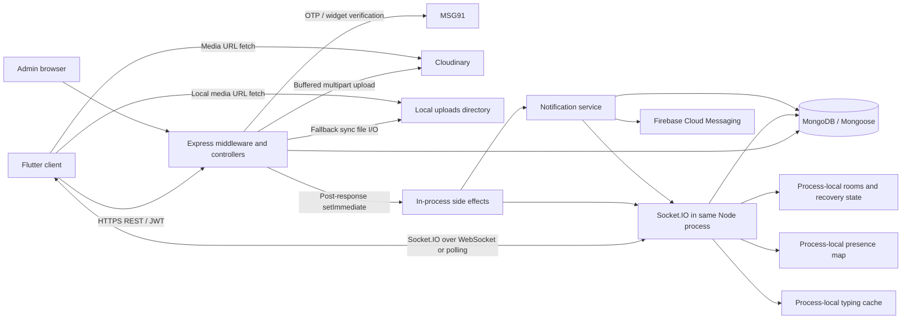

# Phase 19 — Implement vertical and cross-instance scaling scenarios

[Master index](README.md) · [Shared contracts](ARCHITECTURE-AND-CONVENTIONS.md) · [Decisions](DECISIONS-AND-ASSUMPTIONS.md) · [Progress](IMPLEMENTATION-PROGRESS.md)

**Implementation handoff; not test implementation.** Authoritative source: [complete original report](ORIGINAL-MASTER-REPORT.md), upstream master `4c01dc24247aa95a73e286a2b42c7f2f81257c7a`. Read README, shared contracts and this phase. Upstream SHA was rechecked during packaging and still matched; future drift must be recorded.

## A. Phase overview

- **Objective:** Implement vertical and cross-instance scaling scenarios.
- **Why necessary:** Define fixed-resource variants, worker partitions and clock/ledger merge; prove cross-node correctness before load; document adapter/shared-state prerequisites without implementing product architecture.
- **Scope:** SCALE-SYS-001; SCALE-SYS-002.
- **Exclusions:** No assumed clustering; no cloud provisioning or durable queue/adapter changes in test implementation.
- **Priority:** P0; individual priorities retained below.
- **Implementation prerequisites:** [18: Implement separate validation and authorized orchestration design](PHASE-18-GITHUB-ACTIONS.md)
- **Execution dependencies:** original case prerequisites below may reference later scenario implementations; these gate execution, not writing independent code. Missing interfaces block dependent implementation, not unrelated documentation.
- **Expected outcome:** reviewable modules/configurations, independent oracles and metrics, updated catalog/progress, without performance claims.
- **Relative effort:** XL. Limit work to this batch.

## B. Relevant architecture and source evidence

Cited application files exist at the investigated SHA; section D paths are proposed. Preserve the copied technical facts and limitations below.

### B. Verified architecture and dependency map

#### B1. Evidence conventions

- **Verified:** directly visible in the pinned upstream implementation.
- **Risk:** an engineering inference from that implementation, requiring execution to establish severity.
- **Hypothesis:** proposed workload or experiment parameter.
- **Unknown:** deployment, usage, or runtime evidence unavailable in this investigation.

Unless stated otherwise, backend paths below are relative to `medcollab-backend/src/`. All source links are pinned to the inspected commit.

#### B2. Components and runtime

| Component | Verified implementation | Performance implications |
|---|---|---|
| Backend | Express **5.2.1**, Mongoose **9.7.0**, Socket.IO **4.8.3** in the inspected lockfile; CommonJS Node application | Event-loop scheduling, JSON serialization, middleware, and asynchronous I/O need independent measurement |
| Runtime declaration | `package.json` declares Node `>=18`; existing workflows select Node 22; runtime lock specifies 22.20.0 | Record actual runtime for every run; do not equate declared minimum with deployed version |
| HTTP server | `server.js:startServer` connects DB, configures providers, creates HTTP server, attaches Socket.IO, then listens | Cold-start time includes DB connection; HTTP and realtime share a process |
| Mobile | Flutter/Dart; locked `socket_io_client` 3.1.6; Dio HTTP client | Node protocol clients cannot establish Flutter rendering, memory, or lifecycle performance |
| Database | MongoDB via Mongoose; one configured pool with `maxPoolSize:10`, selection timeout 10 seconds, socket timeout 45 seconds | Auth, business queries, notifications, and background writes compete for the pool |
| Media | Multer memory storage; Cloudinary upload stream or synchronous local-file fallback | Concurrent upload buffers and downstream stalls can grow RSS/external memory |
| Push | Firebase Admin, one `messaging.send` per token | Provider latency and token multiplicity amplify in-flight work |
| Authentication | JWT access/refresh tokens; server OTP and MSG91 widget verification paths | Distinct CPU, provider, DB, and limiter costs |
| Administrative UI | Static admin assets served by the backend; protected admin API | Analytics requests contend with user traffic |
| Deployment declarations | Railway/Nixpacks; `/health`; restart-on-failure, maximum three retries | These are repository settings, not evidence of current deployed resources |

Sources: [backend package][package], [server][server], [database configuration][db], [Railway configuration][railway], [mobile socket client][client-socket], [runtime lock][runtime].

#### B3. Dependency map

There is **no verified durable queue between persistence and side effects**. The diagram’s “in-process side effects” box is scheduled application work, not a worker service.

#### B4. Critical flows

| Flow | Actual sequence and synchronization | Amplification/shared state | Failure and measurement requirements |
|---|---|---|---|
| Server OTP login | Request → limiter/validation → invalidate prior OTPs → bcrypt hash → OTP insert → MSG91; verification → bcrypt compare → atomic OTP claim/delete → find/create user → JWTs | Phone-local contention; bcrypt CPU; provider request; user uniqueness | Measure request and verification separately; concurrent first login; provider timeout; OTP consumed but subsequent user operation failing |
| Widget login | Validate input → MSG91 form request; second JSON-form request after a non-success response → identity resolution → user find/create → JWTs | Up to two provider calls on response failure; transport exception does not necessarily take the fallback path | Count provider attempts and distinguish timeout, provider rejection, account creation, and successful token issuance |
| Protected API | JWT verify → user read → active check → unawaited `lastSeenAt` update → route handler | “Read-only” API traffic still produces writes; hot users generate hot user documents | Measure auth overhead, DB operations/request, pending background writes, and errors after response |
| Socket connection | JWT/user validation → active-space lookup → join space rooms → register handlers/presence → user room → `authenticated` | Presence broadcast and user availability query; membership-dependent work | Measure transport connect and application-ready latency separately |
| Message send | Access resolution → optional thread/quote lookup → message insert/populate → channel preview update → HTTP 201 → scheduled room/user emits → optional thread update → notifications | Hot channel preview; hot thread root; duplicate room paths; recipient-dependent notifications | Record accepted, persisted, emitted, received, reconciled, and notification-complete stages independently |
| Notification | Notification insert → user-room event → recipient preferences/token read → per-token FCM calls | Parallel recipient promises and per-token promises; no durable retry queue | FCM acceptance is not device receipt; swallowed failures require explicit accounting |
| Space join/approval | Read space → array membership/pending mutation → save → fetch channels → enumerate local sockets → update rooms → member event | Hot embedded arrays; socket scan proportional to local connections | Race same/different members, approval/removal, and room convergence |
| Request acceptance | Read request → save accepted state → keyed channel upsert → populate → synchronous notification → response | Multi-document partial completion; repeated acceptance side effects | Verify retry recovers missing DM; count channels, state transitions, and notifications |
| Conversation expansion | Validate targets → find/create destination → read complete selected source history → allocate ID map and copies → ordered insert → update preview | Memory and write work proportional to history; no transactional copy | Check partial copies, concurrent expansion, references, and mixed-traffic impact |
| Handoff submit/ack | Conditional state update; user lookups; room event; response; deferred notification | Hot handoff and notification paths | Submit/ack use conditional updates, but edit/reassign use read-modify-save; test their interactions |
| Search | Resolve accessible spaces/channels → sequential category queries → regex filtering/population | `$in` cardinality, regex scans, nested handoff arrays, broad known-user scan | Measure per-search-type and no-result queries, not only aggregate search latency |
| Media upload/delete | Auth → limiter → complete memory buffer → provider upload or sync disk write → storage counter; delete may try three resource types and scan handoff attachments | Buffer memory, external latency, synchronous disk I/O, attachment scan | Separate transfer, provider, persistence, deletion, and subsequent fetch results |
| Mobile recovery | Resume/connect callbacks → room synchronization; network errors schedule recovery; token refresh may replace socket; chat HTTP reload/reconciliation | Multiple readiness callbacks can trigger synchronization; retries add traffic | Test actual Flutter behavior separately from protocol-level recovery |

Detailed sources: [auth][auth], [OTP model][otp-model], [OTP service][otp-service], [MSG91 service][msg91], [auth middleware][auth-middleware], [messages][messages], [requests][requests], [channels][channels], [handoffs][handoffs], [search][search], [media][media], [client socket][client-socket].

#### B5. State, caching, jobs, and recovery

**Verified state and caching**

- `onlineUsers: Map<userId, Set<socketId>>` tracks devices in one Node process.
- `typingMembers` caches channel members for 60 seconds. Entries are refreshed on access; no eviction sweep was found.
- Socket.IO recovery is configured for two minutes with `skipMiddlewares:true`.
- `spaceRooms` iterates the process’s sockets for membership changes.
- Flutter `ChatTranscriptCache` holds transcript lists in static maps without a visible size bound in that class.
- No general backend query cache or Redis cache was found.

**Background work**

- Message/handoff side effects use `setImmediate`.
- Auth activity, media storage counters, stale FCM token removal, and final-device disconnect activity updates include unawaited database operations.
- MongoDB TTL indexes expire OTPs and notifications; notification default expiry is 30 days.
- No application cron scheduler, worker pool, job queue, or replayable outbox was found.

**Recovery limits**

- `/health` returns HTTP 200 even when its database field reports disconnected.
- Shutdown closes the HTTP server and subsequently MongoDB, with a 30-second forced-exit timeout. Explicit Socket.IO closure and explicit draining of deferred side effects are not present in the inspected shutdown function.
- Local media is explicitly described by startup warnings as ephemeral on Railway redeploy.
- JWT expiry is checked during ordinary socket authentication; no per-event JWT expiry validation was found.
- Recovery bypasses authentication middleware when recovery succeeds.

Sources: [presence][presence], [typing][typing], [socket][socket], [rooms][rooms], [mobile cache][client-cache], [server][server], [application health route][app].

#### B6. Database schema and index review

These are **schema declarations**, not proof that a deployed database has built the indexes.

| Model | Important structure/indexes | Queries to investigate |
|---|---|---|
| User | Unique phone; sparse unique username; institution; role/speciality; verified/createdAt; lastSeenAt; isActive; embedded FCM tokens capped at five by model method | Auth reads/activity writes; colleague discovery; admin sorting/cohorts; concurrent token/preference updates |
| OTP | Phone; TTL `expiresAt`; `{phone,isUsed,expiresAt}` | Latest eligible OTP sorted by createdAt; concurrent issuance/claim; TTL interference |
| Space | Unique inviteCode; member-user multikey; createdBy; embedded members/pendingRequests | Membership lookup plus `isActive`; large document load; concurrent array changes |
| Channel | spaceId; `{spaceId,type}`; `{spaceId,isArchived,position}`; `{type,members}`; partial unique `{type,memberPairKey}` for direct channels | Unpaginated DM list sorted by lastMessage/updatedAt; keyed DM upsert; channel-name existence check |
| Message | channelId; threadId; `{channelId,createdAt:-1}`; `{threadId,createdAt:1}`; `{spaceId,createdAt:-1}`; mentions | Feed sorts by `_id`, not createdAt; thread feed also sorts `_id`; regex search; quote cleanup; sender aggregates; hot reactions/readBy |
| MessageRequest | Individual sender/recipient/status indexes; `{fromUserId,toUserId}`; `{toUserId,status}` | Bidirectional pending lookups; no declared unique pending-pair constraint; sorted request lists |
| Handoff | spaceId; `{spaceId,shiftDate:-1}`; `{toUserId,status}`; `{fromUserId,shiftDate:-1}`; `{spaceId,shiftDate,shiftType}` | Composite shiftDate/`_id` cursor; assignment-history filters; unpaginated personal lists; attachment regex |
| Notification | userId; read; TTL expiresAt; `{userId,read,createdAt:-1}` | Feed sorts `_id`; channel mark-read also filters metadata.channelId; count after listing |
| SupportTicket | Embedded schema in support controller; type/userId/status indexes | Admin newest-100 sort, open count; insertion/logging |

Model references: [User][user-model], [OTP][otp-model], [Space][space-model], [Channel][channel-model], [Message][message-model], [MessageRequest][request-model], [Handoff][handoff-model], [Notification][notification-model], [SupportTicket][support].

**Candidate experiments, not immediate index prescriptions**

Evaluate existing plans first, then compare isolated database variants for:

- Message feed: equality filters for channel/thread/deletion followed by `_id`.
- Thread feed: channel/thread/deletion plus `_id`, accounting for the implemented `$or`.
- Notification feed: user/read/type variants plus `_id`.
- Notification channel clearing: user/read/metadata.channelId.
- Handoff history: space/shiftDate/`_id`, with representative visibility filters.
- DM listing: type/members/archive plus sort fields, subject to multikey constraints.
- Message sender aggregation used by admin and Needl-related reads.
- Request direction/status/createdAt.
- Admin createdAt ordering/cohorts and support createdAt ordering.

A normal B-tree index should not be assumed to solve unanchored, case-insensitive regex search. The institution index also does not eliminate the current application-side normalization scan in `resolveKnownUserIds`.

No explicit application transactions, transaction sessions, read concern, or write concern settings were found. Runtime MongoDB defaults/topology therefore remain required evidence.

---

### D. Bottleneck and scalability risk register

All entries below are **source-derived risks**, not measured defects unless described as an explicit implementation fact.

| Risk | Priority | Evidence and mechanism | Required investigation |
|---|---|---|---|
| R01: acknowledged message without completed delivery side effects | P0 | HTTP response precedes `setImmediate`; no durable outbox | Kill/fail after acceptance; reconcile DB, recipients, thread counters, notifications |
| R02: fan-out overwhelms pool/event loop | P0 | Parallel notification promises; per-recipient reads/inserts; per-token sends | Audience/viewer/token sweeps with pending-work accounting |
| R03: misleading horizontal scaling | P0 | Local presence/cache/socket enumeration; no adapter | Cross-instance sender/receiver and membership tests before throughput comparisons |
| R04: duplicates after response loss | P0 | No server message idempotency key observed; client reconciliation dedupes IDs/content locally | Lost-response and manual retry, including legitimate identical messages |
| R05: hot channel/thread documents | P0 | Every send updates channel preview; thread replies update same root | Hot-room versus distributed-room throughput and final preview/counter correctness |
| R06: pool saturation hidden behind successful responses | P0 | Pool cap ten; unawaited auth/media/token writes | Checkout waiting, background lag, failure attribution |
| R07: full-history expansion memory/partial-copy risk | P0 | Complete read, in-memory copies, ordered insert; no transaction | History-volume sweep and failpoint between copy stages |
| R08: stale room access/recovery | P0 | Recovery skips middleware; removal helpers synchronize space rooms, not visibly all channel rooms | Revocation while connected/disconnected; check subsequent payloads |
| R09: read-modify-save races | P0 | Membership, requests, reactions, pins, preferences, reassignments | Barrier-controlled competing operations and DB state oracles |
| R10: upload memory/event-loop pressure | P0 | 50 MiB Multer buffer; synchronous local file writes | Parallel transfers, slow provider, mixed message latency |
| R11: unbounded/list-sized reads | P1 | DM/personal handoff lists, members, admin cohorts | Data-growth curves, response bytes, heap/GC |
| R12: query/index mismatch | P1 | Feed `_id` sorts versus declared createdAt compounds | Explain plans, scanned/returned ratio, alternative-index experiments |
| R13: discovery/Needl query amplification | P1 | Broad institution scan; sequential access checks | Users/channels per account independently varied |
| R14: reconnect synchronization amplification | P1 | Connect and authenticated callbacks invoke readiness; sync includes per-space/member work | Actual events/connect and requests/resume |
| R15: typing cache/memory and stale membership | P1 | Timestamped map without observed eviction; fallback user emits | Distinct-channel churn, TTL boundary, removed member |
| R16: shutdown fails to drain realtime/deferred work | P0 | HTTP close callback plus forced exit; no explicit side-effect drain | Graceful versus abrupt termination |
| R17: health masking outage | P1 | `/health` remains 200 with DB disconnected | Dependency-aware readiness and recovery measurement |
| R18: provider failures appear successful upstream | P1 | Notification errors caught/returned as null; FCM errors caught | Independent provider/notification ledgers |
| R19: rate limiting distorts results | P0 for validity | Global bypass in test mode; auth 20/15m by IP; upload 30/h/user | Separate deployment-policy and isolated-ceiling experiments |
| R20: client memory/reconciliation degradation | P1 | Cached transcript lists, seen-message set, repeated list copying/sorting | Device soak, many chats, duplicate payloads, account switch |

#### Existing product decisions must remain part of the oracle

The upstream [product decision ledger][decisions] establishes, among other things:

- No 500-message cap for expansion of all history.
- Phone-local midnight for expansion “today.”
- Copied thread/quote remapping; destination preview may retain source message ID.
- One group DM per membership.
- Lost-send reconciliation/deduplication expectation.
- Author-only draft handoffs.
- Immediate presence eviction after leave/removal.
- Quiet hours use server timezone.

There are potential mismatches requiring characterization:

- `getHandoffById` explicitly permits an admin to view drafts, while the ledger says author-only.
- Message creation exposes no server idempotency field.
- Space eviction does not visibly guarantee eviction from previously joined channel rooms.
- Expansion’s source-ID preview is an explicit product decision, so it must **not** be incorrectly reported as a broken-reference defect.
- Client media constants use 25 MiB while backend enforcement uses 50 MiB.

Do not weaken existing assertions to make performance runs pass.

---

## C. Test cases to implement

### SCALE-SYS-001 — Vertical scalability

**Priority:** P1. **Owner:** Phase 19. **Status:** PLANNED / NOT IMPLEMENTED / NOT EXECUTED.

#### Preserved original specification

- **Original category, priority, objective and source:** Vertical scalability, P1; identify CPU versus memory/DB limits
- **Original workload, data, actions and invariants:** Repeat L/T with one CPU/memory allocation changed at a time; same source/data/generator
- **Original metrics, acceptance, limits, environment and dependencies:** Throughput/resource efficiency, tail latency, bottleneck migration; extra CPU need not accelerate one JS event loop; E2; depends STRESS-SYS-001

#### Detailed scenario logic

1. Freeze workload/source/data/DB/generator; enumerate one-at-a-time CPU or memory allocation variants.
2. Repeat L/T identically on each resource manifest without simultaneously changing process count or database.
3. Compare correct useful throughput, latency and bottleneck migration with repeated-run variance.
4. Report efficiency and single-JS-event-loop limitations; do not assume extra CPU yields linear speedup.

#### Preconditions, results and required fields

- **Preconditions:** shared interfaces exist; later authorized setup validates isolated target identity, source/harness SHA, data/index manifest, provider mode and finite budgets. No setup executes in this documentation/development handoff.
- **Test data:** use case-specific dimensions above plus deterministic actor/resource manifests. Precompute expected audiences/state; keep negative/boundary variants distinct.
- **Concurrency and timing:** original profile above plus B/C/L/T/P/Z/G/F definitions below. Barrier races use coordinated release, not guessed sleeps. Record scheduled and actual arrival. Observation/drain deadlines are mandatory; expiry is censored/failure evidence.
- **Metrics:** preserve original metrics plus stage histograms, useful throughput, errors, generator health and relevant SUT/DB/provider/device resources. IDs belong in bounded ledgers, not unbounded metric labels.
- **Functional assertions:** implement original invariants and the numbered independent DB/event/state oracle. A 2xx is not proof of delivery, notification or rendering.
- **Expected results:** correct terminal state and complete eligible fault-free accounting; faults classify preserved/lost/rejected/ambiguous work. The current application may fail requirements; retain failures and do not repair it here.
- **Failure conditions:** invariant violation, unexpected egress, unexplained unfinished work, safety breach or missing evidence. Generator saturation invalidates measurement; undefined policy blocks the affected assertion without discarding observations.
- **Cleanup:** stop arrivals, bounded drain, capture terminal evidence, restore owned faults, close actors, remove only journal-owned data/assets/resources and independently verify. Preserve cleanup failures separately.
- **Execution environment / hosted versus dedicated:** original case E-code above is binding. E1 is small hosted characterization only; E2/E3 require dedicated measurement resources; E4 physical devices/controlled network; E5 sandbox approval. Hosted orchestration is not hosted capacity evidence.
- **Safety limits:** inherit F3 and tighter case limits. Missing numerical arrival/connection/event/byte/total-work/duration/provider ceilings block execution. Never extend a stage automatically.
- **Dependencies for execution:** [STRESS-SYS-001](PHASE-16-STRESS-SPIKE-SOAK.md#stress-sys-001). Shared adapters can be authored earlier than the full prerequisite measurement case.
- **Unknown thresholds/product decisions:** `BASELINE_REQUIRED` and `PRODUCT_DECISION_REQUIRED` where not established; preserve specific conflicts above and consult the shared decision ledger.
- **Automation feasibility:** automated scenario/oracle/reporting; infrastructure and provider authorization external. Actual-device/real-push observations require their environment and are not proven by protocol doubles.

### SCALE-SYS-002 — Horizontal correctness and scalability

**Priority:** P0. **Owner:** Phase 19. **Status:** PLANNED / NOT IMPLEMENTED / NOT EXECUTED.

#### Preserved original specification

- **Original category, priority, objective and source:** Horizontal correctness then scaling, P0
- **Original workload, data, actions and invariants:** E3, two instances; sender/receiver on different nodes; devices split; membership removal and recovery across nodes; only then L/T
- **Original metrics, acceptance, limits, environment and dependencies:** Cross-node delivery/presence/limiter correctness first. Current architecture may fail; report limitation, not successful scaling. Adapter/shared-state changes are separate product work; depends RT-005/006 and MSG-001

#### Detailed scenario logic

1. Define two-node routing and identify which node owns each sender/receiver/device and HTTP request.
2. First test cross-node message/presence/room eviction/recovery/rate-limiter behavior with low traffic.
3. Stop scalability certification on correctness failure; document missing adapter/shared state as product prerequisites.
4. Only after correctness passes, repeat fixed-data L/T with calibrated workers and globally reconciled recipients; record adapter recovery semantics.

#### Preconditions, results and required fields

- **Preconditions:** shared interfaces exist; later authorized setup validates isolated target identity, source/harness SHA, data/index manifest, provider mode and finite budgets. No setup executes in this documentation/development handoff.
- **Test data:** use case-specific dimensions above plus deterministic actor/resource manifests. Precompute expected audiences/state; keep negative/boundary variants distinct.
- **Concurrency and timing:** original profile above plus B/C/L/T/P/Z/G/F definitions below. Barrier races use coordinated release, not guessed sleeps. Record scheduled and actual arrival. Observation/drain deadlines are mandatory; expiry is censored/failure evidence.
- **Metrics:** preserve original metrics plus stage histograms, useful throughput, errors, generator health and relevant SUT/DB/provider/device resources. IDs belong in bounded ledgers, not unbounded metric labels.
- **Functional assertions:** implement original invariants and the numbered independent DB/event/state oracle. A 2xx is not proof of delivery, notification or rendering.
- **Expected results:** correct terminal state and complete eligible fault-free accounting; faults classify preserved/lost/rejected/ambiguous work. The current application may fail requirements; retain failures and do not repair it here.
- **Failure conditions:** invariant violation, unexpected egress, unexplained unfinished work, safety breach or missing evidence. Generator saturation invalidates measurement; undefined policy blocks the affected assertion without discarding observations.
- **Cleanup:** stop arrivals, bounded drain, capture terminal evidence, restore owned faults, close actors, remove only journal-owned data/assets/resources and independently verify. Preserve cleanup failures separately.
- **Execution environment / hosted versus dedicated:** original case E-code above is binding. E1 is small hosted characterization only; E2/E3 require dedicated measurement resources; E4 physical devices/controlled network; E5 sandbox approval. Hosted orchestration is not hosted capacity evidence.
- **Safety limits:** inherit F3 and tighter case limits. Missing numerical arrival/connection/event/byte/total-work/duration/provider ceilings block execution. Never extend a stage automatically.
- **Dependencies for execution:** [SCALE-RT-005](PHASE-06-PRESENCE-RECOVERY.md#scale-rt-005), [SCALE-RT-006](PHASE-08-MEMBERSHIP-EVICTION.md#scale-rt-006), [PERF-MSG-001](PHASE-05-MESSAGING.md#perf-msg-001). Shared adapters can be authored earlier than the full prerequisite measurement case.
- **Unknown thresholds/product decisions:** `BASELINE_REQUIRED` and `PRODUCT_DECISION_REQUIRED` where not established; preserve specific conflicts above and consult the shared decision ledger.
- **Automation feasibility:** automated scenario/oracle/reporting; infrastructure and provider authorization external. Actual-device/real-push observations require their environment and are not proven by protocol doubles.

## Original inherited case contract

### F1. Case specification and inherited fields

The catalog is normalized to avoid repeating the same safety and measurement text dozens of times. **Each case inherits all fields below; its entry supplies the operation-specific fields.** The implementation should materialize these into full machine-readable case records.

Every case has:

- **Status:** `PLANNED / NOT IMPLEMENTED / NOT EXECUTED`.
- **Common preconditions:** pinned upstream source and harness SHA; validated isolated target; seeded owned database; confirmed required indexes; provider mode recorded; generator calibrated; instrumentation operational.
- **Baseline acceptance:** `BASELINE_REQUIRED`.
- **Product latency/throughput/recovery objectives:** `PRODUCT_DECISION_REQUIRED`.
- **Functional acceptance:** the stated case invariants, checked independently of HTTP status.
- **Common failure indicators:** unexpected response/event errors, lost accepted work, incorrect state, growing unfinished work, generator inability to sustain arrivals, or a safety-limit breach.
- **Common metrics:** HTTP/event stage latency histograms, offered/completed rates, errors, correctness counts, generator telemetry, SUT CPU/RSS/heap/external memory/event-loop delay, DB utilization and query/pool metrics.
- **Common cleanup:** stop arrivals; bounded drain; capture terminal ledger; disconnect clients; remove only run-owned data/files/provider objects; verify cleanup. Fault tests restore connectivity/processes before cleanup.
- **Automation:** fully automatable except real-device/provider observations noted below.
- **Source references:** operation inventory entries plus the function references named in each case.
- **Dependencies:** `PERF-API-001` and validated foundation unless the case explicitly names others.
- **Limits:** the selected profile’s resource/traffic cap plus any tighter case-specific limit.

A timeout, unexecuted case, inconclusive measurement, or missing oracle must never become a pass.

### F2. Execution environments

| Code | Environment/infrastructure | Standard GitHub-hosted runner? | Dedicated infrastructure? |
|---|---|---|---|
| E0 | Static validation, no SUT/network load | Yes | No |
| E1 | Small isolated Node/Mongo/provider-double environment; bounded local generator | Yes, for characterization only | No |
| E2 | Separate fixed-resource generator, backend, MongoDB, provider-double host/network; OS/DB telemetry | Hosted runner may orchestrate, not supply defensible sustained capacity by assumption | Yes |
| E3 | E2 plus disposable multi-instance backend/load balancer and optional Mongo replica set | No as the measurement platform | Yes |
| E4 | E2 plus controlled network impairment and physical Android devices | Hosted runner only orchestrates/reporting | Yes |
| E5 | Explicitly approved provider sandbox and registered synthetic devices | A tiny integration check may be orchestrated there | Provider sandbox; dedicated generator for any sustained experiment |

### F3. Workload profiles and limits

Numbers below are **initial experiment bounds**, not promised capacity or acceptable production performance.

| Profile | Arrival/concurrency/ramp/duration | Limits |
|---|---|---|
| B: baseline | One actor, then 5 actors; 60-second ramp; 2-minute warm-up; 5-minute sample; three independent runs | E1 cap 10 HTTP starts/s, 20 connections, 20 synthetic accounts; no provider egress |
| C: race | 2, 5, then 10 actors synchronized at a barrier; up to 20 rounds; 10-minute overall limit | Fresh owned entity per round; no uncontrolled retry loop |
| L: load | 5-minute ramp, 5-minute warm-up, 30-minute steady state, 5-minute drain | Requires signed manifest with finite request/event/connection/byte caps |
| T: staircase | Start below known sustainable rate; increase offered rate 25% per 10-minute stage; maximum six stages | E2 only; stop at saturation/safety limit; no automatic unbounded escalation |
| P: spike | 5-minute base, 30-second bounded jump, 2-minute peak, 10-minute recovery | Peak explicitly capped; initially no more than 2× established stable rate |
| Z: soak | 10-minute ramp; 2-hour first pass; separately approved 8-hour pass; 15-minute drain | Provisioned storage budget, finite session churn, abort watchdog |
| G: growth | Same low offered rate across independent S/M/L datasets; 5-minute warm-up and 10-minute sample each | One data dimension changed at a time; setup excluded from timed sample |
| F: failure | 5-minute stable load; one bounded fault; restore; up to 10-minute recovery | Initial outage 15 seconds, then separately 60 seconds; process-owned resources only |

For E2–E5, **missing numerical limits block execution**. The manifest must specify maximum connections, new connections/s, HTTP/s, messages/s, application events/s, total requests/messages, transferred bytes, duration, database growth, and provider calls.

Initial watchdog defaults may stop at 85% container memory or 20% free-disk reserve, but these are operational safeguards, **not SLOs**. Final budgets must be selected from the provisioned environment.

## D. Implementation instructions

### Proposed files and ownership

- `tests/performance/distributed/`
- `tests/performance/infra-manifests/`
- `tests/performance/scenarios/scaling/`

These are future repository paths, not code created by this task. Existing application files in B are read-only references. Store run artifacts separately from source.

### Implementation tasks

Define fixed-resource variants, worker partitions and clock/ledger merge; prove cross-node correctness before load; document adapter/shared-state prerequisites without implementing product architecture.

1. Revalidate affected signatures and record drift; do not silently alter requirements.
2. Add assigned variants to catalog using exact case/operation IDs.
3. Develop scenario hooks using immutable actor/data manifests and shared adapters.
4. Build independent state/event oracles; do not call the same business function to compute expected state.
5. Substitute provider boundaries only; retain real auth/persistence/access/business computation.
6. Integrate schema-compatible histograms and terminal statuses, retaining timeout/censored outcomes.
7. Journal resources before mutation; cleanup/fault restore survive partial setup and exceptions.
8. Update source map, decisions, progress and interface documentation.

### Framework/configuration

Use Artillery scheduling and Node Socket.IO 4.8.3 observer contracts. Lock exact harness dependency versions during implementation; do not alter backend dependencies. Validated versioned JSON creates bounded scheduler inputs; never accept an arbitrary URL as the target contract. Device code uses new performance-only Flutter instrumentation.

### Imported interfaces

Phase 01: `validateRunConfig`, `assertIsolatedTarget`, `captureProvenance`, `allocateActors`, `registerOwnedResource`, `recordStage`, `recordOutcome`, `finalizeRun`, `cleanupOwnedResources`.
Phase 02: shared HTTP adapter.
Phase 03: `openCohort`, `awaitApplicationReady`, `joinChannelAndWait`, `recordDelivery`, `closeCohort`.
Phase 07A: `runBarrierRound`.
Phase 10: `buildDatasetManifest`, `verifyIndexes`, `sampleExplain`.
Phase 14: `applyOwnedFault`, `restoreOwnedFault`.

Exact proposed signatures are in [shared contracts](ARCHITECTURE-AND-CONVENTIONS.md). If a later interface is needed, declare the dependency and implement independent config/oracle logic; do not clone the utility. Fault activation remains deferred. Every scenario exports metadata and `prepare/run/observe/reconcile/cleanup` hooks. Module import performs no network access/startup. Missing prerequisites return BLOCKED_PREREQUISITE.

### Error handling, logging and cleanup

Use finally-style restoration plus supervisor recovery after process death. Preserve primary and cleanup failures separately. Bound retries, waits and evidence buffers. Log run/case/variant/operation and redacted error classes; no credentials, full tokens, personal data or full provider payloads. Every abort/missing observation appears in the report; no continue-on-error conversion to success.

### Documentation updates

Record changed interfaces and next-phase prerequisites. New genuine gaps go to proposed-addition ledger, not the original catalog. Keep implemented/executed status separate.

## E. Acceptance criteria

### 1. Implementation completeness

Every assigned ID/variant has scenario logic, finite configuration, deterministic data, independent correctness oracles, stage metrics and owned cleanup. Shared utilities are reused. Deferred variants retain reason, owner and prerequisite. No duplicate ownership or silent omissions.

### 2. Static/code-review validation

Revalidate paths/handlers against the pinned source and record drift. Parse configuration/schema/syntax without application imports or target startup. Check correct event names, finite limits, permissions, timing/accounting, propagation, redaction and cleanup ownership. Report checks actually performed, not proposed checks.

### 3. Execution validation

**NOT EXECUTED in this development handoff.** Later authorized execution must use the specified environment and calibrated generator, preserving offered/started/completed/censored work and terminal state. Infrastructure failure or missing observations cannot produce PASS. Load/performance execution stays outside Codex Cloud.

### 4. Performance threshold validation

`BASELINE_REQUIRED` until repeated valid measurements exist. Undefined production latency, throughput, recovery and loss requirements are `PRODUCT_DECISION_REQUIRED`. An invariant can fail without a latency threshold. Unknown thresholds produce NOT_EVALUATED/INCONCLUSIVE, never invented passing baselines.

### Completion condition

Implementation/review can finish while execution/thresholds remain pending. Mark implementation complete only after all scoped deliverables are implemented or explicitly deferred with approval and no blocking interface ambiguity remains. That condition never marks a case PASSED.

### Phase-specific gates

- Section D tasks and assigned numbered scenario sequences have concrete module/oracle mappings.
- Exact IDs/variants, source references, metrics and original constraints remain present.
- Exclusions honored: No assumed clustering; no cloud provisioning or durable queue/adapter changes in test implementation.
- Next agent can use exported interfaces without earlier chat history.
- No measured result is claimed by scaffold or document creation.

## F. Implementation restrictions

Work only in `mathiharan29/medcollab-beta`, based on upstream `master`, on `testing/vocle-performance-scale`. Never use the previous fork or edit master directly. Verify repository identity and capture branch/base/HEAD before future implementation; flag source drift rather than silently revising the plan.

Preserve existing regression/security suites and assertions. Do not alter application behavior to make a test pass. Application instrumentation or product fixes require separate explicit scope and review. Keep load execution separate from development.

**Do not run load/performance tests in Codex Cloud.** Do not start the app, MongoDB, Docker, Flutter, emulators, servers or infrastructure to validate implementation. Dependency installation, provisioning, application/regression/security/smoke tests and workflow execution need separate authorization. Default validation is read-only parsing, syntax/configuration review and source inspection without importing executable application code or contacting a target. Implementation approval is not execution approval.

No production connections/credentials, real patient information or personal data. No invented baselines/SLOs, silent skips, weakened assertions or pass from absent evidence. Real-provider sandbox use requires separate authorization, owned-resource journal, finite call/byte budget and cleanup.

## G. Required completion report

The implementing agent must report:

- Repository, branch, base SHA and resulting HEAD/commit; say if no commit was created.
- Files created/modified, separating harness, docs, workflows and approved instrumentation.
- Case IDs/variants implemented and deferred, with reasons/owners.
- Exact static checks and outcomes.
- Tests/workflows executed, if any, with explicit authorization/environment; otherwise **none**.
- Known limitations, source drift, unresolved product/technical decisions.
- Next-phase dependencies and exact exported interfaces.
- Separate implementation/review/execution/threshold status.
- Review checklist: upstream identity; unchanged assertions; finite budgets; privacy; no production access; unique IDs; cleanup journal; no invented baselines; no missing-result pass.

### Source-link definitions

[package]: https://github.com/mathiharan29/medcollab-beta/blob/4c01dc24247aa95a73e286a2b42c7f2f81257c7a/medcollab-backend/package.json
[app]: https://github.com/mathiharan29/medcollab-beta/blob/4c01dc24247aa95a73e286a2b42c7f2f81257c7a/medcollab-backend/src/app.js
[server]: https://github.com/mathiharan29/medcollab-beta/blob/4c01dc24247aa95a73e286a2b42c7f2f81257c7a/medcollab-backend/src/server.js#L82
[db]: https://github.com/mathiharan29/medcollab-beta/blob/4c01dc24247aa95a73e286a2b42c7f2f81257c7a/medcollab-backend/src/config/database.js#L56
[railway]: https://github.com/mathiharan29/medcollab-beta/blob/4c01dc24247aa95a73e286a2b42c7f2f81257c7a/medcollab-backend/railway.json
[auth-middleware]: https://github.com/mathiharan29/medcollab-beta/blob/4c01dc24247aa95a73e286a2b42c7f2f81257c7a/medcollab-backend/src/middleware/auth.js#L37
[limits]: https://github.com/mathiharan29/medcollab-beta/blob/4c01dc24247aa95a73e286a2b42c7f2f81257c7a/medcollab-backend/src/middleware/rateLimiter.js#L60
[auth]: https://github.com/mathiharan29/medcollab-beta/blob/4c01dc24247aa95a73e286a2b42c7f2f81257c7a/medcollab-backend/src/features/auth/auth.controller.js
[auth-routes]: https://github.com/mathiharan29/medcollab-beta/blob/4c01dc24247aa95a73e286a2b42c7f2f81257c7a/medcollab-backend/src/features/auth/auth.routes.js
[otp-model]: https://github.com/mathiharan29/medcollab-beta/blob/4c01dc24247aa95a73e286a2b42c7f2f81257c7a/medcollab-backend/src/features/auth/otp.model.js#L70
[otp-service]: https://github.com/mathiharan29/medcollab-beta/blob/4c01dc24247aa95a73e286a2b42c7f2f81257c7a/medcollab-backend/src/services/otp.service.js
[msg91]: https://github.com/mathiharan29/medcollab-beta/blob/4c01dc24247aa95a73e286a2b42c7f2f81257c7a/medcollab-backend/src/services/msg91Widget.service.js#L107
[users]: https://github.com/mathiharan29/medcollab-beta/blob/4c01dc24247aa95a73e286a2b42c7f2f81257c7a/medcollab-backend/src/features/users/user.controller.js
[user-routes]: https://github.com/mathiharan29/medcollab-beta/blob/4c01dc24247aa95a73e286a2b42c7f2f81257c7a/medcollab-backend/src/features/users/user.routes.js
[user-model]: https://github.com/mathiharan29/medcollab-beta/blob/4c01dc24247aa95a73e286a2b42c7f2f81257c7a/medcollab-backend/src/features/users/user.model.js
[spaces]: https://github.com/mathiharan29/medcollab-beta/blob/4c01dc24247aa95a73e286a2b42c7f2f81257c7a/medcollab-backend/src/features/spaces/space.controller.js
[space-routes]: https://github.com/mathiharan29/medcollab-beta/blob/4c01dc24247aa95a73e286a2b42c7f2f81257c7a/medcollab-backend/src/features/spaces/space.routes.js
[space-model]: https://github.com/mathiharan29/medcollab-beta/blob/4c01dc24247aa95a73e286a2b42c7f2f81257c7a/medcollab-backend/src/features/spaces/space.model.js
[channels]: https://github.com/mathiharan29/medcollab-beta/blob/4c01dc24247aa95a73e286a2b42c7f2f81257c7a/medcollab-backend/src/features/channels/channel.controller.js
[channel-routes]: https://github.com/mathiharan29/medcollab-beta/blob/4c01dc24247aa95a73e286a2b42c7f2f81257c7a/medcollab-backend/src/features/channels/channel.routes.js
[channel-model]: https://github.com/mathiharan29/medcollab-beta/blob/4c01dc24247aa95a73e286a2b42c7f2f81257c7a/medcollab-backend/src/features/channels/channel.model.js#L150
[messages]: https://github.com/mathiharan29/medcollab-beta/blob/4c01dc24247aa95a73e286a2b42c7f2f81257c7a/medcollab-backend/src/features/messages/message.controller.js
[message-routes]: https://github.com/mathiharan29/medcollab-beta/blob/4c01dc24247aa95a73e286a2b42c7f2f81257c7a/medcollab-backend/src/features/messages/message.routes.js
[message-model]: https://github.com/mathiharan29/medcollab-beta/blob/4c01dc24247aa95a73e286a2b42c7f2f81257c7a/medcollab-backend/src/features/messages/message.model.js
[requests]: https://github.com/mathiharan29/medcollab-beta/blob/4c01dc24247aa95a73e286a2b42c7f2f81257c7a/medcollab-backend/src/features/message-requests/messageRequest.controller.js
[request-routes]: https://github.com/mathiharan29/medcollab-beta/blob/4c01dc24247aa95a73e286a2b42c7f2f81257c7a/medcollab-backend/src/features/message-requests/messageRequest.routes.js
[request-model]: https://github.com/mathiharan29/medcollab-beta/blob/4c01dc24247aa95a73e286a2b42c7f2f81257c7a/medcollab-backend/src/features/message-requests/messageRequest.model.js
[handoffs]: https://github.com/mathiharan29/medcollab-beta/blob/4c01dc24247aa95a73e286a2b42c7f2f81257c7a/medcollab-backend/src/features/handoffs/handoff.controller.js
[handoff-routes]: https://github.com/mathiharan29/medcollab-beta/blob/4c01dc24247aa95a73e286a2b42c7f2f81257c7a/medcollab-backend/src/features/handoffs/handoff.routes.js
[handoff-model]: https://github.com/mathiharan29/medcollab-beta/blob/4c01dc24247aa95a73e286a2b42c7f2f81257c7a/medcollab-backend/src/features/handoffs/handoff.model.js
[notifications]: https://github.com/mathiharan29/medcollab-beta/blob/4c01dc24247aa95a73e286a2b42c7f2f81257c7a/medcollab-backend/src/features/notifications/notification.controller.js
[notification-routes]: https://github.com/mathiharan29/medcollab-beta/blob/4c01dc24247aa95a73e286a2b42c7f2f81257c7a/medcollab-backend/src/features/notifications/notification.routes.js
[notification-model]: https://github.com/mathiharan29/medcollab-beta/blob/4c01dc24247aa95a73e286a2b42c7f2f81257c7a/medcollab-backend/src/features/notifications/notification.model.js
[notify]: https://github.com/mathiharan29/medcollab-beta/blob/4c01dc24247aa95a73e286a2b42c7f2f81257c7a/medcollab-backend/src/services/notification.service.js
[search]: https://github.com/mathiharan29/medcollab-beta/blob/4c01dc24247aa95a73e286a2b42c7f2f81257c7a/medcollab-backend/src/features/search/search.controller.js
[known]: https://github.com/mathiharan29/medcollab-beta/blob/4c01dc24247aa95a73e286a2b42c7f2f81257c7a/medcollab-backend/src/utils/knownUsers.js#L49
[media]: https://github.com/mathiharan29/medcollab-beta/blob/4c01dc24247aa95a73e286a2b42c7f2f81257c7a/medcollab-backend/src/features/media/media.controller.js
[media-routes]: https://github.com/mathiharan29/medcollab-beta/blob/4c01dc24247aa95a73e286a2b42c7f2f81257c7a/medcollab-backend/src/features/media/media.routes.js
[socket]: https://github.com/mathiharan29/medcollab-beta/blob/4c01dc24247aa95a73e286a2b42c7f2f81257c7a/medcollab-backend/src/socket/index.js
[presence]: https://github.com/mathiharan29/medcollab-beta/blob/4c01dc24247aa95a73e286a2b42c7f2f81257c7a/medcollab-backend/src/socket/handlers/presence.handler.js
[typing]: https://github.com/mathiharan29/medcollab-beta/blob/4c01dc24247aa95a73e286a2b42c7f2f81257c7a/medcollab-backend/src/socket/handlers/message.handler.js
[rooms]: https://github.com/mathiharan29/medcollab-beta/blob/4c01dc24247aa95a73e286a2b42c7f2f81257c7a/medcollab-backend/src/socket/spaceRooms.js
[admin]: https://github.com/mathiharan29/medcollab-beta/blob/4c01dc24247aa95a73e286a2b42c7f2f81257c7a/medcollab-backend/src/features/admin/admin.controller.js
[admin-routes]: https://github.com/mathiharan29/medcollab-beta/blob/4c01dc24247aa95a73e286a2b42c7f2f81257c7a/medcollab-backend/src/features/admin/admin.routes.js
[support]: https://github.com/mathiharan29/medcollab-beta/blob/4c01dc24247aa95a73e286a2b42c7f2f81257c7a/medcollab-backend/src/features/support/support.controller.js
[support-routes]: https://github.com/mathiharan29/medcollab-beta/blob/4c01dc24247aa95a73e286a2b42c7f2f81257c7a/medcollab-backend/src/features/support/support.routes.js
[dev-routes]: https://github.com/mathiharan29/medcollab-beta/blob/4c01dc24247aa95a73e286a2b42c7f2f81257c7a/medcollab-backend/src/features/dev/dev.routes.js
[client-socket]: https://github.com/mathiharan29/medcollab-beta/blob/4c01dc24247aa95a73e286a2b42c7f2f81257c7a/medcollab-app/lib/core/socket/socket_client.dart
[client-cache]: https://github.com/mathiharan29/medcollab-beta/blob/4c01dc24247aa95a73e286a2b42c7f2f81257c7a/medcollab-app/lib/core/chat/chat_transcript_cache.dart
[runtime]: https://github.com/mathiharan29/medcollab-beta/blob/4c01dc24247aa95a73e286a2b42c7f2f81257c7a/scripts/vocle-runtime-lock.json
[decisions]: https://github.com/mathiharan29/medcollab-beta/blob/4c01dc24247aa95a73e286a2b42c7f2f81257c7a/docs/PRODUCT_DECISIONS_2026-10-25.md
[provider-preload]: https://github.com/mathiharan29/medcollab-beta/blob/4c01dc24247aa95a73e286a2b42c7f2f81257c7a/tests/functional-regression/providers/preload.cjs
[ci-functional]: https://github.com/mathiharan29/medcollab-beta/blob/4c01dc24247aa95a73e286a2b42c7f2f81257c7a/.github/workflows/vocle-functional-regression.yml
[ci-security]: https://github.com/mathiharan29/medcollab-beta/blob/4c01dc24247aa95a73e286a2b42c7f2f81257c7a/.github/workflows/vocle-api-realtime-security.yml
[ci-cloudinary]: https://github.com/mathiharan29/medcollab-beta/blob/4c01dc24247aa95a73e286a2b42c7f2f81257c7a/.github/workflows/vocle-cloudinary-security.yml
[ci-reporting]: https://github.com/mathiharan29/medcollab-beta/blob/4c01dc24247aa95a73e286a2b42c7f2f81257c7a/.github/workflows/vocle-reporting.yml
